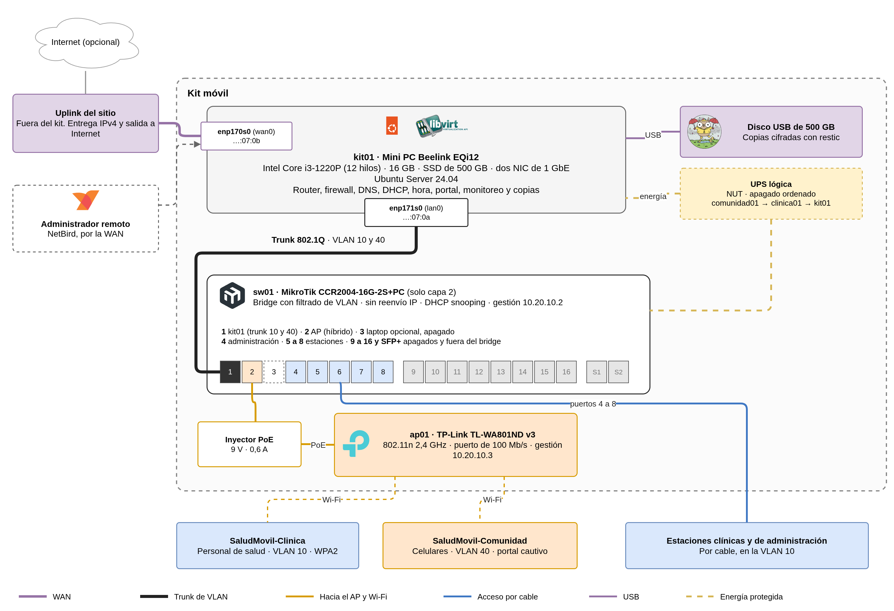
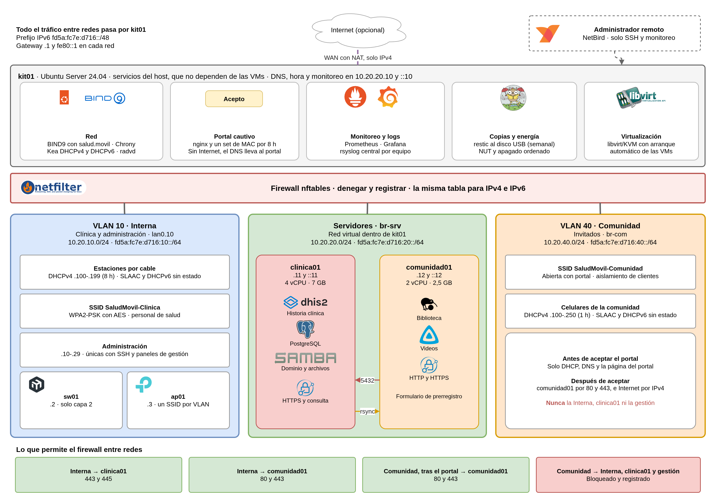
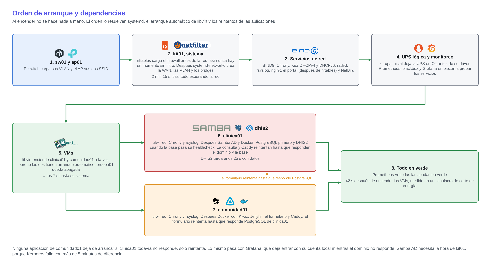
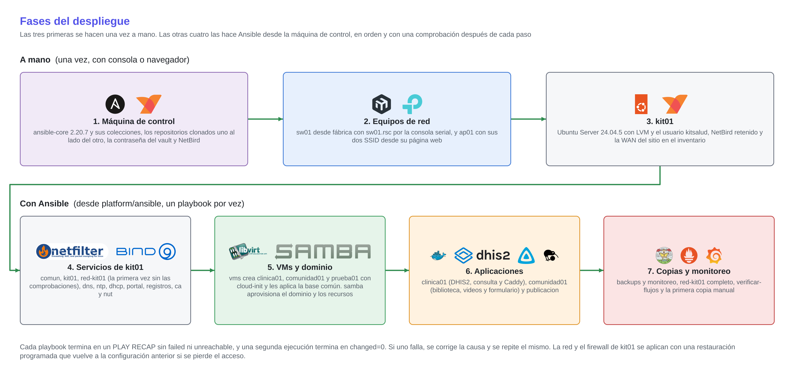
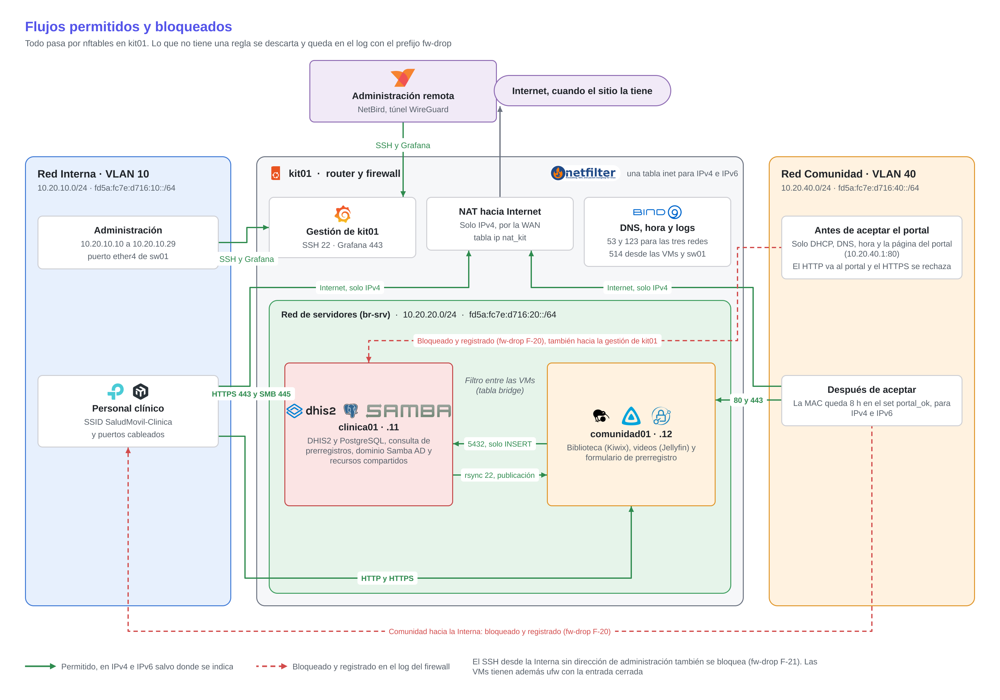

# Kit móvil de atención primaria en salud

## Arquitectura, despliegue y seguridad

**Proyecto final - Plataformas I - 2026-2** · Organización `kitsalud-movil-plats1`

Este documento junta tres entregables del enunciado. La primera parte es el **documento de arquitectura (E1)**, la segunda es la **guía de despliegue (E2)** y la tercera es la **matriz de seguridad (E4)**. Se combinaron porque los tres describen el mismo sistema desde ángulos distintos. La arquitectura explica qué hay y por qué, el despliegue explica cómo se construye desde cero y la matriz explica qué tráfico se permite entre las piezas. Leerlos juntos evita repetir las mismas tablas de direcciones y nombres en tres lugares.

Está escrito para el personal técnico que va a instalar, revisar o modificar el kit. La operación diaria y el respaldo están en el documento de operación (E3 y E5), y las pruebas, el repositorio y la sustentación en el de evidencias (E6, E7 y E8).

<div class="salto"></div>

# Parte 1. Arquitectura (E1)

## 1. Qué es el kit

Una brigada de salud llega a una vereda, un centro comunitario o una sede temporal y necesita registrar pacientes, compartir documentos y darle a la comunidad un Wi-Fi con contenido útil, todo sin depender de Internet. El kit resuelve eso con tres equipos que caben en una maleta. Un mini PC (`kit01`) hace de router, firewall e hipervisor, un MikroTik CCR2004 (`sw01`) hace de switch y un TP-Link TL-WA801ND (`ap01`) emite un Wi-Fi para el personal y otro para la comunidad.

Dentro de kit01 corren dos máquinas virtuales. `clinica01` guarda todo lo sensible (historia clínica, dominio de usuarios y archivos) y `comunidad01` sirve lo que ve la comunidad (biblioteca, videos y formulario de prerregistro). La separación por público es la idea central del diseño, porque si alguien compromete la biblioteca pública no llega a los datos de pacientes.

El criterio que se siguió es el del enunciado, que pide una plataforma pequeña, segura, reproducible y útil con la menor cantidad de tecnologías. Por eso hay un solo sistema operativo (Ubuntu Server 24.04) en el host y en las VMs, dos VLAN físicas, dos VMs y, para cada requisito, la herramienta más simple que lo cumple. Todo se instala con Ansible desde repositorios versionados.

### 1.1 Usuarios y servicios

| Usuario | Necesidad | Aplicación | Nombre | Dónde corre | Desde qué red |
|---|---|---|---|---|---|
| Personal de salud | Registrar y seguir pacientes | DHIS2 | `pacientes.salud.movil` | clinica01 | Interna |
| Personal de salud | Ver los prerregistros y marcar a quién se atendió | Consulta de prerregistros | `consultas.salud.movil` | clinica01 | Interna |
| Personal de salud | Compartir documentos | Recursos SMB de Samba | `archivos.salud.movil` | clinica01 | Interna |
| Personal técnico | Ver estado, métricas y logs | Grafana, Prometheus y rsyslog | `monitoreo.salud.movil` | kit01 | Administración o NetBird |
| Personal técnico | Configurar, respaldar y recuperar | SSH, Ansible y restic | `kit01` | kit01 | Administración o NetBird |
| Comunidad | Conectarse al Wi-Fi | Portal cautivo | `portal.salud.movil` | kit01 | Comunidad |
| Comunidad | Leer literatura de salud y contenido para niños | Kiwix | `biblioteca.salud.movil` | comunidad01 | Comunidad |
| Comunidad | Ver videos y escuchar audio | Jellyfin | `videos.salud.movil` | comunidad01 | Comunidad |
| Pacientes en sala de espera | Llenar el prerregistro desde el celular | Formulario propio | `registro.salud.movil` | comunidad01, guarda en clinica01 | Comunidad |

### 1.2 Cómo se cumple cada requisito

| Requisito | Solución | Dónde |
|---|---|---|
| R1 DHCPv4 y provisión IPv6 | Kea DHCPv4 con pools por red y un pool de administración para el puerto `ether4` de sw01. radvd anuncia SLAAC (M=0, O=1) y Kea DHCPv6 sin estado entrega DNS, dominio y NTP. Los servidores tienen dirección fija | kit01 |
| R2 DNS interno dual-stack | BIND9 autoritativo para `salud.movil` con registros A, AAAA y PTR en las dos familias. Recursivo solo para las redes del kit | kit01 |
| R3 NTP | Chrony como servidor (`ntp.salud.movil`). Con Internet se sincroniza con `pool.ntp.org` y sin Internet sigue dando la hora con `local stratum 10` | kit01 |
| R4 Firewall y segmentación | Dos VLAN 802.1Q y una red de servidores virtual. nftables en una sola tabla `inet` para IPv4 e IPv6, con denegar y registrar por defecto, y el NAT en otra tabla | kit01 y sw01 |
| R5 Portal cautivo | Portal propio con nginx y un set de MAC en nftables que vence en 8 h. Aplica igual a IPv4 e IPv6 | kit01 |
| R6 Aplicación de pacientes | DHIS2 2.42 con PostgreSQL en Docker, cuentas locales y el tablero "Brigada de salud" | clinica01 |
| R7 Portal de literatura | Kiwix con la Wikipedia médica, Vikidia y PhET, y Jellyfin con audio y video de salud y de la comunidad | comunidad01 |
| R8 Formularios de prerregistro | App propia mínima. Guarda en PostgreSQL de clinica01 con un usuario que solo puede insertar, y solo el grupo AD `clinicos` consulta los datos | comunidad01 y clinica01 |
| R9 Almacenamiento compartido | SMB3 con autenticación del dominio. El recurso `archivos` es del grupo `clinicos` con cifrado obligatorio y `contenido` alimenta la biblioteca y los videos | clinica01 |
| R10 Identidad centralizada | Samba AD DC (`ad.salud.movil`). La usan los recursos SMB, Grafana y la consulta de prerregistros | clinica01 |
| R11 Copias y restauración | restic cifrado en un disco USB, en modo pull. kit01 extrae los datos de las VMs cada semana y guarda 4 semanales y 3 mensuales | kit01 |
| R12 Registros y monitoreo | Prometheus con sondas en IPv4 e IPv6, Grafana con el tablero "Estado del kit" y rsyslog que centraliza en kit01 los logs de todos los equipos | kit01 |

### 1.3 Supuestos y restricciones

El diseño parte de algunos supuestos. Si alguno falla, el impacto está acotado.

| Supuesto o restricción | Qué pasa si cambia |
|---|---|
| El mini PC tiene 16 GB de RAM y dos NIC de 1 GbE | El mismo diseño corre en una laptop de 16 GB con un adaptador USB-Ethernet para la WAN |
| El uplink del sitio entrega IPv4 con salida a Internet. Si anuncia IPv6, el kit no lo usa | Con DHCPv6-PD se podría agregar GUA más adelante sin cambiar las políticas |
| Se esperan 5-10 equipos del personal y hasta 50 de la comunidad | Se amplía el pool de la Comunidad a /23 y se agrega un AP |
| No hay UPS física | La alimentación segura se implementa con NUT y un driver simulado, y el apagado ordenado es el mismo que con una UPS real |
| El equipo de red es prestado | Toda su configuración está versionada y se puede reinstalar en cualquier momento |
| `salud.movil` no es un dominio público | No hay certificados públicos, así que el kit tiene su propia CA |
| Todos los datos de pacientes son ficticios | Ninguno |

<div class="diagrama"></div>

## 2. Arquitectura física

### 2.1 Inventario

| Equipo | Rol | Características |
|---|---|---|
| `kit01`, mini PC Beelink EQi12 | Router, firewall, servicios de red e hipervisor | Intel Core i3-1220P (10 núcleos, 12 hilos), 16 GB DDR4, SSD de 500 GB, dos NIC de 1 GbE (`enp170s0` para la WAN y `enp171s0` hacia el switch), fuente interna de 85 W |
| `sw01`, MikroTik CCR2004-16G-2S+PC | Switch de capa 2 con VLAN | RouterOS 7, 16 puertos de 1 GbE y 2 SFP+, sin ventiladores, fuente de 48 V |
| `ap01`, TP-Link TL-WA801ND v3 | Wi-Fi con un SSID por VLAN | Firmware 3.16.9, 802.11n en 2,4 GHz, puerto de 100 Mb/s, hasta 4 SSID con VLAN, PoE pasivo de 9 V |
| Disco USB de 500 GB | Repositorio de copias | ext4 con etiqueta `kitbackup`, montado solo durante la copia |
| UPS lógica | Apagado ordenado | NUT en kit01 con el driver `dummy-ups` |
| Laptop (opcional) | Alojar comunidad01 si falta memoria | Solo en el perfil con un equipo más |

El uplink del sitio queda fuera del kit. En el laboratorio es la red `192.168.160.0/24`, conectada directamente a `enp170s0`, sin pasar por el switch. Los puertos del mini PC no tienen rótulo, así que cada uno se identifica por su nombre de interfaz y su MAC (`…:07:0b` la WAN y `…:07:0a` el trunk).

### 2.2 Puertos de sw01

| Puerto | Conectado a | Modo | VLAN |
|---|---|---|---|
| ether1 | kit01 `enp171s0` | Trunk | 10 y 40 etiquetadas. También tiene la 20, que kit01 solo usa en el perfil con un equipo más |
| ether2 | ap01, por el inyector PoE | Híbrido | 10 y 40 etiquetadas hacia el AP. Acepta también tramas sin etiqueta en la 10, porque la gestión del AP responde así |
| ether3 | Laptop opcional | Trunk | 10 y 20. Deshabilitado si no se usa |
| ether4 | Puerto de administración | Acceso | 10. Kea le da una dirección de administración a cualquier equipo conectado aquí |
| ether5 a ether8 | Estaciones clínicas | Acceso | 10 |
| ether9 a ether16, SFP+ | Sin uso | Deshabilitados y fuera del bridge | - |

El CCR2004 es un router, pero aquí trabaja solo en capa 2. Los puertos en uso forman un bridge (`bridge-kit`) con filtrado de VLAN, el reenvío IPv4 e IPv6 está apagado y su única dirección es la de gestión (`10.20.10.2`). Así todo el tráfico entre redes tiene que pasar por kit01 y no hay un segundo lugar donde se puedan saltar las reglas. Además tiene DHCP snooping con ether1 como único puerto de confianza, y descarta los anuncios de router IPv6 que entren por los puertos de acceso.

### 2.3 Wi-Fi

| SSID | VLAN | Seguridad | Aislamiento de clientes |
|---|---|---|---|
| `SaludMovil-Clinica` (SSID1) | 10, Interna | WPA2-PSK con AES. El AP no soporta WPA3 | Sí |
| `SaludMovil-Comunidad` (SSID2) | 40, Comunidad | Abierta, con portal cautivo en kit01 | No. El firmware solo aísla el SSID1 |

El AP tiene la dirección fija `10.20.10.3`, su servidor DHCP, WPS y SNMP apagados, y "Allow remote access" desactivado. Su gestión es solo por HTTP e IPv4. Que los clientes de la Comunidad se vean entre sí es una limitación del firmware y queda como riesgo aceptado (sección 14). Lo que importa es que nada de la Comunidad llega a otra red sin pasar por el firewall de kit01.

<div class="diagrama"></div>

## 3. Arquitectura lógica

### 3.1 Las cuatro redes del enunciado

El enunciado pide al menos cuatro redes. El kit las implementa con dos VLAN físicas, una red virtual y un plano de gestión.

| Red del enunciado | Cómo se implementa | Interfaz en kit01 |
|---|---|---|
| Clínica y administrativa | VLAN 10, **Interna**. Estaciones por cable y el SSID del personal | `lan0.10` |
| Servidores | **`br-srv`**, un bridge dentro de kit01 sin puerto físico, donde se conectan las VMs | `br-srv` |
| Comunidad e invitados | VLAN 40, **Comunidad**. El SSID abierto con portal | `br-com` (con `lan0.40` como puerto) |
| Administración | Las direcciones `10.20.10.10` a `10.20.10.29` dentro de la Interna y el túnel de NetBird. Son los únicos orígenes que pueden abrir SSH o las páginas de gestión | `lan0.10` filtrada por dirección y `wt0` |

kit01 es el `.1` (y `fe80::1`) de las tres redes internas, así que todo el tráfico entre ellas pasa por nftables. Como `br-srv` vive dentro de kit01, el firewall también filtra el tráfico entre las dos VMs, cosa que no pasaría si estuvieran en un switch físico.

Juntar la administración con la red Interna fue una decisión para tener menos VLAN que configurar en el switch y en el AP. La protección está en el origen, porque solo unas direcciones concretas abren SSH. Si el kit creciera, separar una VLAN de gestión es una subinterfaz más en kit01 y un puerto más en el switch.

### 3.2 Qué corre en cada equipo

- **kit01 (host).** El núcleo de red corre como servicios de systemd y no depende de ninguna VM. Son nftables, Kea DHCPv4 y DHCPv6, radvd, BIND9, Chrony y el portal cautivo. En el host corren también Prometheus, Grafana, rsyslog, restic, NUT, NetBird y libvirt.
- **clinica01.** DHIS2 con PostgreSQL y la consulta de prerregistros en Docker, detrás de Caddy, y Samba AD DC instalado de forma nativa con los recursos `archivos` y `contenido`.
- **comunidad01.** Kiwix, Jellyfin y el formulario de prerregistro en Docker, detrás de Caddy.
- **prueba01.** VM pequeña conectada a `br-com` que hace de celular de la Comunidad. Solo se enciende para las pruebas.

Los servicios de kit01 que usan los clientes (DNS, NTP y logs) responden en una dirección propia de la red de servidores, `10.20.20.10`. Para los clientes es un servidor de infraestructura cualquiera, y si ese rol se moviera a otra máquina la dirección se iría con él.

### 3.3 Plan IPv4

| Red | Interfaz | Subred | Gateway | Asignación | Pool DHCP |
|---|---|---|---|---|---|
| Interna (VLAN 10) | `lan0.10` | `10.20.10.0/24` | `10.20.10.1` | Fija para red y administración, DHCPv4 para estaciones | `.100` a `.199`, préstamo de 8 h |
| Servidores | `br-srv` | `10.20.20.0/24` | `10.20.20.1` | Fija | - |
| Comunidad (VLAN 40) | `br-com` | `10.20.40.0/24` | `10.20.40.1` | DHCPv4 | `.100` a `.250`, préstamo de 1 h |
| WAN | `enp170s0` | La del sitio | La del sitio | DHCP o fija según el sitio | - |

La convención en cada red es `.1` para el gateway, `.2` a `.9` para equipos de red, `.10` a `.29` para servidores o administración y `.100` en adelante para clientes. Se eligió `10.20.0.0/16` para no chocar con las redes `192.168.x` que suelen tener los sitios, y porque todo el kit se resume en una sola regla de NAT.

| Equipo | Función | IPv4 | IPv6 |
|---|---|---|---|
| kit01 | Gateway de cada red | `10.20.10.1`, `10.20.20.1`, `10.20.40.1` | `fe80::1` y `fd5a:fc7e:d716:{10,20,40}::1` |
| kit01 (servicios) | DNS, NTP, logs y monitoreo | `10.20.20.10` | `fd5a:fc7e:d716:20::10` |
| sw01 | Gestión del switch | `10.20.10.2` | `fd5a:fc7e:d716:10::2` |
| ap01 | Gestión del AP | `10.20.10.3` | No tiene, el AP solo se gestiona por IPv4 |
| clinica01 | DHIS2, dominio, archivos y consulta | `10.20.20.11` | `fd5a:fc7e:d716:20::11` |
| comunidad01 | Biblioteca, videos y formulario | `10.20.20.12` | `fd5a:fc7e:d716:20::12` |
| Estaciones de administración | DHCP en `ether4` (`.10` a `.28`) o fija a mano (`.29`) | `10.20.10.10` a `.29` | SLAAC |

### 3.4 Plan IPv6

El kit usa el prefijo ULA `fd5a:fc7e:d716::/48`, generado al azar como pide la RFC 4193. Cada red tiene un /64 cuyo identificador coincide con el tercer octeto IPv4 (`10.20.40.0/24` corresponde a `fd5a:fc7e:d716:40::/64`), y los servidores repiten el último octeto (`10.20.20.11` es `fd5a:fc7e:d716:20::11`). Así es fácil pasar de una familia a la otra cuando se lee un log.

No hay direcciones globales. IPv6 es solo interno y nftables no reenvía IPv6 hacia la WAN. Con ULA los clientes prefieren IPv4 para salir a Internet (RFC 6724), así que IPv6 nunca queda como un camino que se salte el portal.

| Red | Prefijo | Mecanismo | Banderas del RA | DNS |
|---|---|---|---|---|
| Interna | `fd5a:fc7e:d716:10::/64` | SLAAC y DHCPv6 sin estado | M=0, O=1 | DHCPv6 y DHCPv4 |
| Servidores | `fd5a:fc7e:d716:20::/64` | Fija, sin RA | - | Fija |
| Comunidad | `fd5a:fc7e:d716:40::/64` | SLAAC y DHCPv6 sin estado | M=0, O=1 | DHCPv6 y DHCPv4 |

kit01 usa `fe80::1` en cada interfaz interna, así que la ruta por defecto IPv6 de cualquier cliente es siempre `default via fe80::1`. radvd no anuncia RDNSS, porque el DNS llega por DHCPv6. Android no implementa DHCPv6, pero recibe el DNS por DHCPv4 y ese mismo servidor responde los registros AAAA, así que igual resuelve en las dos familias.

Durante las pruebas apareció un problema con IPv6 en el Wi-Fi. Los clientes inalámbricos no respondían las solicitudes de vecino multicast de kit01, y sí las unicast. Por eso se escribió el servicio `kit-vecinos`, que aprende la dirección y la MAC de cada paquete que entra, las carga en la tabla de vecinos y deja que el kernel las compruebe por unicast. Solo acepta direcciones del prefijo de cada red.

### 3.5 Nombres DNS

BIND9 en kit01 es autoritativo para `salud.movil` y escucha solo en `10.20.20.10` y `fd5a:fc7e:d716:20::10`. Tiene las zonas inversas de `10.20.0.0/16` y del prefijo IPv6, y delega `ad.salud.movil` al DNS de Samba en clinica01. La recursión solo se permite a las redes del kit. Con Internet usa los reenviadores `1.1.1.1` y `9.9.9.9`, y sin Internet las zonas locales siguen respondiendo porque son autoritativas.

| Nombre | Servicio | A | AAAA |
|---|---|---|---|
| `pacientes.salud.movil` | DHIS2 | `10.20.20.11` | `fd5a:fc7e:d716:20::11` |
| `consultas.salud.movil` | Consulta de prerregistros | `10.20.20.11` | `fd5a:fc7e:d716:20::11` |
| `archivos.salud.movil` | Recursos SMB | `10.20.20.11` | `fd5a:fc7e:d716:20::11` |
| `dc01.ad.salud.movil` | Samba AD DC | `10.20.20.11` | `fd5a:fc7e:d716:20::11` |
| `biblioteca.salud.movil` | Kiwix | `10.20.20.12` | `fd5a:fc7e:d716:20::12` |
| `videos.salud.movil` | Jellyfin | `10.20.20.12` | `fd5a:fc7e:d716:20::12` |
| `registro.salud.movil` | Formulario de prerregistro | `10.20.20.12` | `fd5a:fc7e:d716:20::12` |
| `ca.salud.movil` | Raíz de la CA del kit, por HTTP | `10.20.20.12` | `fd5a:fc7e:d716:20::12` |
| `ntp.salud.movil`, `ns1.salud.movil` | Hora y DNS | `10.20.20.10` | `fd5a:fc7e:d716:20::10` |
| `monitoreo.salud.movil` | Grafana | `10.20.20.10` | `fd5a:fc7e:d716:20::10` |
| `portal.salud.movil` | Portal cautivo | `10.20.40.1` | `fd5a:fc7e:d716:40::1` |
| `kit01`, `sw01`, `ap01` | Gestión | `10.20.10.1`, `.2`, `.3` | `fd5a:fc7e:d716:10::1`, `::2`, sin AAAA |

Sin Internet, los celulares no pueden comprobar si hay conexión, porque los nombres que usan para eso (`connectivitycheck.gstatic.com`, `captive.apple.com`) no resuelven. Para resolverlo, kit01 revisa cada 30 segundos si los reenviadores responden y, con dos fallos seguidos, activa una zona RPZ que le contesta a la Comunidad cualquier nombre externo con la dirección del portal. El celular entonces abre el portal solo. La red Interna, los servidores y las zonas del kit no cambian, y cuando vuelve Internet la zona queda vacía.

### 3.6 TLS

El kit tiene una CA propia. La raíz vive solo en kit01 y cada VM tiene un certificado intermedio limitado a sus propios nombres (*name constraints*), con el que Caddy firma y renueva sus certificados. Así, si alguien compromete comunidad01, su intermedio no le sirve para falsificar `pacientes.salud.movil`. Los servicios con datos personales van por HTTPS (`pacientes`, `consultas`, `registro` y `monitoreo`), y la biblioteca y los videos van por HTTP, porque no llevan datos personales y así el navegador de la comunidad no muestra advertencias. La raíz se descarga en `http://ca.salud.movil/raiz.crt`.

## 4. Servicios, dependencias y orden de arranque

### 4.1 Catálogo de máquinas

| Equipo | Servicios | vCPU | RAM | Disco |
|---|---|---|---|---|
| kit01 (host) | nftables, Kea, radvd, BIND9, Chrony, nginx, portal, Prometheus, Grafana, rsyslog, restic, NUT, NetBird y libvirt | - | 3 GB reservados | 100 GB |
| clinica01 | DHIS2 (heap de 2 GB) con PostgreSQL/PostGIS, consulta de prerregistros, Caddy y Samba AD | 4 | 7 GB | 40 GB más 120 GB de datos |
| comunidad01 | Caddy, Kiwix, Jellyfin sin transcodificación y formulario | 2 | 2,5 GB | 20 GB más 120 GB de medios |
| prueba01 | Cliente de pruebas, solo encendida durante las pruebas | 1 | 0,5 GB | 10 GB |

Los discos de las VMs son qcow2 con aprovisionamiento delgado, en un volumen lógico propio de kit01 (`ubuntu-vg/vms`, 320 GiB), y hoy ocupan unos 32 GB en total. Todas las VMs llevan `node_exporter`, reenvío de logs a kit01, Chrony apuntando a `ntp.salud.movil`, SSH solo desde kit01 sin acceso directo de root y `ufw` con la entrada cerrada como segunda capa.

### 4.2 Criticidad

| Nivel | Servicios | Si falla |
|---|---|---|
| 1. Núcleo de red (kit01) | Firewall, DHCP, DNS, NTP y portal | Nadie obtiene dirección ni nombres. Por eso vive en el host y no depende de las VMs |
| 2. Clínico (clinica01) | DHIS2, consulta, Samba AD y SMB | No se registran pacientes, pero la comunidad sigue con biblioteca y videos |
| 3. Comunitario (comunidad01) | Biblioteca, videos y formulario | La atención clínica sigue y el prerregistro se hace directamente en DHIS2 |
| 4. Soporte (kit01) | Monitoreo, copias y NetBird | No afecta la atención. Se pierde visibilidad o la copia de esa semana |

### 4.3 Orden de arranque

Al encender no hay que hacer nada a mano. nftables carga el firewall antes de que exista la red, así que nunca hay un momento sin filtro. Después arrancan la red, los servicios del host y, al final, libvirt enciende las dos VMs a la vez. libvirt no tiene un retardo entre VMs, y tampoco hace falta, porque el orden entre aplicaciones lo resuelven ellas mismas con healthchecks en Docker Compose, `Restart=on-failure` en systemd y reintentos. El formulario de comunidad01, por ejemplo, reintenta hasta que responde PostgreSQL de clinica01, y Grafana deja entrar con su cuenta local mientras el dominio no responde.

<div class="diagrama"></div>

Hay dos dependencias que no se ven a simple vista. Samba AD necesita la hora de kit01, porque Kerberos rechaza a un equipo con más de 5 minutos de diferencia, y la consulta de prerregistros necesita el dominio por LDAPS para dejar entrar a alguien. En un simulacro de corte de energía, todo quedó en verde 42 segundos después de encender las VMs.

## 5. Dimensionamiento y energía

- **Cómputo.** 6 vCPU en VMs más los servicios del host, sobre los 12 hilos del i3-1220P. La carga más alta es DHIS2 al arrancar y al registrar.
- **Memoria.** 12,5 GB de 16 en el perfil de referencia, con unos 3,5 GB de margen. Una prueba de carga con 5 usuarios registrando 2000 pacientes llevó a DHIS2 y PostgreSQL a unos 2 GB, y la VM conservó más de 4 GB libres.
- **Almacenamiento.** Unos 400 GB asignados en el SSD de 500 GB, con unos 45 GB ocupados hoy porque los discos son delgados. Las copias van a un disco USB aparte.
- **Clientes.** 5-10 del personal y hasta 50 de la comunidad. El pool de la Comunidad tiene 151 direcciones con préstamo de 1 h, así que el límite real lo pone el AP.
- **Red.** El trunk entre kit01 y sw01 es de 1 GbE. El cuello de botella es el AP, con 802.11n en 2,4 GHz (entre 50 y 80 Mb/s reales compartidos) y un puerto de 100 Mb/s. Por eso los videos se preparan a 480p, cerca de 1 Mb/s, lo que permite unas 20 a 30 reproducciones a la vez.

**Energía.** Ningún consumo se midió con vatímetro, así que las cifras son estimadas a partir de las fichas de los fabricantes.

| Equipo | Capacidad de la fuente | Consumo típico | Pico estimado |
|---|---|---|---|
| Mini PC Beelink EQi12 | 85 W | ≈ 25 W | ≈ 60 W |
| MikroTik CCR2004 | 45,6 W (48 V, 0,95 A) | ≈ 18 W | 36 W |
| AP con inyector PoE | 5,4 W (9 V, 0,6 A) | ≈ 4 W | 5,4 W |
| **Total** | **136 W** | **≈ 47 W** | **≈ 101 W** |

La carga de diseño es de unos 95 W, que son los 136 W de las fuentes menos un 30 %, porque los equipos nunca usan toda su fuente al mismo tiempo. La carga térmica es de unos 160 BTU/h típicos, así que basta con ventilación natural.

Para la UPS se toma como referencia una de 1000 VA y 600 W, con unos 70 Wh útiles según el fabricante. A carga típica alcanza para cerca de 1 h 30 min, y a carga de diseño para unos 45 minutos. La señal de batería baja se configura en el 20 %, unos 14 Wh, y el peor caso del apagado ordenado son 7 minutos (180 s por VM y un minuto para kit01), que gastan unos 11 Wh. En las pruebas cada VM cerró en menos de 5 segundos, así que la reserva sobra. Para una jornada de 8 horas sin red eléctrica la UPS no alcanza, y lo que se recomienda es una estación LiFePO4 de 1 kWh, que da cerca de 18 horas a carga típica.

### 5.1 Qué cambiaría con más usuarios

- Separar una VLAN de gestión de la red Interna.
- Pasar Samba AD a su propia VM (1,5 GB más) y dejar los recursos en un Samba miembro.
- Subir clinica01 a 10 o 12 GB y repartirlos entre la JVM de DHIS2 y PostgreSQL.
- Agregar un segundo nodo con DNS secundario y réplica de la base, para quitar el punto único de falla.
- Cambiar el AP por uno de doble banda con puerto gigabit, o agregar otro, y ampliar el pool de la Comunidad a /23.

Si solo faltara memoria, el diseño ya tiene un perfil con un equipo más. comunidad01 se mueve a una laptop conectada a `ether3`, y `br-srv` se extiende hasta ella con la VLAN 20. La VM conserva su IP y su MAC, así que el DNS y el firewall no cambian.

### 5.2 Sincronización cuando vuelve Internet

El enunciado no exige implementarla, pero sí documentarla. Los datos de DHIS2 se sincronizarían con una instancia central de la organización usando los trabajos de sincronización del propio DHIS2, solo cuando kit01 detecta salida a Internet. Los prerregistros no se sincronizan directamente, porque el personal los convierte en registros de DHIS2 al atender a cada paciente. El contenido nuevo (ZIM y videos) se descarga en la base y se publica con el flujo normal, y las copias se subirían a un `rest-server` en modo solo agregar (detallado en el plan de respaldo).

## 6. Decisiones de diseño

| Decisión | Se descartó | Por qué |
|---|---|---|
| El host Ubuntu es el router y el firewall, con los servicios de red en systemd | OPNsense o pfSense en una VM | El núcleo de red no depende de una VM, se ahorran 3 GB de RAM y las reglas son archivos de texto versionados. Una sola tabla `inet` cubre IPv4 e IPv6 |
| El CCR2004 trabaja solo en capa 2 | Usarlo como router o firewall | Con un solo punto de enrutamiento, las reglas están en un solo lugar. Como router, además, separaría IPv4 de IPv6 y su portal (Hotspot) solo cubre IPv4 |
| Un solo SO (Ubuntu 24.04), KVM/libvirt y Docker dentro de las VMs | Proxmox, Docker en el host | Un solo Ansible para todo. Docker en el host reescribiría las reglas del firewall del router |
| Dos VMs separadas por público | Una VM por servicio, o todo en el host | Un compromiso de la parte pública no alcanza los datos de pacientes, y cada VM se puede apagar sin tocar la otra |
| Dos VLAN físicas y una red de servidores virtual | Cuatro VLAN | Menos configuración en el switch y el AP. El enunciado acepta interfaces virtuales como mecanismo de separación |
| Samba AD en clinica01, que también sirve los recursos SMB | FreeIPA, OpenLDAP o una VM de identidad | Cubre identidad y almacenamiento compartido con un solo servicio, sin otra VM |
| DHIS2 con cuentas locales | DHIS2 con LDAP, OpenMRS | Si el dominio falla, el registro de pacientes sigue funcionando |
| Formulario propio que guarda en clinica01 con un usuario de solo INSERT | LimeSurvey, formulario de DHIS2 | El paciente nunca deja datos en comunidad01, que es la VM expuesta a invitados |
| Portal cautivo propio en kit01 con un set de MAC | Portal del AP o de un router | El mismo set autoriza IPv4 e IPv6 y funciona sin Internet |
| restic en modo pull hacia un disco USB | Push por SFTP, rest-server local | Las VMs no tienen credenciales del repositorio y el disco es otro medio físico |
| Administración por puerto (`ether4`) con DHCP y opción 82 | Reservas por MAC | Funciona con cualquier equipo sin registrarlo, y el permiso depende de dónde se conecta |
| SLAAC con DHCPv6 sin estado, sin RDNSS, y `fe80::1` como gateway | DHCPv6 con estado, RDNSS | Una sola pareja de mecanismos en todo el kit y una ruta por defecto predecible |
| NetBird solo en kit01, para administrar en remoto | Subnet router, WireGuard directo | Funciona detrás del NAT de la universidad sin abrir puertos y no hace falta en campo |
| Un usuario de administración compartido, con acceso limitado por origen | Cuentas individuales con llave | El grupo es pequeño y administra el kit en conjunto. Se pierde la trazabilidad por persona, que queda como riesgo aceptado |

<div class="salto"></div>

# Parte 2. Guía de despliegue (E2)

## 7. Antes de empezar

El despliegue lleva el kit desde equipos recién sacados de la caja hasta todos sus servicios funcionando. Casi todo lo hace Ansible desde una máquina de control, que es el portátil del administrador. La guía dice qué ejecutar, en qué orden y cómo comprobar cada paso antes de seguir, porque un paso que falla en silencio suele aparecer como un error raro tres pasos después.

<div class="diagrama"></div>

Las tres primeras fases se hacen una sola vez a mano, en la consola o el navegador de cada equipo. Las otras cuatro son playbooks de Ansible.

| Qué se necesita | Para qué |
|---|---|
| Portátil con Linux (Ubuntu 24.04 o similar), Internet y sudo | Máquina de control. En macOS los paquetes se instalan con Homebrew |
| Cuenta en la red de NetBird del grupo y su clave de registro | Llegar a kit01 en remoto |
| La contraseña del vault, que el grupo comparte por un canal privado | Abrir los secretos del kit |
| Memoria USB de 4 GB o más | Instalador de Ubuntu Server 24.04.5 |
| Cable de consola RJ45 a USB | Configurar el switch desde cero |
| Disco USB para las copias | Repositorio de restic |

## 8. Fase 1. Máquina de control

### 8.1 Paquetes

Ansible se instala con `pipx` en la misma versión con la que se desplegó el kit, y sus colecciones también con versión fija. Usar otra versión suele funcionar, pero si algo falla no se sabe si es el kit o la herramienta.

```bash
sudo apt-get update
sudo apt-get install -y git sshpass openssh-client pipx
pipx install ansible-core==2.20.7
export PATH="$HOME/.local/bin:$PATH"
ansible-galaxy collection install ansible.posix:==2.2.0 community.general:==12.6.2 community.crypto:==3.2.2
ansible --version | head -1        # ansible [core 2.20.7]
```

### 8.2 Clonar los repositorios

Los roles de Ansible viven en cuatro repositorios distintos (`platform`, `network`, `apps` y `observability`) y se encuentran entre sí por su posición en el disco, así que tienen que quedar uno al lado del otro. El script `clonar-repos.sh` del repositorio `workspace` los clona todos o los actualiza si ya existen.

```bash
git clone https://github.com/kitsalud-movil-plats1/workspace.git kitsalud
kitsalud/scripts/clonar-repos.sh
cd kitsalud/platform/ansible
```

Ansible se ejecuta **siempre** desde `platform/ansible`, porque ahí está `ansible.cfg` con el inventario, las rutas de los roles de los otros repositorios y la ubicación de la contraseña del vault. Si se ejecuta desde otra carpeta, aparece `the role ... was not found` o `could not match supplied host pattern`.

### 8.3 Secretos y permisos

Las contraseñas del kit están cifradas con `ansible-vault` en `inventarios/kit/group_vars/all/vault.yml`, que sí está en el repositorio. Lo que no está es la contraseña que lo abre. Esa contraseña se guarda en la máquina de control en un archivo que solo puede leer su dueño.

```bash
install -d -m 700 ~/.config/kitsalud
(umask 077; read -rsp 'Contraseña del vault: ' c && echo "$c" > ~/.config/kitsalud/vault-pass; echo)
ls -l ~/.config/kitsalud/vault-pass        # -rw------- solo el dueño
ansible-vault view inventarios/kit/group_vars/all/vault.yml >/dev/null && echo "vault abierto"
ansible-playbook playbooks/preparar-control.yml   # crea ~/.config/kitsalud/ssh-pass desde el vault
```

El `umask 077` hace que el archivo nazca con permisos `600`, y el `read -rs` evita que la contraseña quede en el historial de la terminal. `preparar-control.yml` crea un segundo archivo con la contraseña SSH, también con `600`, que usa Ansible para saltar por kit01 hasta las VMs.

Para un kit nuevo con secretos propios se genera otra contraseña del vault y se crea el archivo con las mismas claves de `vault.example.yml`.

```bash
(umask 077; openssl rand -base64 32 > ~/.config/kitsalud/vault-pass)
openssl passwd -6                          # hash de la contraseña del usuario kitsalud, para cloud-init
ansible-vault create inventarios/kit/group_vars/all/vault.yml
```

### 8.4 NetBird

La máquina de control entra a la misma red de NetBird que kit01. La clave de registro no se guarda en ningún archivo, y el espacio al inicio del comando evita que quede en el historial.

```bash
curl -fsSL https://pkgs.netbird.io/install.sh | sh
 sudo netbird up --setup-key '<clave-de-registro>'
netbird status | grep -E 'Management|Signal'      # Connected en los dos
```

## 9. Fase 2. Equipos de red

El switch y el AP se configuran conectando un portátil directamente a cada uno, así que pueden quedar listos antes de instalar kit01.

**sw01.** Toda su configuración está en `network/switch/sw01.rsc`, exportada con `/export terse`. Se aplica sobre un switch sin configuración y por la consola serial, para no perder el acceso mientras cambian las VLAN.

```
# Consola serial a 115200 8N1 (picocom -b 115200 /dev/ttyUSB0)
/system reset-configuration no-defaults=yes skip-backup=yes
# Subir sw01.rsc por Winbox (pestaña Neighbors, por MAC) y aplicarlo
/import file-name=sw01.rsc
/user set admin password="<la del vault, vault_sw01_password>"
/interface bridge vlan print      # VLAN 10 y 40, y la 20 en ether1 y ether3
/ip service print                 # solo ssh y winbox
```

La contraseña se pone a mano porque `/export` omite los datos sensibles, así que el archivo versionado nunca la tiene.

**ap01.** No tiene línea de comandos, así que se configura en su página web (`http://192.168.0.254` de fábrica, con el portátil en `192.168.0.10/24`). El orden importa. Primero se apagan el servidor DHCP, WPS y SNMP, después se configura el modo Multi-SSID con VLAN (SSID1 `SaludMovil-Clinica` en la VLAN 10 con WPA2-PSK, SSID2 `SaludMovil-Comunidad` en la 40 sin clave), se activa AP Isolation y al final se cambia la IP a `10.20.10.3`. Si se cambia la IP primero, el AP deja de responder en el portátil antes de terminar. La copia de su configuración se guarda fuera del repositorio, porque incluye la clave del Wi-Fi.

Después se conectan los cables. `enp170s0` va al uplink, `enp171s0` a `ether1` de sw01, `ether2` al inyector PoE del AP, `ether4` es el puerto de administración y `ether5` a `ether8` son las estaciones.

## 10. Fase 3. Instalar kit01

En el instalador de Ubuntu Server 24.04.5 se eligen estos valores, y lo demás se deja como viene.

| Pantalla | Valor |
|---|---|
| Red | `enp170s0` con la IP del sitio y `enp171s0` sin configurar |
| Almacenamiento | Disco completo con LVM. `/` queda en 100 GiB y el resto de `ubuntu-vg` libre para las VMs |
| Perfil | Servidor `kit01` y usuario `kitsalud` con la contraseña del vault |
| SSH | Install OpenSSH server |

Al terminar se actualiza, se desactiva cloud-init para que no cambie el nombre ni la red en los arranques siguientes, se instala NetBird y se retiene para que una actualización no lo reinicie a mitad de una sesión.

```bash
sudo apt-get update && sudo apt-get -y full-upgrade
sudo touch /etc/cloud/cloud-init.disabled
curl -fsSL https://pkgs.netbird.io/install.sh | sh
 sudo netbird up --setup-key '<clave-de-registro>'
sudo apt-mark hold netbird
netbird status | grep 'NetBird IP'
```

La dirección de NetBird se escribe en `ansible_host` de kit01 en `inventarios/kit/hosts.yml`, y los datos de la WAN del sitio en `inventarios/kit/host_vars/kit01.yml`. Es lo único que cambia de un sitio a otro. Las direcciones internas del kit están definidas una sola vez en `inventarios/kit/group_vars/all/red.yml`. Desde aquí todo se hace en remoto y el monitor ya no hace falta.

```bash
sshpass -f ~/.config/kitsalud/ssh-pass ssh -o StrictHostKeyChecking=accept-new kitsalud@<ip-netbird-de-kit01> hostname
ansible kit01 -m ping        # "ping": "pong"
```

## 11. Fases 4 a 7. Playbooks en orden

Todos se ejecutan desde `kitsalud/platform/ansible`, uno por vez. Cada uno termina con un `PLAY RECAP` que no debe tener `failed` ni `unreachable`. Si uno falla, se corrige la causa y se vuelve a ejecutar el mismo, porque todos son idempotentes. Una segunda ejecución termina en `changed=0`.

| # | Playbook | Qué deja | Por qué en este lugar |
|---|---|---|---|
| 1 | `comun.yml -l kit01` | Usuario en `libvirt` y `kvm`, SSH sin root y zona horaria | Es la base de lo demás |
| 2 | `kit01.yml` | Nombre, QEMU/KVM, libvirt con su red `default` apagada | Esa red trae su propio NAT y tiene que estar apagada antes del firewall |
| 3 | `red-kit01.yml` | Firewall, VLAN, bridges, direcciones IPv4 e IPv6 y reenvío | Los servicios que siguen escuchan en las direcciones que crea este paso |
| 4 | `dns.yml` | BIND9 con las zonas y la revisión de Internet | Las VMs resuelven nombres desde su primer arranque |
| 5 | `ntp.yml` | Chrony como servidor | Las VMs, el switch y el dominio necesitan la misma hora |
| 6 | `dhcp.yml` | Kea DHCPv4, Kea DHCPv6 y radvd | Los clientes reciben dirección, DNS y hora |
| 7 | `portal.yml` | nginx y el servicio del portal | El set y la redirección ya los dejó el firewall |
| 8 | `registros.yml` | Receptor central de rsyslog | Recibe los logs de las VMs desde su primer arranque |
| 9 | `ca.yml` | Raíz de la CA del kit y el certificado de `monitoreo` | Firma los intermedios de las VMs |
| 10 | `nut.yml` | UPS lógica y `kit-apagado` | Apaga las VMs en orden cuando existan |
| 11 | `vms.yml` | Volumen lógico, imagen de Ubuntu verificada con su SHA256 y las VMs con cloud-init y la base común | Necesita los bridges, el DNS, la hora y el receptor de logs |
| 12 | `samba.yml` | Dominio `ad.salud.movil`, grupos, usuarios y recursos | La consulta, Grafana y la publicación usan el dominio |
| 13 | `clinica01.yml` | Docker, DHIS2, la base de prerregistros, el intermedio de la CA, LDAPS, la consulta y Caddy | comunidad01 escribe en esa base |
| 14 | `comunidad01.yml` | Docker, Kiwix, Jellyfin con su contenido, el formulario y Caddy | El formulario necesita la base de clinica01 |
| 15 | `publicacion.yml` | Copia de `contenido` a comunidad01 cada 10 minutos | Necesita el recurso y los medios que dejó el paso anterior |
| 16 | `backups.yml` | restic y el timer en kit01, y el usuario `backup` en cada VM | Necesita las bases, el dominio y los recursos |
| 17 | `monitoreo.yml` | node_exporter, Prometheus, blackbox, Grafana y nginx | Prueba todos los servicios, así que va al final |

El paso 3 es el único que puede dejar a kit01 sin acceso, así que se trata aparte. El playbook siempre acepta NetBird y SSH, compara lo nuevo con lo activo y solo recarga si algo cambió. Cuando recarga, programa la vuelta a la configuración anterior a los pocos minutos y solo la cancela si vuelve a entrar y NetBird sigue conectado. La red se aplica con `netplan generate` y `networkctl reload`, que reconfiguran sin bajar los enlaces. En remoto nunca se usa `netplan apply`, porque reinicia todas las interfaces, incluida la WAN.

La primera vez todavía no existen las VMs ni Prometheus, que el playbook usa para comprobar el firewall nuevo, así que se ejecuta sin esas comprobaciones. Las siguientes veces se ejecuta sin los `-e`.

```bash
ansible-playbook playbooks/red-kit01.yml --check --diff -e kit01_firewall_sondas=false -e '{"kit01_firewall_comprobaciones": []}'
ansible-playbook playbooks/red-kit01.yml -e kit01_firewall_sondas=false -e '{"kit01_firewall_comprobaciones": []}'
ansible kit01 -b -m shell -a 'nft list tables; sysctl net.ipv4.ip_forward net.ipv6.conf.all.forwarding'
```

Deben aparecer las tablas `inet filtro`, `ip nat_kit` y `bridge filtro_vms`, y el reenvío en `1` en las dos familias.

**Si se reinstala un kit01 que ya tenía copias**, la raíz de la CA se recupera del disco de copias antes del paso 9. Si no, `ca.yml` crea una raíz nueva y dejan de valer los certificados que ya tienen instalados los equipos de la brigada.

```bash
sudo mount UUID=<backup_disco_uuid> /mnt/backup
sudo restic -r /mnt/backup/restic restore latest --tag config --include /etc/kitsalud/ca --target /
sudo umount /mnt/backup
```

**El disco de copias, antes del paso 16.** Si es nuevo, se formatea con una partición `kitbackup` en ext4 y su UUID se escribe en `backup_disco_uuid` de `inventarios/kit/group_vars/all/backups-equipos.yml`. Antes de borrar se confirma con `lsblk -o NAME,SIZE,SERIAL,TRAN` que el dispositivo es el disco USB.

## 12. Archivos de configuración relevantes

Todo lo escribe Ansible desde plantillas versionadas, así que estos archivos no se editan a mano en los equipos. Los paquetes con versión fija quedan retenidos con `apt-mark hold`, y las imágenes de Docker tienen su versión escrita en cada `compose.yml`.

| Servicio | Versión | Archivos | Unidad o contenedor |
|---|---|---|---|
| Firewall | nftables 1.0.9 | `/etc/nftables.conf` | `nftables` |
| Red | netplan | `/etc/netplan/50-cloud-init.yaml`, `/etc/sysctl.d/60-kit01-router.conf` | `systemd-networkd` |
| DNS | BIND9 9.18.39 | `/etc/bind/named.conf.options`, `/etc/bind/named.conf.local`, `/etc/bind/zonas/` | `named`, `kit-internet.timer` |
| Hora | Chrony 4.5 | `/etc/chrony/chrony.conf` | `chrony` |
| DHCP e IPv6 | Kea 2.4.1, radvd 2.19 | `/etc/kea/kea-dhcp4.conf`, `/etc/kea/kea-dhcp6.conf`, `/etc/radvd.conf` | `kea-dhcp4-server`, `kea-dhcp6-server`, `radvd` |
| Portal | nginx 1.24.0 | `/etc/nginx/sites-available/portal`, `/usr/local/lib/kitsalud-portal/portal.py` | `nginx`, `kitsalud-portal` |
| Logs | rsyslog 8.2312.0 | `/etc/rsyslog.d/30-kitsalud-central.conf`, logs en `/var/log/kitsalud/` | `rsyslog` |
| CA | openssl | `/etc/kitsalud/ca/` (llave raíz con `600`), `/etc/kitsalud/tls/` | - |
| UPS lógica | NUT 2.8.1 | `/etc/nut/`, `/usr/local/sbin/kit-ups`, `/usr/local/sbin/kit-apagado` | `nut-server`, `nut-monitor` |
| Copias | restic 0.16.4 | `/usr/local/sbin/backup-kit`, `/etc/kitsalud/backup/` | `backup.timer` |
| Monitoreo | Prometheus 2.45.3, Grafana 13.2.4 | `/etc/prometheus/prometheus.yml`, `/etc/prometheus/reglas/alertas.yml`, `/etc/grafana/` | `prometheus`, `grafana-server` |
| Dominio y archivos | Samba 4.19.5 | `/etc/samba/smb.conf`, recursos en `/srv/samba/` | `samba-ad-dc` (clinica01) |
| Historia clínica | `dhis2/core:2.42.6.0`, `postgis/postgis:16-3.5` | `/srv/dhis2/compose.yml`, `.env`, `pg_hba.conf` | Compose `dhis2` (clinica01) |
| HTTPS | `caddy:2.11.7` | `/srv/caddy/conf/Caddyfile` | Compose `caddy` (las dos VMs) |
| Biblioteca y videos | `kiwix-serve:3.8.2`, `jellyfin:12.3.20261023` | `/srv/kiwix/compose.yml`, `/srv/jellyfin/compose.yml` | Compose (comunidad01) |
| Formulario y consulta | Flask 3.1.3, imágenes construidas en la VM | `/srv/formularios/`, `/srv/consultas/` | Compose (las dos VMs) |

## 13. Comprobación final

Con todos los playbooks aplicados, estas comprobaciones confirman que el kit quedó completo. Todas se hacen en remoto desde la máquina de control.

```bash
# 1. Ansible no tiene nada pendiente (los de aplicaciones se repiten sin --check)
for p in comun kit01 red-kit01 dns ntp dhcp portal registros ca nut vms samba publicacion backups; do
  ansible-playbook playbooks/$p.yml --check --diff -l '!pruebas' | grep -A5 'PLAY RECAP'
done
# 2. Ninguna sonda en rojo (responde "result":[])
ansible kit01 -m shell -a "curl -s -G --data-urlencode 'query=probe_success == 0 or up == 0' http://127.0.0.1:9090/api/v1/query"
# 3. Todos los flujos del firewall, en IPv4 e IPv6 (termina con "69 pruebas, todas como se esperaba")
ansible-playbook playbooks/verificar-flujos.yml
# 4. La primera copia (responde success)
ansible kit01 -b -m shell -a 'systemctl start backup.service; systemctl show -p Result --value backup.service'
```

En el kit, los 14 playbooks de la lista terminaron en `changed=0`, las 39 sondas estaban en verde y las 69 pruebas de flujos dieron lo esperado. Además se reconstruyó comunidad01 desde cero siguiendo solo esta guía, y quedó igual que antes, con sus 4 contenedores sanos y la biblioteca y los videos completos.

| Error común | Causa | Solución |
|---|---|---|
| `The vault password file ... was not found` | Falta `~/.config/kitsalud/vault-pass` | Crearlo como en la sección 8.3 |
| `Using a SSH password instead of a key is not possible` | La clave de host de kit01 no está en `known_hosts` | Entrar una vez con `ssh -o StrictHostKeyChecking=accept-new` |
| `REMOTE HOST IDENTIFICATION HAS CHANGED` hacia una VM | La VM se volvió a crear | `ssh-keygen -R <ip>` |
| `the role ... was not found` | Ansible no se ejecutó desde `platform/ansible` | Entrar a esa carpeta |
| `red-kit01.yml` falla al consultar Prometheus | Es el primer despliegue | Usar los `-e` de la sección 11 |
| `HTTP Error 429` en `comunidad01.yml` | Wikimedia limita la descarga de videos | Esperar 10 minutos y repetir el mismo playbook |
| DHIS2 rechaza una contraseña con `generic word` | Su política rechaza palabras como `admin` o `dhis` | Cambiar esa clave en el vault |

<div class="salto"></div>

# Parte 3. Matriz de seguridad (E4)

## 14. Principios

La seguridad del kit parte de suponer que la red de invitados es hostil y que cualquier servicio puede tener una falla. Por eso no se confía en una sola barrera.

- **Denegar y registrar por defecto.** Lo que no tiene una regla explícita se descarta y queda en el log con el prefijo `fw-drop`, limitado a 10 registros por segundo para que un ataque no llene el disco.
- **IPv4 e IPv6 juntos.** Una sola tabla `inet` filtra las dos familias con las mismas zonas, y cada regla que aplica a las dos se escribe en par. Un firewall que solo filtrara IPv4 dejaría pasar a un invitado a clinica01 por IPv6, y la prueba P10 comprueba justamente eso.
- **Un solo punto de enrutamiento.** sw01 no enruta y las VMs comparten un bridge dentro de kit01, así que todo pasa por nftables, incluso lo que va de una VM a la otra.
- **Segunda capa en las VMs.** Cada VM tiene `ufw` con la entrada cerrada, así que una regla de más en kit01 no basta para llegar a un servicio.
- **Los bloqueos importantes se cuentan aparte.** Lo que la Comunidad intenta hacia la red clínica (`fw-drop F-20`), el SSH desde equipos que no son de administración (`fw-drop F-21`) y la salida no permitida de kit01 a Internet (`fw-drop F-18`) tienen su propia cadena, con contador y prefijo.
- **NAT separado del filtrado.** El NAT de salida está en otra tabla (`ip nat_kit`) con una sola regla, como pide el enunciado.

## 15. Flujos permitidos y bloqueados

| # | Origen | Destino | Puertos | Familias | Justificación |
|---|---|---|---|---|---|
| 1 | Administración y NetBird | kit01 | 22, 443, eco ICMP | v4 | SSH y Grafana. Las direcciones de administración y NetBird son IPv4 |
| 2 | kit01 | clinica01 y comunidad01 | 22 | v4 y v6 | Salto SSH de administración y extracción de copias |
| 3 | Interna, Comunidad y Servidores | kit01 `.10` | 53 TCP y UDP, 123 UDP | v4 y v6 | DNS y hora |
| 4 | Interna y Comunidad | kit01 | 67 UDP, 547 UDP desde `fe80::/10` | v4 y v6 | DHCPv4 y DHCPv6 sin estado |
| 5 | Interna | clinica01 | 443, 445 | v4 y v6 | DHIS2, consulta de prerregistros y recursos compartidos |
| 6 | Interna | comunidad01 | 80, 443 | v4 y v6 | Biblioteca, videos y formulario |
| 7 | Comunidad sin aceptar | kit01 `10.20.40.1` | 80 | v4 y v6 | Página del portal. El HTTP a otros destinos se redirige ahí y el HTTPS se rechaza con RST |
| 8 | Comunidad que aceptó | comunidad01 | 80, 443 | v4 y v6 | Biblioteca, videos y formulario. Es la única excepción de la Comunidad hacia los servidores |
| 9 | Comunidad que aceptó | Internet | Todos | Solo v4, con NAT | Conectividad de la comunidad cuando hay Internet |
| 10 | comunidad01 | clinica01 | 5432 | v4 y v6 | El formulario guarda el prerregistro con un usuario de solo INSERT |
| 11 | clinica01 | comunidad01 | 22 | v4 y v6 | Publicación de contenido con `rsync` y un usuario restringido |
| 12 | kit01 | clinica01 | 636, 53 | v4 y v6 | LDAPS de Grafana y consultas del DNS del kit a la zona del dominio |
| 13 | kit01 | clinica01 y comunidad01 | 9100, 443, 445, 80 | v4 y v6 | Métricas y sondas del monitoreo |
| 14 | clinica01 y comunidad01 | kit01 `.10` | 514 TCP | v4 y v6 | Envío de logs |
| 15 | sw01 | kit01 `.10` | 514 y 123 UDP | v4 y v6 | Syslog y hora del switch |
| 16 | clinica01 y comunidad01 | Internet | 80, 443 | Solo v4 | Paquetes e imágenes, en una ventana de mantenimiento |
| 17 | kit01 | Internet | 53, 80 y 443 TCP, todo UDP, ICMP | v4 | DNS, NTP, actualizaciones y el túnel de NetBird, que usa puertos UDP variables. Lo demás se bloquea (`fw-drop F-18`) |
| 18 | Interna | Internet | Todos | Solo v4 | Conectividad del personal cuando hay Internet |
| 19 | Interna | kit01 y las VMs | Eco ICMP | v4 y v6 | Diagnóstico extremo a extremo |
| 20 | Comunidad y Servidores | Su propio gateway | Eco ICMP | v4 y v6 | Cada equipo comprueba su conectividad |
| 21 | Todas | Todas | ICMPv6 de vecinos, enrutadores y errores | v6 | IPv6 no funciona sin ellos (RFC 4890) |
| 22 | Comunidad | Interna, clinica01 y gestión de kit01 | Todos | v4 y v6 | **Bloqueado y registrado** (`fw-drop F-20`), haya aceptado el portal o no |
| 23 | Interna sin dirección de administración | SSH de kit01 y de las VMs | 22 | v4 y v6 | **Bloqueado y registrado** (`fw-drop F-21`) |
| 24 | Interna | Puertos del dominio en clinica01 | 88, 135, 389, 464, 49152+ | - | **No habilitado.** Solo haría falta para unir equipos Windows al dominio |

<div class="diagrama"></div>

El ruleset activo tiene 79 reglas (31 de entrada, 21 de reenvío, 2 de redirección al portal, 6 de salida, 6 de las cadenas de bloqueo, 12 entre las VMs y 1 de NAT). Se comprobó que todas están cubiertas por esta matriz y que las reglas activas son las versionadas, comparándolas sin aplicar nada en un espacio de red desechable.

**Entre las dos VMs.** La tabla `bridge filtro_vms` solo ve lo que `br-srv` pasa de una VM a la otra. Acepta ARP, los mensajes de vecinos IPv6 y las dos conexiones de la matriz (5432 hacia clinica01 y 22 hacia comunidad01), y descarta todo lo demás con el prefijo `fw-drop br-srv`. La respuesta de una conexión permitida no abre el camino contrario, porque se usa conntrack.

**Segunda capa en las VMs.** En clinica01, `ufw` solo abre 22, 53, 636 y 9100 a kit01, y 443 y 445 a la red Interna y a kit01. PostgreSQL corre en Docker, que publica sus puertos sin pasar por `ufw`, así que su protección es la tabla `bridge` de kit01 y `pg_hba.conf`, que acepta al usuario de los formularios solo desde comunidad01 y al de DHIS2 solo desde la red interna de Docker. En comunidad01, `ufw` abre 22 a kit01 y a clinica01, y 80 y 443 a las redes Interna y Comunidad.

## 16. Puertos en escucha

| Equipo | Puerto | Servicio | Quién llega |
|---|---|---|---|
| kit01 | 22, 443 | SSH y Grafana | Administración y NetBird |
| kit01 | 80 en `10.20.40.1` | Portal cautivo | Comunidad |
| kit01 | 53, 123, 514 en `.10` | BIND9, Chrony y rsyslog | Redes internas según la matriz |
| kit01 | 67, 547 | Kea | Interna y Comunidad |
| kit01 | 51820 UDP | WireGuard de NetBird | WAN |
| kit01 | 3000, 3493, 8081, 9090, 9115, 953 | Grafana, NUT, portal, Prometheus, blackbox y control de BIND9 | Solo `127.0.0.1`, nadie desde la red |
| clinica01 | 22, 443, 445, 636, 53, 5432, 9100 | SSH, Caddy, Samba, LDAPS, DNS de Samba, PostgreSQL y métricas | Según la matriz |
| clinica01 | 8080, 8200 | DHIS2 y consulta detrás de Caddy | Solo `127.0.0.1` |
| comunidad01 | 22, 80, 443, 9100 | SSH, Caddy y métricas | Según la matriz |
| comunidad01 | 8090, 8096, 8100 | Kiwix, Jellyfin y formulario detrás de Caddy | Solo `127.0.0.1` |

Los servicios internos escuchan en `127.0.0.1` y solo Caddy o nginx los publican. Así, una aplicación con una falla no queda expuesta directamente a la red.

## 17. Administración remota

**En el sitio.** Se administra desde un equipo conectado al puerto `ether4` de sw01, que recibe una dirección de administración por DHCP. Si el DHCP falla, se pone a mano la `10.20.10.29`. kit01 acepta SSH y Grafana solo desde esas direcciones. A las VMs se entra saltando por kit01 (`ssh -J kitsalud@10.20.10.1 kitsalud@10.20.20.11`), porque solo aceptan SSH desde kit01. sw01 acepta SSH y Winbox desde kit01 y desde las direcciones de administración, y tiene telnet, FTP, la web y la API apagados. ap01 se administra por su página web desde la red Interna.

**Durante el desarrollo.** NetBird corre solo en kit01. Abre el túnel hacia afuera, así que no hace falta abrir puertos en la red del sitio. Desde NetBird se llega a SSH y Grafana de kit01, y desde ahí a lo demás. En una misión real se puede desactivar (`systemctl disable netbird`) sin afectar el kit.

**SSH.** En ningún equipo puede entrar `root` por SSH (`PermitRootLogin no`). Se entra con el usuario de administración y se usa `sudo`, que queda registrado en el log central.

**Cambios que pueden cortar el acceso.** Antes de aplicar un cambio de red o de firewall en kit01 se valida el archivo (`nft -c -f`, `netplan generate`, `sshd -t`), se guarda una copia y se programa la vuelta al archivo anterior en 2 minutos con `systemd-run --on-active=120`. La vuelta se cancela solo si el acceso sigue funcionando. En sw01, cada cambio se hace en Safe Mode (Ctrl+X), que deshace todo si la sesión se corta.

## 18. Política de credenciales

- Ninguna contraseña, llave o token se guarda en los repositorios. Los secretos viven en un vault de Ansible cifrado con AES-256 y su contraseña solo está en las máquinas de control, con permisos `600`.
- Lo que una aplicación necesita en un `.env` lo genera Ansible desde el vault en la VM, con permisos `600`. En los repositorios solo está el `.env.example`, sin valores.
- Cada servicio usa su propia cuenta con lo mínimo que necesita. Las personas usan cuentas individuales en DHIS2 y en el dominio.
- Las cuentas del dominio piden al menos 8 caracteres y se bloquean 15 minutos después de 5 intentos fallidos.
- Las contraseñas actuales son de laboratorio. Antes de una misión real se cambian todas. Las del vault se cambian con `ansible-vault edit` y vuelven a los equipos con los playbooks, la del AP en su página web y la de las copias con `restic key`, porque el repositorio ya está cifrado con la anterior.

| Credencial | Para qué | Dónde vive | Restricción |
|---|---|---|---|
| Usuario de administración | SSH y `sudo` en kit01 y las VMs | Vault (también su hash) | Sin root, solo desde administración, NetBird o kit01 |
| `admin` de sw01 | Gestión del switch | Vault | Solo desde kit01 y administración |
| Administrador de ap01 | Gestión del AP | Vault | Contraseña de fábrica, riesgo aceptado |
| `Administrator` del dominio | Tareas del dominio | Vault | Solo para administrar Samba AD |
| Personas del dominio | Archivos, Grafana y consulta | Samba AD | Grupos `clinicos` y `admins` |
| Cuentas de DHIS2 | Historia clínica | DHIS2 (la de `admin` en el vault) | Individuales, la de fábrica cambiada |
| `dhis`, `formularios` y `consultas` de PostgreSQL | Cada aplicación | Vault | `formularios` solo inserta y solo desde comunidad01 |
| Clave de restic | Cifrado de las copias | Vault y `/etc/kitsalud/backup/restic.clave` (`400`, root) | Las VMs no la tienen |
| Llave SSH de copias | kit01 extrae de las VMs | Solo en kit01 | En las VMs solo ejecuta el comando de extracción |
| Llave SSH de publicación | clinica01 copia a comunidad01 | Solo en clinica01 | Solo ejecuta `rsync` en módulos de escritura |
| Llave de la CA raíz | Firma los intermedios | Solo en kit01 (`600`) | Nunca sale de kit01 |

Se comprobó con un script que busca cada valor del vault en el historial completo de los repositorios, sin imprimirlo, además de llaves privadas y archivos `.env` versionados. El resultado fue 0 coincidencias, y un control positivo confirmó que el script sí detecta los secretos cuando están.

## 19. Protección de las copias

- **Copias por extracción.** kit01 entra a cada VM con una llave que solo se acepta desde kit01 y solo ejecuta un comando de extracción, que acepta `rsync` de solo lectura, los volcados de las bases y el respaldo del dominio. Una VM comprometida no tiene credenciales para leer, cambiar o borrar las copias.
- **Repositorio cifrado.** restic cifra todo con una clave que solo tiene kit01.
- **Disco montado solo durante la copia.** Se monta por su UUID una vez por semana, con `nodev`, `nosuid` y `noexec`, y se desmonta al terminar, aunque algo falle. No está en `fstab`.
- **Integridad.** Cada copia termina con `restic check` y, si falla, aparece como unidad fallida en el monitoreo.
- **La clave fuera del kit.** Además de kit01, la clave queda en el vault de las máquinas de control. Sin ella las copias no se pueden leer.

## 20. Riesgos aceptados

| Riesgo | Por qué se acepta | Qué lo reduce |
|---|---|---|
| kit01 es un punto único de falla | Un solo mini PC | Copias probadas, apagado ordenado y reconstrucción con Ansible |
| Usuario de administración compartido, sin trazabilidad por persona | Tamaño del grupo y alcance académico | Acceso solo por origen, sin root y `sudo` registrado con la IP de origen |
| ap01 con su contraseña de fábrica y gestión solo por HTTP | El firmware no permite más | DHCP, WPS y SNMP apagados, sin acceso remoto. En una misión real se cambia |
| Los invitados de la Comunidad se alcanzan entre sí en el Wi-Fi | El firmware solo aísla el SSID de la Clínica | Todo lo que sale de la Comunidad pasa por nftables |
| La red Interna mezcla personal y administración | Menos VLAN que configurar | SSH solo desde direcciones de administración, DHCP snooping y RA filtrados en sw01 |
| Una sola copia, que viaja con el kit | Hay un solo disco | Copia cifrada y desmontada. La copia en línea y un segundo disco quedan como evolución |
| PostgreSQL sin TLS entre las VMs | El tráfico no sale de kit01 | Tabla `bridge` y usuario de solo INSERT |
| kit01 puede sacar cualquier UDP a Internet | NetBird usa puertos variables | Solo kit01. Las VMs solo salen por TCP 80 y 443 |
| No hay UPS física y los consumos no se midieron | No se cuenta con el equipo | El apagado ordenado está probado con NUT y el cálculo usa el dato del fabricante |
