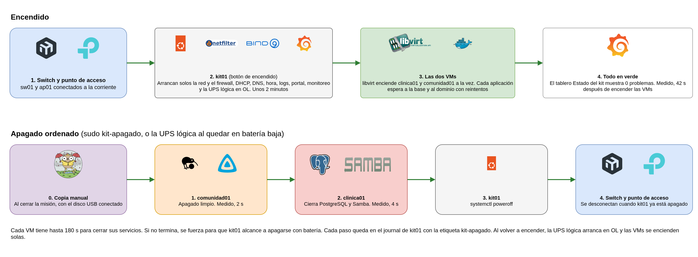
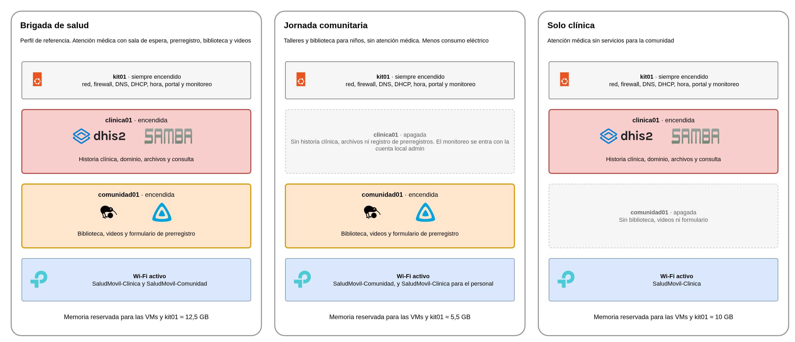
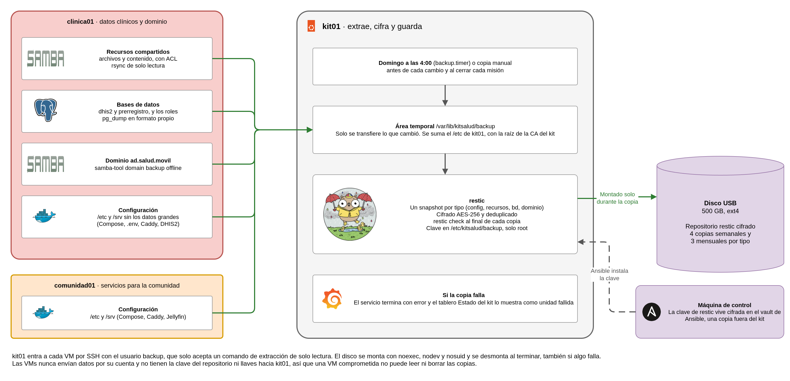

# Kit móvil de atención primaria en salud

## Guía de operación y plan de respaldo

**Proyecto final - Plataformas I - 2026-2** · Organización `kitsalud-movil-plats1`

Este documento junta dos entregables del enunciado, la **guía de operación (E3)** y el **plan de respaldo y recuperación (E5)**. Se combinaron porque en la práctica los hace la misma persona y en el mismo momento. Cerrar una misión, por ejemplo, es sacar una copia y después apagar el kit en orden, y recuperar un archivo borrado es parte de la operación de cualquier día. Tenerlos juntos evita saltar entre documentos en medio de un problema.

Está escrito como un manual para el personal técnico de la brigada, es decir, para quien tiene el usuario de administración del kit aunque no lo haya instalado. Cada procedimiento dice qué hacer, cómo comprobar que funcionó y qué pasó cuando se probó en el kit real. La instalación desde cero y las reglas del firewall están en el documento de arquitectura, despliegue y seguridad (E1, E2 y E4).

<div class="salto"></div>

# Parte 1. Guía de operación (E3)

## 1. El kit en pocas palabras

| Equipo | Qué es | Dirección |
|---|---|---|
| kit01 | Mini PC que hace de router, firewall, DNS, DHCP, hora, portal cautivo, logs y monitoreo, y donde corren las dos máquinas virtuales | `10.20.10.1` desde la red Interna, `100.90.225.113` por NetBird |
| clinica01 | Historia clínica (DHIS2), base de datos, dominio de usuarios, archivos compartidos y consulta de prerregistros | `10.20.20.11` y `fd5a:fc7e:d716:20::11` |
| comunidad01 | Biblioteca, videos y formulario de prerregistro | `10.20.20.12` y `fd5a:fc7e:d716:20::12` |
| sw01 | Switch MikroTik que separa la red Interna y la Comunidad | `10.20.10.2` |
| ap01 | Punto de acceso con los Wi-Fi `SaludMovil-Clinica` y `SaludMovil-Comunidad` | `10.20.10.3` |

| Servicio | Dirección | Quién lo usa |
|---|---|---|
| Historia clínica (DHIS2) | `https://pacientes.salud.movil` | Personal de salud |
| Consulta de prerregistros | `https://consultas.salud.movil` | Grupo `clinicos` del dominio |
| Archivos compartidos | `\\archivos.salud.movil\archivos` y `\contenido` | Grupos `clinicos` y `admins` |
| Monitoreo (Grafana) | `https://monitoreo.salud.movil` | Grupo `admins`, desde administración |
| Biblioteca | `http://biblioteca.salud.movil` | Todos |
| Videos | `http://videos.salud.movil` | Todos |
| Formulario de prerregistro | `https://registro.salud.movil` | Pacientes en la sala de espera |
| Raíz de certificados del kit | `http://ca.salud.movil/raiz.crt` | Quien quiera evitar la advertencia del navegador |

### 1.1 Cómo se entra

La administración solo funciona desde un equipo conectado por cable al puerto `ether4` de sw01, que recibe una dirección entre `10.20.10.10` y `10.20.10.28`, o por NetBird cuando hay Internet. Desde otro puerto o desde el Wi-Fi, kit01 rechaza el SSH, y eso es intencional. Las VMs solo aceptan SSH desde kit01, así que a ellas se llega saltando.

```bash
ssh kitsalud@10.20.10.1                              # kit01 desde la red Interna
ssh -J kitsalud@10.20.10.1 kitsalud@10.20.20.11      # clinica01
ssh -J kitsalud@10.20.10.1 kitsalud@10.20.20.12      # comunidad01
ssh -J kitsalud@10.20.10.1 admin@10.20.10.2          # sw01
```

Por NetBird es lo mismo, cambiando `10.20.10.1` por `100.90.225.113`. Las contraseñas no están en este documento. Están en el vault de Ansible y en la hoja privada del grupo.

## 2. Encender el kit

1. Conectar a la corriente el switch y el punto de acceso, y esperar a que se enciendan los indicadores de sus puertos.
2. Encender kit01 con su botón. Tarda cerca de 2 min 15 s en tener todos sus servicios, casi todo esperando a que la red esté lista.
3. No hacer nada más. kit01 levanta solo la red, el firewall, el DHCP, el DNS, la hora, los logs, el portal, el monitoreo y la UPS lógica, y después enciende las dos VMs a la vez. Cada aplicación espera con reintentos a la base de datos y al dominio, así que el orden entre ellas se resuelve solo.

<div class="diagrama"></div>

Para comprobar que arrancó bien se revisa en kit01.

```bash
systemctl --failed                                         # 0 loaded units listed
virsh -c qemu:///system list --all                         # clinica01 y comunidad01 en running
upsc kit@127.0.0.1 ups.status                              # OL
```

En el navegador, el tablero **Estado del kit** de `https://monitoreo.salud.movil` muestra **Problemas ahora** en 0. En el kit esto pasó 42 segundos después de que arrancaron las VMs. Si una VM sigue apagada después de 5 minutos, se enciende con `sudo virsh -c qemu:///system start <vm>`. `virsh` siempre necesita `-c qemu:///system`, porque sin eso consulta las máquinas del propio usuario y la lista sale vacía, y eso confunde bastante.

## 3. Revisión rápida (health check)

Esta revisión sirve para saber en pocos minutos si el kit está bien y, si algo falla, encontrar qué es. Se hace al empezar cada jornada y cada vez que alguien reporta un problema.

**Paso 1. El tablero.** `https://monitoreo.salud.movil` abre en **Estado del kit**. Se entra con una cuenta del grupo `admins` del dominio, o con la cuenta local `admin` de Grafana si el dominio no responde.

| Recuadro | Lo normal | Si no |
|---|---|---|
| **Problemas ahora** | 0 | Hay alertas activas, que se leen en **Qué está fallando** |
| **Equipos** | kit01, clinica01, comunidad01, el switch y el Wi-Fi encendidos | Un equipo no responde (síntoma 1 de la tabla de abajo) |
| **Servicios** | Todos en verde | El servicio en rojo dice por dónde empezar |
| **Qué está fallando** | Vacía | Cada fila dice qué falla, en qué equipo y si es en IPv4 o en IPv6 |

Prometheus prueba cada servicio cada 15 segundos en IPv4 y en IPv6, y lo pone en rojo cuando lleva 30 segundos fallando. Además mide CPU, memoria, disco y el estado de las unidades de systemd de los tres equipos, que están en el tablero **Recursos de los equipos**.

**Paso 2. kit01 en un minuto.**

```bash
systemctl --failed                         # servicios caídos
virsh -c qemu:///system list --all         # las dos VMs en running, prueba01 apagada
df -h / /var/lib/libvirt/images            # por debajo del 80 %, donde salta la alerta DiscoAlto
chronyc tracking | grep -E "Stratum|Leap"  # Leap status : Normal
sudo ss -ltnup | grep -E ':(53|67|80|123|443|514|547) '   # puertos de los servicios del kit
```

**Paso 3. Buscar por síntoma.** Después de arreglar, se vuelve al tablero y se espera a que todo esté en verde.

| Síntoma | Dónde | Revisar | Arreglar |
|---|---|---|---|
| Un equipo apagado, o nada de una VM responde | kit01 | `virsh -c qemu:///system list --all` | `virsh -c qemu:///system start <vm>`. Los servicios vuelven solos en 1 o 2 minutos |
| **DNS** en rojo, o se abre `https://10.20.20.11` pero no `pacientes.salud.movil` | kit01 | `systemctl status named` y `dig @10.20.20.10 pacientes.salud.movil` | `sudo systemctl restart named`. Si no arranca, `sudo named-checkconf` dice qué archivo tiene el error |
| **DHCP** en rojo, o los equipos nuevos no obtienen dirección | kit01 | `systemctl status kea-dhcp4-server kea-dhcp6-server radvd` y `ip link show enp171s0` | `sudo systemctl restart kea-dhcp4-server kea-dhcp6-server radvd`. Si `enp171s0` no tiene enlace, revisar el cable al puerto 1 del switch |
| **DHIS2** o **Base de datos** en rojo | clinica01 | `cd /srv/dhis2 && sudo docker compose ps` (`db` y `core` en `healthy`) | `sudo docker compose up -d`. DHIS2 tarda cerca de un minuto en responder |
| **Archivos** o **Inicio de sesión (AD)** en rojo | clinica01 | `systemctl status samba-ad-dc` | `sudo systemctl restart samba-ad-dc`. Una cuenta bloqueada se libera sola a los 15 minutos |
| **Biblioteca**, **Videos** o **Registro** en rojo | comunidad01 | `sudo docker ps` (`kiwix`, `jellyfin`, `formularios` y `caddy`) | En la carpeta del que falta, dentro de `/srv`, `sudo docker compose up -d` |
| El formulario dice que no pudo guardar | clinica01 | La base de datos | Cuando vuelve la base, la persona toca Enviar otra vez y no pierde lo escrito |
| Los celulares de la Comunidad no ven el portal | kit01 | `systemctl status nginx kitsalud-portal` | `sudo systemctl restart nginx kitsalud-portal`. En el celular, abrir una dirección con `http://`, porque las de `https://` no muestran el portal |
| **Hora (NTP)** en rojo, o un equipo tiene la hora mal | kit01 | `chronyc tracking` | `sudo systemctl restart chrony` |
| Alguien no llega a un servicio que debería ver | kit01 | `sudo tail -20 /var/log/kitsalud/kit01/firewall.log` | Si el bloqueo es correcto, por ejemplo un celular de la Comunidad intentando abrir DHIS2, no hay nada que hacer |
| Alerta **DiscoAlto** | El equipo de la alerta | `df -h` y `sudo du -xh / --max-depth=2 \| sort -h \| tail` | Avisar al responsable técnico antes de borrar nada |
| La copia falló (`backup` en **Qué está fallando**) | kit01 | `journalctl -u backup -o cat \| tail -20` y `lsblk -f` | Conectar el disco USB y ejecutar `sudo systemctl start backup.service` |

Si un problema se repite o no se arregla con esta tabla, se anota la hora, el síntoma y lo que mostraron los comandos, y se avisa al responsable técnico. Esa información es la que se necesita para buscarlo en los logs.

## 4. Apagar el kit

El apagado ordenado cierra primero lo que tiene datos, para que PostgreSQL y el dominio terminen limpios.

1. Si se cierra una misión, sacar antes una copia con el disco USB conectado (`sudo systemctl start backup.service`, unos 15 segundos).
2. Ejecutar el apagado ordenado.

   ```bash
   sudo kit-apagado
   ```

   Apaga comunidad01, después clinica01 y al final kit01. Cada VM tiene hasta 180 segundos para cerrar sus servicios y, si no termina, se fuerza para que kit01 alcance a apagarse. En el kit, comunidad01 cerró en 2 segundos y clinica01 en 4.
3. Cuando el indicador de kit01 se apaga, desconectar el switch y el punto de acceso.

`shutdown` y `poweroff` apagan las dos VMs al mismo tiempo y sin orden, así que para apagar el kit se usa siempre `kit-apagado`. Al encender de nuevo se puede ver cómo fue el apagado anterior con `journalctl -t kit-apagado -b -1 -o short-iso`. Si alguna línea dice `apagado forzado`, esa VM no cerró a tiempo y conviene revisar su log.

### 4.1 Corte de energía

El kit no tiene una UPS física, así que su estado se simula con NUT. La UPS lógica avisa cuando pasa a batería y, cuando la batería queda baja, ejecuta el mismo `kit-apagado`. Con una UPS real conectada por USB solo cambia el driver de NUT y el procedimiento queda igual.

| Comando | Qué simula | Qué hace el kit |
|---|---|---|
| `sudo kit-ups` | Nada | Muestra el estado, la carga y la autonomía |
| `sudo kit-ups ob` | Se cortó la energía | Avisa en el journal y no apaga nada |
| `sudo kit-ups lb` | La batería quedó baja | Ejecuta el apagado ordenado completo |
| `sudo kit-ups ol` | Volvió la energía | Vuelve a `OL` |

Para practicar sin apagar kit01 existe un simulacro. Con el archivo `/etc/kitsalud/nut/simulacro` creado hace menos de una hora, la batería baja apaga las VMs en orden pero deja kit01 encendido. Como seguro adicional se enmascara el apagado de kit01 mientras dura la práctica.

```bash
sudo systemctl mask --runtime poweroff.target halt.target
sudo touch /etc/kitsalud/nut/simulacro
sudo kit-ups ob; sleep 10; sudo kit-ups lb
journalctl -t kit-apagado --since -5min -o cat        # termina con "Simulacro terminado"
sudo systemctl unmask --runtime poweroff.target halt.target
sudo virsh -c qemu:///system start comunidad01 && sudo virsh -c qemu:///system start clinica01
```

En el kit, las dos VMs se apagaron 16 segundos después de la batería baja, kit01 siguió encendido y la UPS volvió sola a `OL`. Al encenderlas otra vez todo estaba en verde a los 42 segundos.

## 5. Gestión de usuarios

El kit tiene dos tipos de cuentas personales. Las del dominio sirven para los archivos compartidos, la consulta de prerregistros y el monitoreo, y las de DHIS2 para la historia clínica. Son independientes, aunque cada persona tiene el mismo nombre en las dos (por ejemplo `ana.rojas`). Una persona nueva del personal clínico necesita las dos. DHIS2 usa sus propias cuentas a propósito, para que el registro de pacientes siga funcionando si el dominio falla.

| Cuenta | Para qué | Dónde se gestiona |
|---|---|---|
| Del dominio (`SALUD\<usuario>`) | `archivos` y consulta para `clinicos`, `contenido` para `clinicos` y `admins`, Grafana solo para `admins` | clinica01, con `samba-tool` o con Ansible |
| De DHIS2 | Registro y consulta de pacientes, con el rol "Personal clínico" o "Administrador" | DHIS2, app **Users**, o con Ansible |
| `comunidad` de Jellyfin | Ver los videos, sin contraseña | No se cambia |
| Administración del kit | SSH y `sudo` en kit01 y las VMs | `passwd` en cada equipo y el vault de Ansible |

### 5.1 Personas permanentes, con Ansible

Las personas que van a estar en todas las misiones se agregan al inventario. Así quedan con el mismo número de usuario si el dominio se reconstruye, y los archivos restaurados conservan su dueño. Se agrega la persona en `inventarios/kit/group_vars/all/samba.yml` con el siguiente `uid` libre (empiezan en 10101) y en `dhis2.yml` con su rol, y se aplica.

```yaml
- { nombre: maria.lopez, nombres: Maria, apellidos: Lopez, uid: 10104, grupos: [clinicos] }
```

```bash
ansible-playbook playbooks/samba.yml
ansible-playbook playbooks/clinica01.yml
```

Los playbooks solo crean lo que falta. No cambian la contraseña de una cuenta que ya existe ni borran las que se quitan del inventario, así que eso se hace a mano.

### 5.2 En campo, con samba-tool

Sin la máquina de control, las cuentas del dominio se gestionan en clinica01. Una cuenta creada así se agrega después al inventario con el mismo `uid`.

| Qué | Comando en clinica01 |
|---|---|
| Ver cuentas y grupos | `sudo samba-tool user list` y `sudo samba-tool group listmembers clinicos` |
| Crear una cuenta | `sudo samba-tool user create maria.lopez --given-name=Maria --surname=Lopez` |
| Darle su número y grupo principal | `sudo samba-tool user addunixattrs maria.lopez 10104 --gid-number=10001` (10001 es `clinicos` y 10002 es `admins`) |
| Agregarla a un grupo | `sudo samba-tool group addmembers clinicos maria.lopez` y `sudo net cache flush` |
| Cambiar la contraseña | `sudo samba-tool user setpassword maria.lopez` |
| Deshabilitar o habilitar | `sudo samba-tool user disable maria.lopez` y `enable` |
| Desbloquear | `sudo samba-tool user unlock maria.lopez` |
| Borrar | `sudo samba-tool user delete maria.lopez` |

Después de 5 contraseñas equivocadas la cuenta se bloquea 15 minutos. Después de un cambio de contraseña, la anterior sigue sirviendo hasta una hora en los recursos compartidos, como en un dominio de Windows, así que para cortar el acceso de inmediato se deshabilita la cuenta.

**Cuentas de DHIS2.** En `https://pacientes.salud.movil`, con una cuenta de rol "Administrador", se abre la app **Users**. Al crear una cuenta se le pone el rol "Personal clínico", la unidad del kit en las tres listas de **Organisation units** y el grupo "Personal clínico". Sin el grupo, la persona entra pero no ve los datos de pacientes. Para quitar el acceso es mejor **Disable** que **Delete**, porque así queda claro quién hizo cada registro.

**Administración del kit.** Es un solo usuario con `sudo` en kit01 y las dos VMs. Para cambiar su contraseña se ejecuta `passwd` en los tres equipos y después se actualizan en el vault `vault_admin_password` y su hash (`mkpasswd -m sha-512`). Si no se actualiza el vault, Ansible deja de poder conectarse.

En el kit se probó el ciclo completo con una cuenta temporal. Se creó, entró a `archivos` y a la consulta por IPv4 y por IPv6, recibió 401 en Grafana por no ser de `admins`, se deshabilitó (`NT_STATUS_ACCOUNT_DISABLED`), se bloqueó con 5 intentos (`NT_STATUS_ACCOUNT_LOCKED_OUT`), se desbloqueó y se borró. Con DHIS2 se hizo lo mismo por su API.

## 6. Revisión de logs

Todos los equipos envían sus logs a kit01, a una carpeta por equipo en `/var/log/kitsalud/`. El equipo se decide por la dirección de origen, así que uno no puede escribir en la carpeta de otro. Lo práctico de esto es que los logs de una VM se pueden leer aunque esa VM esté apagada.

| Archivo en kit01 | Qué tiene |
|---|---|
| `/var/log/kitsalud/<equipo>/auth.log` | Inicios de sesión SSH, `sudo` y accesos rechazados. En clinica01 también los del dominio, con la etiqueta `samba-auth` |
| `/var/log/kitsalud/<equipo>/syslog.log` | Todo lo demás de cada equipo, incluido sw01 |
| `/var/log/kitsalud/kit01/firewall.log` | Lo que bloqueó el firewall, con la etiqueta `fw-drop` |
| `/var/log/kitsalud/kit01/dhcp.log` | Direcciones entregadas por el DHCP |
| `/var/log/kitsalud/kit01/dns.log` | Mensajes del DNS (arranque, recargas, errores de zona) |
| `/var/log/named/consultas.log` | Cada consulta al DNS con el equipo que preguntó |

El AP no envía sus logs, así que su registro se ve en su página, en **System Tools**, **System Log**.

Estos son los eventos que más se consultan.

```bash
# Inicios de sesión SSH fallidos
sudo grep -h -E "Failed password|Invalid user" /var/log/kitsalud/*/auth.log | tail
# Inicios de sesión del dominio con problemas
sudo grep samba-auth /var/log/kitsalud/clinica01/auth.log | grep -E "WRONG_PASSWORD|LOCKED_OUT|NO_SUCH_USER" | tail
# Bloqueos del firewall por tipo
sudo grep -o "fw-drop [A-Za-z0-9-]*" /var/log/kitsalud/kit01/firewall.log | sort | uniq -c | sort -rn
# Lo bloqueado dentro del kit, sin el ruido de la WAN
sudo grep fw-drop /var/log/kitsalud/kit01/firewall.log | grep -v "IN=enp170s0" | tail
# Direcciones entregadas
sudo grep DHCP4_LEASE_ALLOC /var/log/kitsalud/kit01/dhcp.log | tail
# Un servicio concreto, en su equipo
journalctl -u <servicio> --since -15min
cd /srv/dhis2 && sudo docker compose logs --since 15m core
```

| Etiqueta del firewall | Qué se bloqueó |
|---|---|
| `fw-drop F-20` | Un equipo de la Comunidad intentó llegar a la red Interna, a clinica01 o a la gestión de kit01 |
| `fw-drop F-21` | Un SSH desde un equipo de la Interna sin dirección de administración, o por IPv6 |
| `fw-drop F-18` | kit01 intentó salir a Internet por un puerto no permitido |
| `fw-drop br-srv` | Una VM intentó llegar a un servicio de la otra que no está permitido |
| `fw-drop IN=...` | Cualquier otra cosa sin regla |

En una línea del firewall, `IN` es la red de donde vino el paquete (`br-com` es la Comunidad, `lan0.10` la Interna, `br-srv` los servidores y `enp170s0` la WAN), `SRC` y `DST` son las direcciones y `DPT` el puerto. Casi todas las líneas con `IN=enp170s0` son difusiones normales de la red del sitio y no son ataques.

Los logs de `/var/log/kitsalud/` rotan cada semana (o antes si un archivo pasa de 100 MB) y se guardan cuatro copias comprimidas, que se leen con `zgrep`. Los logs no van en la copia semanal, porque son de diagnóstico.

## 7. Actualización

Las actualizaciones se hacen solo en la base, con Internet y en una ventana de mantenimiento, nunca en campo. Lo ideal es hacerlas antes de cada misión, con tiempo para revisar el kit después. Antes de tocar nada se saca una copia al disco USB y una instantánea de cada VM, así que cualquier paso que salga mal en una VM se deshace volviendo a la instantánea.

| Qué | Cómo | Qué queda fijo |
|---|---|---|
| Paquetes de las VMs | `apt` con todo lo que no está retenido | Docker, Samba AD, Chrony y el exportador de métricas |
| Paquetes de kit01 | `apt` con lo no retenido, sin reiniciar | BIND9, Kea, radvd, Chrony, nginx, NUT, Prometheus, Grafana, rsyslog, restic y NetBird |
| Imágenes de las aplicaciones | Se bajan las versiones fijadas en cada `compose.yml` | La versión de cada imagen |

Todo se hace desde la máquina de control, en `platform/ansible`, con el playbook `actualizacion.yml` y la variable `paso`.

| # | Comando | Qué hace | Comprobación |
|---|---|---|---|
| 1 | `docs/pruebas/scripts/P12-reinicio.sh estado` | Revisa que todo esté bien antes de empezar | Sin fallas. Si algo ya falla, se arregla primero para no mezclar problemas |
| 2 | `ssh kitsalud@<kit01> sudo systemctl start backup.service` | Copia al disco USB | Cuatro `snapshot ... saved` y `no errors were found` |
| 3 | `ansible-playbook playbooks/actualizacion.yml -e paso=instantanea` | Apaga cada VM por ACPI, le saca una instantánea `antes-<fecha>` y la enciende | `virsh snapshot-list <vm>` muestra la instantánea |
| 4 | `... -e paso=paquetes` | Actualiza las VMs una por una y las reinicia si hace falta | `apt list --upgradable` solo con retenidos y todo en verde |
| 5 | `... -e paso=paquetes-kit01` | Actualiza kit01 sin reiniciar y sin tocar la red ni NetBird | `netbird status` conectado y el mismo número de cadenas en `nft list ruleset` |
| 6 | `... -e paso=imagenes` | Guarda las imágenes de Docker con `docker save` en el disco USB, con su sha256 | `sha256 bien` y el disco desmontado |
| 7 | `... -e paso=borrar` | Borra las instantáneas cuando todo está verificado | - |

Si algo quedó mal en una VM, `ansible-playbook playbooks/actualizacion.yml -e paso=revertir -e vms=<vm>` la deja como estaba antes del paso 3. Si en campo se daña una imagen, se carga desde el disco USB sin Internet con `-e paso=cargar -e vms=<vm> -e imagen=<imagen>`. En el kit, la actualización completa tomó cerca de 7 minutos y reinstalar `kiwix-serve` sin Internet tomó 43 segundos.

Los paquetes retenidos se actualizan uno por uno y a propósito, con `apt-mark unhold`, la actualización y `apt-mark hold` otra vez. En kit01, los de la red, el firewall y NetBird se actualizan solo con alguien en el sitio, porque un error ahí corta el acceso remoto. Una versión nueva de una aplicación se prueba primero en una rama del repositorio `apps`, leyendo sus notas de versión, porque DHIS2 y PostgreSQL migran sus datos al arrancar y no vuelven atrás solos.

## 8. Operación sin Internet

El kit está hecho para trabajar sin Internet. Todo lo que usa la brigada corre adentro, así que un sitio sin conexión, o una conexión que se cae a mitad de la jornada, no detiene la atención.

| Sigue funcionando | Deja de funcionar |
|---|---|
| DHCP en IPv4 y anuncios de IPv6 | Navegar por Internet desde la Interna y la Comunidad |
| Los nombres de `salud.movil` y del dominio | Los nombres de Internet. A la Comunidad el DNS le responde la IP del portal y a la Interna `SERVFAIL` |
| La hora, que kit01 sigue entregando | La sincronización de kit01 con servidores externos |
| DHIS2, consulta de prerregistros y archivos compartidos | La administración remota por NetBird |
| Biblioteca, videos y formulario de prerregistro | Las actualizaciones |
| El portal cautivo, que el celular abre solo | Las páginas externas con `https://` |
| Inicio de sesión del dominio y de DHIS2, monitoreo, logs y copias | |

Sobre la hora, kit01 conserva la última referencia que tenía y, si el corte se alarga, pasa a estrato 10 y sigue sirviendo la hora. Puede alejarse poco a poco de la hora real, pero todos los equipos siguen con la misma hora, que es lo que necesitan el dominio y los registros clínicos.

Para saber si el kit tiene Internet se revisa en kit01.

```bash
ping -c 3 1.1.1.1                       # 0% packet loss con Internet
cat /run/kit-internet/modo              # con o sin
dig +short @10.20.20.10 pacientes.salud.movil     # 10.20.20.11 en los dos casos
```

`ip route show default` puede seguir mostrando la ruta por la WAN aunque no haya Internet, así que la prueba que vale es el `ping`. El tablero de monitoreo no se pone en rojo por falta de Internet, porque todo lo que vigila está dentro del kit.

Sin NetBird, el kit se administra desde un equipo conectado al puerto `ether4` de sw01, con la red en automático. Si el DHCP falla, se le pone a mano la `10.20.10.29/24`, con gateway `10.20.10.1` y DNS `10.20.20.10`. Esa dirección está fuera del rango que entrega el DHCP, así que no choca con nadie.

Cuando vuelve Internet no hay que hacer nada. La ruta, la hora y NetBird se recuperan solos, y en menos de un minuto el DNS deja de mandar a la Comunidad al portal. Las actualizaciones tampoco se hacen en campo aunque vuelva la conexión.

En el kit se cortó la salida a Internet durante 5 minutos con una tabla temporal del firewall, sin desconectar el cable para no perder el acceso remoto. Se comprobaron 51 cosas en IPv4 y en IPv6 desde kit01, las dos VMs, el switch y un cliente de la Comunidad, y todo lo local siguió funcionando, incluido un prerregistro enviado sin Internet que quedó guardado en clinica01.

## 9. Cambio de perfil por misión

El mismo kit sirve para misiones distintas. Según la misión se enciende o no cada VM y se activa o no el SSID de la Comunidad. El direccionamiento, el DNS y el firewall no cambian, y el perfil queda guardado aunque kit01 se reinicie.

<div class="diagrama"></div>

**Pasar a "Solo clínica".** En kit01 se quita el arranque automático de comunidad01 y se apaga. En clinica01 se detiene la publicación de contenido, que copia cada 10 minutos a comunidad01 y fallaría con ella apagada. En la página del AP se desactiva el SSID2.

```bash
sudo virsh -c qemu:///system autostart --disable comunidad01
sudo virsh -c qemu:///system shutdown comunidad01
# en clinica01
sudo systemctl disable --now publicacion.timer && sudo systemctl reset-failed publicacion.service
```

**Pasar a "Jornada comunitaria".** Se hace lo mismo con clinica01 y se dejan los dos SSID, porque el de la Clínica queda para que el personal administre el kit. Sin clinica01 no hay historia clínica ni archivos, el formulario abre pero avisa que no puede guardar, y a Grafana se entra con la cuenta local.

**Volver al perfil de referencia.** Se activa otra vez el arranque automático y se enciende la VM (`virsh autostart <vm>` y `virsh start <vm>`). Si se venía de "Solo clínica", se activa de nuevo `publicacion.timer` en clinica01 y el SSID2 en el AP.

En un perfil con una VM apagada, el tablero la muestra en rojo con sus servicios, y es lo esperado. La copia del domingo también termina con error porque no puede extraer de la VM apagada, aunque guarda lo que sí pudo. Si se vuelve a aplicar `vms.yml`, el arranque automático vuelve al perfil de referencia.

<div class="salto"></div>

# Parte 2. Plan de respaldo y recuperación (E5)

## 10. Objetivos de recuperación

**Punto de recuperación (RPO).** Se pierde como máximo una semana de datos, porque la copia automática corre el domingo a las 4:00. La ventana se acorta con una copia manual antes de cada cambio de configuración y al cerrar cada misión.

**Tiempo de recuperación (RTO).** Depende de qué se perdió. Los tiempos medidos salen de las pruebas en el kit real y los demás son estimados.

| Qué se perdió | Tiempo | Base |
|---|---|---|
| Un archivo de `archivos` o `contenido` | Unos 70 s | Medido (68 s con un archivo y una tabla) |
| Una tabla de `prerregistro` | Unos 70 s | Medido |
| La base `dhis2` completa | Menos de 5 min | Medido. `pg_restore` tardó 7,7 s con 333 tablas y 45 893 filas, más reiniciar DHIS2 |
| El dominio de Samba AD | De 15 a 30 min | Estimado. La restauración offline tarda 2,5 s y el resto es ponerlo en servicio |
| Una VM completa | De 1 a 2 h | Estimado. Se reconstruye con Ansible y se restauran los datos. Necesita Internet |
| kit01 completo | Medio día | Estimado. Instalar Ubuntu, aplicar Ansible y restaurar, en la base |

## 11. Qué se respalda

kit01 junta todo en un área temporal y guarda un snapshot de restic por tipo, cada uno con su etiqueta.

<div class="diagrama"></div>

| Etiqueta | Qué tiene | Origen | Método |
|---|---|---|---|
| `config` | `/etc` de kit01, con la raíz de la CA, y `/etc` y `/srv` de las VMs sin datos grandes (Compose, `.env`, configuración de DHIS2, Caddy y Jellyfin) | kit01 y las VMs | Lectura directa en kit01 y `rsync` en las VMs |
| `recursos` | Recursos `archivos` y `contenido` con dueños numéricos, ACL y atributos extendidos | clinica01 | `rsync` |
| `bd` | `pg_dump -Fc` de `dhis2` y `prerregistro`, y los roles de PostgreSQL | clinica01 | Comando forzado |
| `dominio` | `samba-tool domain backup offline` de `ad.salud.movil` | clinica01 | Comando forzado |

Lo que no se respalda se dejó afuera a propósito. Los discos de las VMs no, porque se reconstruyen con Ansible y después se restauran los datos. Los datos crudos de PostgreSQL tampoco, porque un `pg_dump` se puede restaurar en otra versión y no depende del estado del motor. Los medios de comunidad01 son una copia de `contenido`, las imágenes Docker tienen versión fija y se descargan otra vez, y los logs y las métricas son de diagnóstico.

## 12. Método, frecuencia, retención y destino

kit01 extrae los datos de las VMs, que nunca los envían por su cuenta. Entra a cada VM con el usuario `backup`, cuya llave solo se acepta desde kit01 y solo ejecuta el comando `backup-extraer`. Ese comando acepta `rsync` en modo demonio con módulos de solo lectura, los volcados de PostgreSQL y el backup del dominio, y nada más. Las VMs no tienen la clave del repositorio ni llaves hacia kit01, así que una VM comprometida no puede leer ni borrar las copias.

| Elemento | Valor |
|---|---|
| Frecuencia | `backup.timer`, cada domingo a las 4:00. Con `Persistent=true`, si kit01 estaba apagado la copia corre al arrancar |
| Copia manual | `sudo systemctl start backup.service`, antes de cada cambio y al cerrar cada misión |
| Duración | Unos 15 s, porque `rsync` solo transfiere lo que cambió |
| Conexión | IPv6 y, si no responde, IPv4. El log dice cuál se usó |
| Retención | 4 semanales y 3 mensuales por etiqueta (`restic forget --keep-weekly 4 --keep-monthly 3 --prune`) |
| Destino | Disco USB 3.0 de 500 GB, ext4 con etiqueta `kitbackup`, montado por UUID en `/mnt/backup` solo durante la copia, con `noatime,nodev,nosuid,noexec` y fuera de `fstab` |
| Cifrado | restic cifra el repositorio con AES-256. La clave está en `/etc/kitsalud/backup/restic.clave` (`400`, root) y sale del vault |
| Verificación | `restic check` al final de cada copia |
| Si falla | El servicio termina con error y aparece **UnidadFallida** en el tablero. Lo que se pudo extraer se guarda igual |

El repositorio ocupa unos 850 MiB, casi todo por los archivos de la biblioteca, que no se comprimen. Cada copia sin cambios en los recursos agrega unos 5 MiB, así que el disco alcanza para años con esta retención.

**Custodia.** El disco viaja con el kit. Hoy hay una sola copia en el mismo lugar que los datos, así que un robo o un incendio se llevan los dos. Es un riesgo aceptado del proyecto, y la copia en línea de la sección 15 es la forma de cerrarlo. La contraseña del vault, que es la que permite leer las copias, se guarda además fuera de los equipos del kit.

## 13. Procedimientos de restauración

Todo empieza en kit01, como root, con el disco montado y las variables de restic cargadas.

```bash
sudo -i
mount -o noatime,nodev,nosuid,noexec UUID=<backup_disco_uuid> /mnt/backup
export RESTIC_REPOSITORY=/mnt/backup/restic RESTIC_PASSWORD_FILE=/etc/kitsalud/backup/restic.clave RESTIC_CACHE_DIR=/var/cache/restic
S=/var/lib/kitsalud/backup
restic snapshots                     # fechas y etiquetas de las copias
# ... restauración ...
umount /mnt/backup                   # siempre al terminar
```

Lo restaurado se pasa a la VM con `scp` desde kit01 (`kitsalud@10.20.20.11` es clinica01). Para recuperar una versión anterior se usa el ID de un snapshot de `restic snapshots` en lugar de `latest`.

**Un archivo o una carpeta.** Se restaura en una carpeta temporal y en clinica01 se copia a `/srv/samba/archivos/` con `sudo cp -a`. El archivo hereda la ACL por defecto del recurso, así que queda igual que antes.

```bash
restic ls latest --tag recursos | grep <nombre>
restic restore latest --tag recursos --include $S/clinica01/archivos/<ruta> --target /tmp/r
```

**Una tabla o una base.** Se saca el volcado del disco y se restaura en clinica01. La base `dhis2` completa se restaura con DHIS2 detenido, para que no escriba mientras se carga.

```bash
restic dump latest --tag bd $S/clinica01/postgres/<base>.dump > /tmp/<base>.dump
# en clinica01, una tabla
docker exec -i dhis2-db-1 pg_restore -U dhis -d <base> -t <tabla> < <base>.dump
# en clinica01, la base dhis2 completa
cd /srv/dhis2 && docker compose stop core
docker exec -i dhis2-db-1 pg_restore -U dhis -d dhis2 --clean --if-exists < dhis2.dump
docker compose start core
```

**Una configuración.** `restic restore latest --tag config --include <ruta> --target /tmp/r`. Lo que gestiona Ansible se recupera mejor ejecutando otra vez su playbook, y la copia sirve para comparar o para lo que se cambió a mano.

**El dominio de Samba AD.** Hay dos caminos. El normal es aprovisionarlo otra vez con `playbooks/samba.yml`, que crea los mismos grupos y usuarios con los mismos `uid` y `gid`, así que los archivos restaurados conservan sus dueños. Se pierden las contraseñas que los usuarios hayan cambiado. El otro camino, para cuando hay cambios hechos fuera de Ansible, es restaurar el backup del dominio con `samba-tool domain backup restore`. `samba-tool` exige un nombre de controlador nuevo, así que el restaurado se llama `dc02`, y después se agregan otra vez los registros DNS de `dc01` y se ejecuta `samba.yml` para que el resto del kit siga usando el mismo nombre.

**Una VM.** Se recrea con `playbooks/vms.yml`, se aplica su playbook (`clinica01.yml` o `comunidad01.yml`, con `samba.yml`, `publicacion.yml` y `backups.yml` según corresponda) y se restauran los datos. comunidad01 no tiene datos propios, porque los medios vuelven con la siguiente publicación. Necesita Internet, así que se hace en la base. comunidad01 se reconstruyó así en el kit real y quedó igual que antes, aunque Wikimedia limitó la descarga de los videos y hubo que esperar 10 minutos.

**kit01 completo.** Se instala Ubuntu Server 24.04 conservando los nombres de interfaz, se instala NetBird, se monta el disco de copias y se restaura primero la raíz de la CA (`/etc/kitsalud/ca`) desde el snapshot `config`, para que los certificados que ya tienen los equipos sigan valiendo. Después se aplican los playbooks en el orden del despliegue y se restauran las VMs. Si kit01 no está, el repositorio se puede leer desde cualquier Linux con restic 0.16 o superior, el disco y la clave del vault.

**El disco falla o se pierde.** Los datos vivos no se tocan, solo se pierden las copias. Se formatea otro disco igual, se cambia `backup_disco_uuid` en el inventario, se ejecuta `backups.yml` y la siguiente copia crea el repositorio. Si se pierde la clave, las copias no se pueden leer de ninguna forma, y por eso está guardada en dos lugares.

## 14. Verificación periódica y pruebas hechas

Una copia que nunca se restauró no sirve de mucho, así que el plan incluye restaurar de verdad cada cierto tiempo.

| Qué | Cuándo | Cómo |
|---|---|---|
| Integridad del repositorio | En cada copia | `restic check` en el log de `backup.service` |
| Que la copia corrió | Cada semana | El tablero sin **UnidadFallida** y `systemctl list-timers backup.timer` |
| Restaurar un archivo y una tabla | Cada mes y después de cambiar los roles de copias | `P11-restauracion.sh`, que borra un archivo y una tabla de prueba y los recupera |
| Restaurar una base completa y el dominio | Antes de cada salida a campo | `dhis2` en una base temporal y el dominio en un directorio temporal, comparados con lo vivo y borrados después |

| Prueba en el kit real | Resultado |
|---|---|
| Copia programada con el disco real | Cuatro snapshots y `restic check` sin errores |
| Archivo de `archivos` y tabla de `prerregistro` | 16 de 16 en 68 s. El archivo volvió con su dueño del dominio y su ACL, y `ana.rojas` lo abrió por SMB. La tabla volvió con las mismas 1000 filas y el mismo md5 |
| Base `dhis2` completa en una base temporal | Las 333 tablas con el mismo número de filas (45 893) y PostGIS 3.5.2. `pg_restore` en 7,7 s |
| Dominio en un directorio temporal | Mismos usuarios, grupos y miembros de `clinicos` que el DC vivo, en 2,5 s, sin tocar el DC en uso |

## 15. Copia en línea (diseñada, sin implementar)

La copia del disco USB viaja con el kit. La copia en línea dejaría una tercera copia fuera del sitio y completaría la regla 3-2-1 (datos vivos, disco USB y servidor externo). Está diseñada pero no implementada, y no hay servidor ni credenciales.

| Elemento | Diseño |
|---|---|
| Destino | `rest-server` en un servidor de la organización de salud, por HTTPS y en modo solo agregar |
| Método | `restic copy` desde kit01 hacia un repositorio propio. Los datos salen cifrados y el servidor no los puede leer |
| Cuándo | Un timer revisa cada hora y sube lo pendiente solo si hay Internet y la UPS está en línea, para no gastar batería |
| Si se corta a la mitad | `restic copy` solo envía lo que falta, así que la siguiente pasada continúa |
| Firewall | Sin cambios, porque kit01 ya puede salir por TCP 443 |
| Tamaño | La primera subida son 850 MiB, unos 12 minutos a 10 Mb/s, y cada semana sin cambios son unos 5 MiB |

Con el modo solo agregar, kit01 puede subir copias nuevas pero no borrar ni cambiar las que ya están, así que un atacante en kit01 no alcanza lo que ya se subió. Como el servidor guardaría copias cifradas de datos de pacientes, la organización de salud tendría que aprobar el destino antes de activarla.

## 16. Límites conocidos

- Hoy hay una sola copia, en el mismo lugar que el kit. La evolución es la copia en línea y un segundo disco que se rota y se queda en la base.
- Lo que cambia entre dos copias se pierde si falla el SSD de kit01 antes de la siguiente. La copia manual al cerrar cada misión reduce esa ventana.
- La reconstrucción de una VM o de kit01 necesita Internet, así que en campo solo se restauran datos sobre equipos que funcionan.
- Un corte de energía durante la copia no deja un snapshot a medias, porque restic lo escribe al final, pero este caso no se probó con un corte real.
