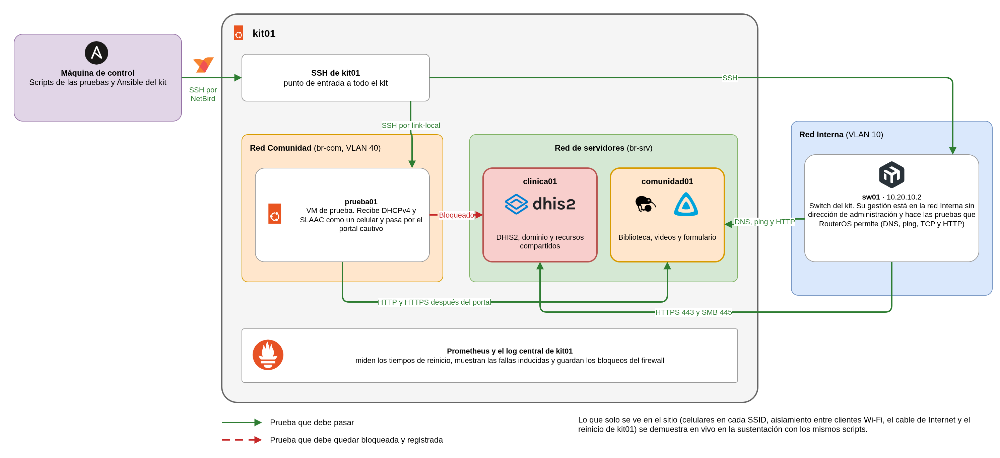

# Kit móvil de atención primaria en salud

## Evidencias, repositorio técnico y sustentación

**Proyecto final - Plataformas I - 2026-2** · Organización `kitsalud-movil-plats1`

Este documento junta tres entregables del enunciado, las **evidencias de las pruebas (E6)**, el **repositorio técnico (E7)** y la **sustentación y demostración (E8)**. Se combinaron porque dependen uno del otro. Cada evidencia sale de un script que está en el repositorio, y la demostración en vivo repite esas mismas pruebas con equipos reales. Leerlos juntos permite seguir una prueba desde el código que la ejecuta hasta lo que se muestra en la sustentación.

La arquitectura, el despliegue y la seguridad están en el documento de E1, E2 y E4, y la operación y el respaldo en el de E3 y E5.

<div class="salto"></div>

# Parte 1. Evidencias de las pruebas (E6)

## 1. Cómo se hicieron las pruebas

Todas las pruebas se hicieron en el kit real, en remoto por NetBird, y en las dos familias (IPv4 e IPv6). El enunciado pide que los criterios se puedan comprobar sin depender de una visita, así que se usaron dos equipos del propio kit como clientes.

<div class="diagrama"></div>

- **`prueba01`** es una VM de kit01 conectada al bridge de la red Comunidad (VLAN 40), la misma red del SSID `SaludMovil-Comunidad`. Recibe su configuración por DHCPv4 y por los anuncios IPv6 como un celular, y pasa por el portal cautivo. Hace de invitado.
- **sw01** tiene su gestión en la red Interna (VLAN 10), la misma del SSID `SaludMovil-Clinica`. Desde RouterOS hace consultas DNS, ping, conexiones TCP y HTTP, así que sirve como equipo de la red Interna.

Cada prueba tiene un script en `docs/pruebas/scripts/` que imprime cada comprobación como `[ OK ]` o `[FALLA]` y termina con el conteo. La automatización no reemplaza la explicación, así que cada prueba trae su interpretación. Lo que solo se puede ver en el sitio (celulares en cada SSID, un PC de la red Interna, el cable de Internet desconectado y el reinicio de kit01) se demuestra en vivo en la sustentación con los mismos scripts.

| Prueba | Qué demuestra | Cómo se probó | Resultado |
|---|---|---|---|
| P1 | Un cliente de la Comunidad recibe IPv4, IPv6, DNS y gateway | `prueba01` | Aprobada, 9 de 9 |
| P2 | Los servicios se encuentran por nombre, con A y AAAA | `prueba01` y sw01 | Aprobada, 39 de 39 |
| P3 | Un invitado no llega a lo clínico ni a la administración | `prueba01` y el log de kit01 | Aprobada, 17 de 17 |
| P4 | Un invitado usa la biblioteca, los videos y el formulario | `prueba01` y la base de clinica01 | Aprobada, 10 de 10 |
| P5 | Un cliente nuevo va al portal cautivo | `prueba01` y kit01 | Aprobada, 8 de 8 |
| P6 | El personal registra y consulta un paciente | sw01 y kit01 | Aprobada, 16 de 16 |
| P7 | Los usuarios del directorio entran a los recursos de su grupo | sw01, clinica01 y Grafana | Aprobada, 10 de 10 |
| P8 | Los equipos toman la hora de kit01 | VMs, sw01 y `prueba01` | Aprobada, 9 de 9 |
| P9 | Sin Internet todo lo local sigue funcionando | Corte simulado en kit01 | Aprobada, 51 de 51 |
| P10 | Por IPv6 se permite lo público y se bloquea lo clínico | `prueba01` y el log de kit01 | Aprobada, 10 de 10 |
| P11 | Un archivo y una tabla se recuperan de la copia | Kit real y disco USB | Aprobada, 16 de 16 |
| P12 | Los servicios vuelven solos después de un reinicio | Reinicio de las dos VMs | Aprobada, 47 de 47 |
| P13 | Una falla se localiza con el monitoreo y los logs | Tres fallas inducidas | Aprobada, 6 de 6 |

## 2. P1. Cliente comunitario

**Criterio.** El cliente obtiene IPv4, IPv6, DNS y gateway, y puede identificar su configuración.

`prueba01` ejecutó `P01-cliente.sh` sin nada configurado a mano.

```
inet 10.20.40.114/24 metric 100 brd 10.20.40.255 scope global dynamic eth0
inet6 fd5a:fc7e:d716:40:5054:ff:fe40:50/64 scope global dynamic mngtmpaddr noprefixroute
default via 10.20.40.1 dev eth0 proto dhcp src 10.20.40.114 metric 100
default via fe80::1 dev eth0 proto ra metric 100 expires 1610sec hoplimit 64 pref medium
       DNS Servers: 10.20.20.10 fd5a:fc7e:d716:20::10
        DNS Domain: salud.movil
  [ OK ]  El gateway responde al ping IPv4
  [ OK ]  El gateway responde al ping IPv6 (fe80::1%eth0)
  [ OK ]  Resuelve portal.salud.movil (10.20.40.1)
Resultado: 9 bien y 0 con falla.
```

**Interpretación.** En IPv4, Kea entregó `10.20.40.114`, dentro del rango de la Comunidad, con préstamo de una hora, el gateway `10.20.40.1` y el DNS del kit. En IPv6, el cliente armó su dirección por SLAAC con el prefijo que anuncia radvd, su ruta por defecto apunta a `fe80::1` y el DNS IPv6 llegó por DHCPv6 sin estado. Un equipo nuevo queda listo para usar el kit sin configurar nada, y como sus DNS son los del kit, los nombres de `salud.movil` resuelven desde el primer momento.

*Captura pendiente.* Configuración de red de un celular conectado a `SaludMovil-Comunidad`, con su dirección IPv4, su dirección IPv6 y el DNS.

## 3. P2. DNS

**Criterio.** Se resuelve por nombre un servicio con registros A y AAAA y se accede sin escribir la IP.

`prueba01` revisó los registros de todos los nombres, la respuesta autoritativa del DNS, la delegación del dominio y las zonas inversas. Como el ping a los servidores solo se permite desde la red Interna, la parte de extremo a extremo se hizo desde sw01.

```
  [ OK ]  A    pacientes.salud.movil (10.20.20.11)
  [ OK ]  AAAA pacientes.salud.movil (fd5a:fc7e:d716:20::11)
  [ OK ]  A    biblioteca.salud.movil (10.20.20.12)
  [ OK ]  AAAA biblioteca.salud.movil (fd5a:fc7e:d716:20::12)
  [ OK ]  Respuesta autoritativa del DNS del kit por IPv4 (bandera aa)
  [ OK ]  Delegación a Samba AD (_ldap._tcp.ad.salud.movil → dc01)
  [ OK ]  Inversa IPv6 de fd5a:fc7e:d716:20::12 (comunidad01.salud.movil.)
  [ OK ]  HTTP IPv6 a http://biblioteca.salud.movil (200)
Resultado: 27 bien y 0 con falla.

== Desde sw01 (10.20.10.2, red Interna)
  [ OK ]  ping IPv4 a biblioteca.salud.movil (10.20.20.12), respuestas (3)
  [ OK ]  ping IPv6 a biblioteca.salud.movil (fd5a:fc7e:d716:20::12), respuestas (3)
  [ OK ]  HTTP IPv6 a http://biblioteca.salud.movil (status: finished)
Resultado: 12 bien y 0 con falla.
```

**Interpretación.** Los diez nombres del kit tienen registro A y AAAA, y el DNS responde como autoritativo por sus dos direcciones. Desde la red Interna hubo ping, resolución y HTTP por nombre en las dos familias, que es la conectividad extremo a extremo que pide el enunciado para IPv6. Nadie tiene que recordar una dirección, y si un servicio cambia de equipo solo cambia su registro.

*Captura pendiente.* `dig AAAA pacientes.salud.movil` y el navegador abriendo `https://pacientes.salud.movil` desde un equipo de la red Interna.

## 4. P3. Aislamiento

**Criterio.** Un cliente de invitados intenta acceder a un servicio clínico o de administración y la conexión queda bloqueada.

`prueba01`, con el portal ya aceptado, intentó llegar en IPv4 y en IPv6 a DHIS2, a la consulta, a los archivos, a Grafana, al SSH de kit01, a la red Interna y a la gestión del AP y del switch.

```
  [ OK ]  IPv4 bloqueado: DHIS2 (clinica01 443)
  [ OK ]  IPv4 bloqueado: SMB de clinica01 (archivos.salud.movil puerto 445)
  [ OK ]  IPv4 bloqueado: SSH de kit01 (ns1.salud.movil puerto 22)
  [ OK ]  IPv6 bloqueado: DHIS2 (clinica01 443)
  [ OK ]  IPv6 bloqueado: Grafana (kit01 443)
  [ OK ]  IPv4 bloqueado: gestión del AP (http://10.20.10.3)
  [ OK ]  IPv6 bloqueado: SSH del switch (fd5a:fc7e:d716:10::2 puerto 22)
Resultado: 17 bien y 0 con falla.

$ grep 'fw-drop F-20' /var/log/kitsalud/kit01/firewall.log
fw-drop F-20 IN=br-com OUT=br-srv SRC=10.20.40.114 DST=10.20.20.11 PROTO=TCP DPT=443 SYN
fw-drop F-20 IN=br-com OUT=br-srv SRC=fd5a:fc7e:d716:0040:5054:00ff:fe40:0050 DST=fd5a:fc7e:d716:0020:...:0011 PROTO=TCP DPT=443 SYN
fw-drop F-20 IN=br-com OUT=lan0.10 SRC=10.20.40.114 DST=10.20.10.3 PROTO=TCP DPT=80 SYN
```

**Interpretación.** Un invitado no llega a nada clínico ni administrativo en ninguna de las dos familias, aunque haya aceptado el portal. El bloqueo está en kit01, que es el único router entre las redes, así que no depende de que los servicios pidan contraseña. Cada intento queda en el log con su origen, su destino y la etiqueta `fw-drop F-20`, lo que permite contar cuántas veces la Comunidad intentó llegar a la red clínica. Dos celulares del SSID de la Comunidad sí se alcanzan entre sí, porque el firmware del AP solo aísla el SSID de la Clínica. Ese tráfico no sale del AP y es un riesgo aceptado.

*Captura pendiente.* El navegador de un celular de la Comunidad sin poder abrir `https://pacientes.salud.movil`, y el log de kit01 con el intento registrado.

## 5. P4. Acceso público local

**Criterio.** El mismo cliente puede acceder a la biblioteca y al formulario locales según la política definida.

`prueba01` abrió la biblioteca, los videos, el formulario y la página de la CA en las dos familias, y envió un prerregistro por cada una. Después se comprobó en clinica01 que llegaron.

```
  [ OK ]  IPv4 biblioteca (Kiwix) (200)
  [ OK ]  IPv4 registro, certificado del kit verificado (200)
  [ OK ]  IPv6 videos (Jellyfin) (302)
  [ OK ]  IPv6 registro, certificado del kit verificado (200)
    issuer: O=Kit de salud movil; CN=Kit de salud movil - comunidad01
  [ OK ]  IPv4 prerregistro enviado, código VT6Y
  [ OK ]  IPv6 prerregistro enviado, código KMUJ
Resultado: 10 bien y 0 con falla.

$ docker exec dhis2-db-1 psql -U dhis -d prerregistro -c "select codigo, apellidos, motivo from prerregistros where codigo in ('VT6Y','KMUJ')"
 VT6Y   | P4 IPv4   | CONTROL
 KMUJ   | P4 IPv6   | CONTROL
```

**Interpretación.** Después del portal, un invitado usa todos los servicios públicos en las dos familias. El 302 de Jellyfin es la redirección a su página de inicio. El formulario está en comunidad01 pero los datos quedaron en la base de clinica01, porque quien se conecta a la base es comunidad01 con un usuario que solo puede insertar. El invitado nunca llega a clinica01. El certificado del formulario lo firmó el intermedio de comunidad01 y se verificó con la raíz del kit.

*Captura pendiente.* Un celular de la Comunidad mostrando el menú del portal, un artículo de la biblioteca y el código que entrega el formulario.

## 6. P5. Portal cautivo

**Criterio.** Un cliente nuevo es redirigido al portal cautivo.

Primero se le quitó a `prueba01` la autorización del portal para que fuera un cliente nuevo. Después revisó a dónde iba su tráfico antes y después de aceptar.

```
  [ OK ]  IPv4 http://neverssl.com va al portal (302 http://portal.salud.movil/)
  [ OK ]  IPv6 http://biblioteca.salud.movil va al portal
  [ OK ]  El HTTPS sin aceptar se rechaza
  [ OK ]  POST /aceptar (lo mismo que tocar Acepto) (303)
  [ OK ]  IPv6 http://biblioteca.salud.movil después de aceptar (200)
Resultado: 8 bien y 0 con falla.

$ sudo nft list set inet filtro portal_ok | grep elements
		elements = { 52:54:00:40:00:50 expires 7h29m51s95ms }
```

**Interpretación.** Sin aceptar, cualquier página por HTTP termina en el portal, en IPv4 y en IPv6, y el HTTPS se rechaza al instante para que el navegador no se quede esperando. Al aceptar, kit01 agrega la MAC del equipo al set `portal_ok` por 8 horas. Como el set está en la tabla `inet`, la misma autorización vale para las dos familias. El portal vive en kit01, así que funciona aunque no haya Internet.

*Captura pendiente.* La página de condiciones que se abre sola en un celular nuevo, y después el menú con el estado de los servicios.

## 7. P6. Aplicación clínica

**Criterio.** Un usuario autorizado accede al sistema de pacientes y registra o consulta un dato.

sw01 abrió el puerto 443 de clinica01 desde la red Interna en las dos familias. Su cliente HTTP no completa el TLS de Caddy, así que el registro se hizo desde kit01 con `curl`, verificando el certificado con la raíz del kit. `ana.rojas` registró un paciente ficticio y `carlos.perez` lo buscó por su documento.

```
  [ OK ]  sw01 abre 10.20.20.11 puerto 443
  [ OK ]  sw01 abre [fd5a:fc7e:d716:20::11] puerto 443
  [ OK ]  ana.rojas inicia sesión; roles Personal clínico
  [ OK ]  ana.rojas registra un paciente ficticio (P6GevAUMI4c) e inscripción en Atención primaria
  [ OK ]  carlos.perez lo encuentra por documento (Prueba P6 IPv4 P6-4-1793934828)
  [ OK ]  ana.rojas registra un paciente ficticio (P6uQtbaHfe1) por IPv6
  [ OK ]  El prerregistro VT6Y aparece en la consulta
  [ OK ]  El prerregistro KMUJ aparece en la consulta
Resultado: 16 bien y 0 con falla.
```

**Interpretación.** El personal clínico registra y consulta pacientes con su propia cuenta y su rol, en las dos familias, y lo que registra una persona lo encuentra otra del mismo grupo. La consulta de prerregistros entra con el dominio, y ahí aparecieron los dos códigos que se enviaron desde la Comunidad en P4, lo que muestra el flujo completo del formulario. Los pacientes de prueba se borraron al final.

*Captura pendiente.* La app Capture de DHIS2 con el paciente registrado, y la lista **Por atender** de la consulta de prerregistros.

## 8. P7. Identidad

**Criterio.** Un usuario del directorio inicia sesión en al menos un recurso administrativo.

Se probaron dos recursos que usan Samba AD. El recurso `archivos` solo admite al grupo `clinicos`, y Grafana solo al grupo `admins`.

```
  [ OK ]  sw01 abre [fd5a:fc7e:d716:20::11] puerto 445
  [ OK ]  ana.rojas (clinicos) entra a archivos por SMB3
    tree connect failed: NT_STATUS_ACCESS_DENIED
  [ OK ]  laura.gomez (admins) no entra a archivos
  [ OK ]  Cifrado en archivos (required)
  [ OK ]  laura.gomez (admins) entra a Grafana; isGrafanaAdmin false
  [ OK ]  ana.rojas (clinicos) no entra a Grafana (401)
Resultado: 10 bien y 0 con falla.
```

**Interpretación.** Una cuenta del directorio sirve en varios recursos, y cada recurso deja entrar solo al grupo que corresponde. `ana.rojas` abre los archivos clínicos y no la consola de monitoreo, y con `laura.gomez` pasa lo contrario. El recurso exige SMB3 con cifrado, así que los archivos viajan cifrados aunque la red sea local. Se probó por las dos direcciones de clinica01.

*Captura pendiente.* El explorador de archivos con `\\archivos.salud.movil\archivos` abierto como `SALUD\ana.rojas`, y Grafana con la sesión de `laura.gomez`.

## 9. P8. Tiempo

**Criterio.** Dos o más nodos muestran sincronización con el servicio NTP interno.

```
## kit01, servidor NTP
    Stratum         : 3
    Leap status     : Normal
## clinica01
    ^* 10.20.20.10                   3   6   377    46  -1585ns[ -182us] +/-   63ms
## comunidad01
    ^* 10.20.20.10                   3   8   377   177  -1943ns[  -88us] +/-   63ms
## Consulta a kit01 por IPv6 desde clinica01, sin cambiar su hora
          fd5a:fc7e:d716:20::10: System clock wrong by -0.000144 seconds (ignored)
## sw01 (red Interna)
              status: synchronized
       synced-server: 10.20.20.10
## prueba01 (Comunidad), que recibe el NTP por DHCP
    ServerAddress=10.20.20.10
    NTPSynchronized=yes
Resultado: 9 bien y 0 con falla.
```

**Interpretación.** Las dos VMs, el switch y un cliente de la Comunidad toman la hora de kit01, con diferencias de microsegundos en las VMs y de menos de un milisegundo en el switch. El `^*` indica la fuente que cada equipo está usando. kit01 respondió también por IPv6, y en su lista de clientes aparecen las direcciones IPv6 de las VMs. Esto importa por dos razones. Kerberos rechaza a un equipo con más de 5 minutos de diferencia con el dominio, y con una sola hora los logs de todos los equipos se pueden ordenar para seguir una falla.

*Captura pendiente.* `chronyc -n clients` en kit01 y `chronyc sources` en una VM.

## 10. P9. Pérdida de Internet

**Criterio.** Se desconecta la salida externa y los servicios locales esenciales continúan disponibles.

Desconectar el cable de la WAN también cortaba el acceso remoto, así que se simuló el corte con una tabla temporal de nftables en kit01, con borrado automático a los 15 minutos. La tabla descarta todo lo que el kit reenvía hacia la WAN y el DNS, NTP y HTTP que kit01 saca hacia afuera, y solo deja pasar el túnel de administración. Para los servicios del kit el efecto es el mismo que desconectar el cable.

```
  [ OK ]  kit01 pasó a modo sin Internet (sin)
  [ OK ]  Un nombre externo no resuelve (status: SERVFAIL)
  [ OK ]  prueba01 (Comunidad), prueba-p9-1793934319.example.org AAAA (fd5a:fc7e:d716:40::1)
  [ OK ]  IPv6 detección de Android sin aceptar lleva al portal (http://portal.salud.movil/)
  [ OK ]  pacientes.salud.movil A y AAAA (10.20.20.11 fd5a:fc7e:d716:20::11)
  [ OK ]  clinica01 toma la hora de kit01 (^*)
  [ OK ]  DHIS2 por [fd5a:fc7e:d716:20::11] (200)
  [ OK ]  Recurso archivos por SMB con ana.rojas (abre)
  [ OK ]  IPv6 biblioteca (200)
  [ OK ]  Prerregistro enviado sin Internet y guardado en clinica01 (código JEEJ)
  [ OK ]  Sondas en rojo (0)
  [ OK ]  kit01 volvió a modo con Internet (con)
Resultado: 51 bien y 0 con falla.
```

**Interpretación.** kit01 notó el corte en menos de un minuto. Lo externo falló como debía, y desde la Comunidad cualquier nombre externo respondió con la dirección del portal, así que las pruebas de detección de Android e iOS terminaron en el portal. Todo lo local siguió funcionando en las dos familias. El DNS respondió sus nombres, la hora siguió llegando, DHIS2, la consulta y los archivos respondieron, y un cliente nuevo de la Comunidad aceptó el portal y envió un prerregistro. El monitoreo no puso nada en rojo, porque todo lo que vigila está dentro del kit. Al quitar la tabla, la salida volvió sola.

*Captura pendiente.* Durante la sustentación, con el cable de la WAN desconectado, `cat /run/kit-internet/modo` mostrando `sin` y DHIS2 abierto en el navegador.

## 11. P10. Firewall IPv6

**Criterio.** Se realizan una prueba de acceso permitido y otra de acceso bloqueado mediante IPv6.

```
  [ OK ]  IPv6 permitido: http://biblioteca.salud.movil/ (200)
  [ OK ]  IPv6 permitido: https://registro.salud.movil/ (200)
  [ OK ]  IPv6 bloqueado: https://pacientes.salud.movil/
  [ OK ]  IPv6 bloqueado: http://[fd5a:fc7e:d716:20::11]/
  [ OK ]  IPv6 bloqueado: SSH de kit01
Resultado: 10 bien y 0 con falla.

fw-drop F-20 IN=br-com OUT=br-srv SRC=fd5a:fc7e:d716:0040:5054:00ff:fe40:0050 DST=fd5a:fc7e:d716:0020:...:0011 PROTO=TCP DPT=443 SYN
fw-drop F-20 IN=br-com OUT= SRC=fd5a:fc7e:d716:0040:5054:00ff:fe40:0050 DST=fd5a:fc7e:d716:0020:...:0010 PROTO=TCP DPT=22 SYN
```

**Interpretación.** Los dos destinos (comunidad01 y clinica01) están en la misma red de servidores, y uno responde mientras el otro queda bloqueado, así que la regla es por equipo y por puerto, no por red. Las mismas cinco pruebas por IPv4 dieron el mismo resultado. Cada equipo del kit tiene dirección IPv6 y kit01 enruta en las dos familias, de modo que un firewall que solo filtrara IPv4 dejaría pasar a un invitado a clinica01 por IPv6. Esta prueba confirma que eso no pasa.

*Captura pendiente.* `curl -6` desde un celular o laptop de la Comunidad, uno permitido y uno bloqueado, y la línea del log con la dirección IPv6.

## 12. P11. Restauración

**Criterio.** Se elimina o modifica un recurso y se recupera desde un backup o snapshot.

El script borra un archivo del recurso `archivos` y una tabla de prueba de la base `prerregistro`, y los recupera con restic desde el disco USB.

```
## 2. Copia con backup.service
    no errors were found
  [ OK ]  Copia hecha en 31 s
## 3. Borrar el archivo y la tabla
    removed '/srv/samba/archivos/prueba-p11.txt'
    DROP TABLE
  [ OK ]  ana.rojas ya no lo encuentra por SMB
## 4. Restaurar con restic desde el disco USB
    42ae3f3a  2026-11-02 10:47:33  kit01  recursos
    Summary: Restored 7 / 1 files/dirs (4 B / 4 B) in 0:00
## 6. Comprobar
  [ OK ]  Dueño, permisos y tamaño (10101:10001 660 4)
  [ OK ]  Contenido (sha256) (17e682f060b5f8e47ea04c5c4855908b0a5ad612022260fe50e11ecb0cc0ab76)
  [ OK ]  ana.rojas lo abre por SMB (sha256)
  [ OK ]  Tabla p11_prueba (filas y md5) (1000 5aa14879f8bb492bd62f332c5310d7c1)
          Restauración del archivo y la tabla en 68 s
Resultado: 16 bien y 0 con falla.
```

**Interpretación.** El archivo volvió con el mismo contenido, el mismo dueño del dominio (`ana.rojas` y `clinicos`), los mismos permisos y la misma ACL, y `ana.rojas` lo volvió a abrir por SMB. La tabla volvió con las mismas 1000 filas y el mismo md5. La extracción salió por IPv6 hacia las VMs, que es la primera familia que prueba la copia. Casi todo el tiempo de la restauración se fue en las conexiones desde la máquina de control, porque restic recuperó el archivo en menos de un segundo.

*Captura pendiente.* El recurso `archivos` abierto en un PC antes de borrar, después de borrar y después de restaurar.

## 13. P12. Reinicio

**Criterio.** Se reinicia un equipo y los servicios críticos se activan sin intervención manual.

En remoto se reiniciaron a la vez clinica01 y comunidad01, que tienen todos los servicios de aplicación, mientras un script consultaba Prometheus cada 2 segundos. kit01 se reinicia en la sustentación, porque en remoto se arriesgaba el acceso.

```
    reinicio de clinica01 y comunidad01 a las 16:31:10
    ipv4 en rojo a los 2 s (1 sondas)
    ipv6 en rojo a los 2 s (1 sondas)
    ipv6 en verde a los 42 s
    ipv4 en verde a los 44 s
  [ OK ]  Todo en verde a los 44 s del reinicio, sin intervención
    dhis2-core-1 Up 2 minutes (healthy)
    dhis2-db-1 Up 2 minutes (healthy)
  [ OK ]  Samba AD activo
Resultado: 47 bien y 0 con falla.

$ docker logs dhis2-db-1 --since 10m | grep -E 'shut down|ready'
LOG:  database system is shut down
LOG:  database system is ready to accept connections
```

**Interpretación.** A los 44 segundos de la orden de reinicio todos los servicios respondían otra vez en las dos familias, sin que nadie arrancara nada a mano. PostgreSQL registró un cierre ordenado y al arrancar no tuvo que recuperar nada. Lo que hace esto posible es el arranque automático de libvirt, systemd y la política `restart: unless-stopped` de Docker, con healthchecks y reintentos que resuelven el orden entre aplicaciones. Después del arranque, `verificar-flujos.yml` dio `69 pruebas, todas como se esperaba`, así que las VMs volvieron también con su firewall.

*Captura pendiente.* El tablero **Estado del kit** con las alertas durante el reinicio y otra vez en 0, y **Encendido desde hace** de las VMs.

## 14. P13. Diagnóstico

**Criterio.** Al simular una falla, se usan logs y comandos para localizarla y explicar el impacto.

Se provocaron tres fallas, una a la vez, y para cada una el script mostró lo que ve el administrador.

```
## Falla 1. systemctl stop named (kit01)
    ServicioCaido kit01 dns ipv4 firing
    ServicioCaido kit01 dns ipv6 firing
    Síntoma: ;; communications error to 10.20.20.10#53: connection refused
    Causa:   Active: inactive (dead) since Mon 2026-11-02 15:19:23 -05
    Log central: kit01 named[265632]: exiting
## Falla 2. docker stop dhis2-db-1 (clinica01)
    ServicioCaido clinica01 postgresql ipv4 firing
    ServicioCaido clinica01 postgresql ipv6 firing
    Causa:   dhis2-db-1 Exited (0) About a minute ago
## Falla 3. virsh shutdown comunidad01 (kit01)
    ServicioCaido comunidad01 biblioteca ipv4 firing
    ExporterCaido comunidad01   firing
    Causa:   comunidad01   shut off
  [ OK ]  Las alertas de la falla se apagaron (en las tres)
```

**Interpretación.** Las tres fallas aparecieron en el monitoreo, cada una en IPv4 y en IPv6, y se localizaron con el estado del servicio y el log central.

- **DNS detenido.** Los clientes dejan de resolver nombres, aunque los servicios siguen arriba y se puede llegar por dirección IP. Se arregla con `systemctl start named`.
- **Base de datos detenida.** Nadie puede iniciar sesión ni registrar pacientes en DHIS2, y el formulario avisa que no pudo guardar. La sonda de DHIS2 siguió en verde porque su página responde aunque no tenga base, y por eso el kit tiene una sonda aparte para PostgreSQL.
- **comunidad01 apagada.** La comunidad pierde la biblioteca, los videos y el formulario, y la atención clínica sigue igual. Esto muestra que separar las VMs por público también separa las fallas.

*Captura pendiente.* **Qué está fallando** en Grafana con la falla activa, y el portal de la Comunidad mostrando el servicio en rojo con el aviso al personal.

<div class="salto"></div>

# Parte 2. Repositorio técnico (E7)

## 15. Organización

Todo el kit está en la organización de GitHub `kitsalud-movil-plats1`, repartido en siete repositorios por responsabilidad. Se separaron así para que cada componente se pueda cambiar y revisar sin tocar los demás, que es la modularidad que pide el enunciado. Ninguno guarda contraseñas.

<div class="diagrama"></div>

| Repositorio | Qué contiene | Commits |
|---|---|---|
| [`platform`](https://github.com/kitsalud-movil-plats1/platform) | El punto de entrada de Ansible (inventario, vault cifrado y los 22 playbooks) y los roles de la base de kit01, las VMs, BIND9, Chrony, NUT, la CA, Samba AD, la publicación, las copias y la actualización | 163 |
| [`network`](https://github.com/kitsalud-movil-plats1/network) | Red de kit01 (netplan, nftables, sysctl), Kea DHCPv4 y DHCPv6, radvd, el portal cautivo, el servicio de vecinos, la configuración de sw01 (`sw01.rsc`) y la revisión de ap01 | 93 |
| [`apps`](https://github.com/kitsalud-movil-plats1/apps) | Docker Compose de clinica01 (DHIS2, consulta, Caddy) y de comunidad01 (Kiwix, Jellyfin, formulario, Caddy), con imágenes de versión fija y el código de las dos apps propias | 75 |
| [`observability`](https://github.com/kitsalud-movil-plats1/observability) | Prometheus con sus alertas, los exporters, los paneles de Grafana versionados y el receptor central de rsyslog | 39 |
| [`docs`](https://github.com/kitsalud-movil-plats1/docs) | Documento de arquitectura, estos entregables, los diagramas, las pruebas P1-P13 con sus scripts y el material de la sustentación | 161 |
| [`workspace`](https://github.com/kitsalud-movil-plats1/workspace) | Reglas de trabajo, contexto acumulado (estado, fichas de los equipos y problemas conocidos), plantillas, scripts y el laboratorio virtual | 137 |
| [`.github`](https://github.com/kitsalud-movil-plats1/.github) | Perfil de la organización y plantillas de issues y pull requests | 10 |

## 16. Cómo se relacionan

Los roles de cada componente viven en su propio repositorio (`<repo>/ansible/roles/`), y `platform/ansible` los encuentra por su posición gracias a `roles_path` en `ansible.cfg`. Por eso los repositorios se clonan uno al lado del otro con `workspace/scripts/clonar-repos.sh`. Las variables (direcciones, prefijos, nombres y versiones) se definen una sola vez en el inventario de `platform` y todos los roles las reutilizan. Si cambia una dirección, se cambia en un solo archivo.

| Rol | Repositorio | Playbook que lo aplica |
|---|---|---|
| `kit01_red`, `kit01_firewall`, `kit01_vecinos` | network | `red-kit01.yml`, `vecinos.yml` |
| `kea_dhcp4`, `kea_dhcp6`, `radvd` | network | `dhcp.yml` |
| `kit01_portal` | network | `portal.yml` |
| `comun`, `kit01_base`, `kit01_vms` | platform | `comun.yml`, `kit01.yml`, `vms.yml` |
| `bind9`, `chrony`, `nut`, `ca_interna` | platform | `dns.yml`, `ntp.yml`, `nut.yml`, `ca.yml` |
| `samba_ad` | platform | `samba.yml` |
| `publicacion` y `publicacion_destino` | platform y apps | `publicacion.yml` |
| `backups`, `backup_origen` | platform | `backups.yml` |
| `actualizacion` | platform | `actualizacion.yml` |
| `docker`, `dhis2`, `consultas`, `caddy` | apps | `clinica01.yml` |
| `kiwix`, `jellyfin`, `formularios` | apps | `comunidad01.yml` |
| `prometheus`, `blackbox_exporter`, `node_exporter`, `grafana`, `rsyslog_central` | observability | `monitoreo.yml`, `registros.yml` |

Además de los playbooks de despliegue hay cuatro de apoyo. `preparar-control.yml` deja lista la máquina de control, `prueba01.yml` enciende o apaga la VM de pruebas, `verificar-flujos.yml` prueba los 69 flujos de la matriz de seguridad en IPv4 e IPv6, y `actualizacion.yml` hace la actualización con instantáneas.

## 17. Secretos fuera del repositorio

El enunciado pide que el repositorio no tenga contraseñas. Los secretos están en `platform/ansible/inventarios/kit/group_vars/all/vault.yml`, cifrado con `ansible-vault` (AES-256), y en el repositorio solo está `vault.example.yml` con los nombres de las claves. La contraseña que abre el vault solo existe en las máquinas de control. Las aplicaciones reciben su `.env` generado desde el vault, y en el repositorio solo está el `.env.example`. La configuración de sw01 se exporta con `/export terse`, que omite las contraseñas.

Para comprobarlo se escribió un script que busca cada valor del vault en el historial completo de todos los repositorios, sin imprimirlos, además de llaves privadas y archivos `.env` versionados. Dio 0 coincidencias, y un control positivo confirmó que el script sí detecta los secretos cuando están. Las 11 versiones del vault que hay en el historial están todas cifradas.

## 18. Cómo se trabajó

Cada tarea fue un issue con su especificación y sus criterios de aceptación, en el tablero de la organización. El trabajo se hizo en una rama por issue, con un commit pequeño y verificado por cada paso, y entró a `main` por un pull request revisado por otra persona del grupo, con la salida de las verificaciones en IPv4 e IPv6. El repositorio `workspace` guarda las reglas de ese flujo y el contexto acumulado, es decir, el estado de cada componente, las fichas de los equipos con lo que se descubrió de su firmware y los problemas ya resueltos con su causa. Los cambios se probaron primero en un laboratorio virtual con libvirt que replica kit01 y un cliente, antes de aplicarlos al kit real.

<div class="salto"></div>

# Parte 3. Sustentación y demostración (E8)

## 19. Presentación

La presentación explica las decisiones de diseño en unos 35 minutos, antes de la demostración. Su fuente editable está en Figma Slides.

| Sección | Contenido |
|---|---|
| Problema | La brigada, la conectividad rural y quién usa el kit |
| Solución | Necesidades y aplicaciones, inventario, diagramas, redes, software y dimensionamiento |
| Decisiones | Lo que se eligió, lo que se descartó y por qué |
| Seguridad | Política entre redes y reglas específicas |
| Continuidad | Operación sin Internet, respaldo, energía, apagado, monitoreo y reconstrucción |
| Más usuarios | Qué cambiaría y riesgos aceptados |
| Demostración | Montaje y pruebas en el orden de la sección 21 |

Hay tres preguntas que conviene tener preparadas. Por qué el router es el host Ubuntu y no un OPNsense o el propio MikroTik, por qué hay dos VMs y no una por servicio, y qué cambiaría si el kit atendiera más usuarios (sección 5.1 del documento de arquitectura).

## 20. Montaje en el sitio

| Qué se necesita | Para qué |
|---|---|
| El kit encendido, con el cable de la WAN conectado a la red del laboratorio | Todas las pruebas, y desconectarlo en P9 |
| Un equipo por cable en `ether4` de sw01, con la red en automático y el Wi-Fi apagado | Administración (SSH, Grafana y logs) |
| Una laptop en `SaludMovil-Clinica` | P2, P6 y P7 |
| Dos celulares o laptops en `SaludMovil-Comunidad`, uno que no se haya conectado ese día | P1, P3, P4, P5 y P10 |
| La laptop con NetBird y el Ansible del kit | P11 |
| El disco USB conectado a kit01 | P11 |

Antes de empezar en la laptop del grupo se comentan las líneas de `salud.movil` en `/etc/hosts`, si las hay, porque si no los nombres del kit apuntan a otra dirección y nada abre. Las contraseñas están en la hoja privada del grupo y no en este documento.

## 21. Orden de la demostración

El orden está pensado para que una prueba deje listo lo que necesita la siguiente. El código del formulario de P4 se usa en P6, y la sesión de Grafana de P7 se usa en P12 y P13.

| Prueba | Red | Qué se hace | Qué se muestra | Qué se explica |
|---|---|---|---|---|
| P1 | Comunidad | Conectar un celular y aceptar el portal. Ver su configuración (`ip a`, `ipconfig /all` o los ajustes del Wi-Fi) | IPv4 `10.20.40.x`, IPv6 `fd5a:fc7e:d716:40:...`, gateway `fe80::1` y DNS `10.20.20.10` | IPv4 llega por Kea, IPv6 se arma con el anuncio de radvd y el DNS llega por DHCPv6 sin estado |
| P2 | Clínica | `dig A` y `dig AAAA` de varios nombres, ping por nombre en las dos familias y abrir las páginas sin IP | Cada nombre con sus dos direcciones | BIND9 es la autoridad de `salud.movil` y delega `ad.salud.movil` a Samba |
| P3 | Comunidad | Intentar abrir `https://pacientes.salud.movil`, `https://monitoreo.salud.movil` y `http://10.20.10.3`, y `curl -4` y `curl -6` | Nada abre. En kit01, `grep 'fw-drop F-20'` con los intentos | Denegar y registrar. Entre dos invitados el AP no aísla, y es un riesgo aceptado |
| P4 | Comunidad | Abrir el portal, la biblioteca, un video y llenar el prerregistro | El contenido local y el código del formulario | Videos a 480p por la capacidad del AP. El formulario guarda en clinica01 con un usuario de solo INSERT |
| P5 | Comunidad | Conectar el equipo nuevo, ver que el portal se abre solo y aceptar | En kit01, `sudo nft list set inet filtro portal_ok` con la MAC y su tiempo | El HTTP va al portal, el HTTPS se rechaza y la MAC vale 8 h para IPv4 e IPv6 |
| P6 | Clínica | En DHIS2, `ana.rojas` registra un paciente y `carlos.perez` lo busca. En la consulta se marca el código de P4 como atendido | El paciente que registró una persona lo encuentra otra, y el prerregistro del celular llegó | DHIS2 usa cuentas propias para no depender del dominio |
| P7 | Clínica y administración | Abrir `archivos` con `ana.rojas` y luego con `laura.gomez`. En Grafana, al revés | `ana.rojas` entra a los archivos y no a Grafana, y `laura.gomez` al contrario | Un directorio y permisos por grupo. SMB3 con cifrado. Bloqueo tras 5 intentos |
| P8 | Administración | `sudo chronyc -n clients` en kit01 y `chronyc -n sources` en las VMs | Las VMs y sw01 como clientes, y `^*` hacia `10.20.20.10` | Kerberos necesita la misma hora, y los logs se pueden comparar entre equipos |
| P9 | Las tres | Desconectar el cable de `enp170s0` (no el que va a sw01) y esperar un minuto | `cat /run/kit-internet/modo` en `sin`, y nombres, hora, DHIS2, prerregistro y biblioteca funcionando | Todo lo esencial es local. Sin Internet, el DNS lleva a la Comunidad al portal |
| P10 | Comunidad | `curl -6` a la biblioteca, el registro, DHIS2 y Grafana, y `nc -6` al 445 de clinica01 | Lo permitido responde y lo bloqueado no, con los intentos en el log | La misma política que en IPv4, en la misma tabla, y por equipo y puerto |
| P11 | Clínica y laptop con NetBird | `./scripts/P11-restauracion.sh`, que copia, borra el archivo y lo restaura | El archivo desaparece del recurso y vuelve igual, y el script termina sin fallas | Copia pull, cifrada, y disco montado solo mientras se usa |
| P12 | Administración | `sudo reboot` de kit01, o `virsh reboot` de las dos VMs | El tablero pasa a rojo y vuelve a verde solo | Arranque automático de libvirt, systemd y Docker, y reintentos de las aplicaciones |
| P13 | Administración y Comunidad | Detener la biblioteca con `docker stop kiwix-kiwix-1` y buscar la causa | El portal la pone en rojo con el aviso al personal, Grafana la lista y `docker ps -a` muestra `Exited` | Primero el panel, después el estado del servicio y al final los logs |

Si sobra tiempo se muestra la publicación de contenido. `ana.rojas` sube un video al recurso `contenido` y, después de la publicación, un celular de la Comunidad lo reproduce en Jellyfin, sin que la comunidad tenga ningún camino hacia clinica01.

## 22. Si algo falla en vivo

Si una prueba falla y no se resuelve en un par de minutos, se abre su evidencia en la parte 1 de este documento y se sigue con la siguiente. Las fallas más probables tienen una salida conocida.

| Qué pasa | Qué hacer |
|---|---|
| El celular no abre el portal solo | Abrir `http://portal.salud.movil` a mano. Algunos sistemas tardan en detectarlo |
| Un celular ya aceptó y no se ve el portal en P5 | En kit01, `sudo nft delete element inet filtro portal_ok { <mac> }`, o usar otro equipo |
| El equipo de administración no recibe dirección | Ponerle a mano `10.20.10.29/24`, gateway `10.20.10.1` y DNS `10.20.20.10` |
| Después de P9 NetBird no vuelve | Esperar 2 minutos con el cable conectado. P11 se puede hacer desde el equipo de administración |
| DHIS2 tarda en responder después de P12 | Esperar cerca de un minuto. Arranca en unos 25 segundos con datos, pero el reinicio de kit01 suma la red y las VMs |
