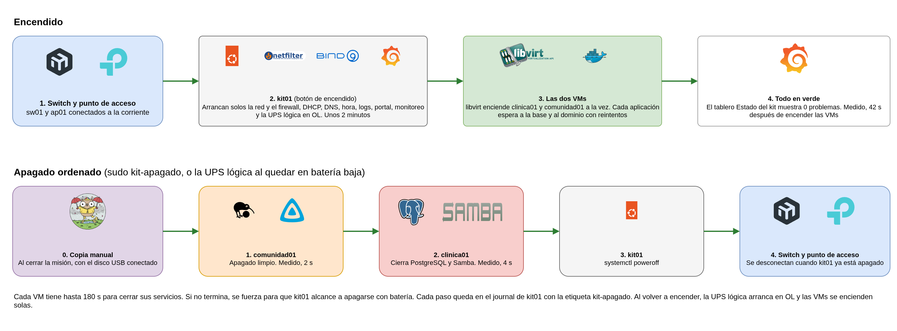

# Inicio y apagado del kit

Este procedimiento explica cómo encender el kit, cómo apagarlo sin dañar los datos y qué pasa cuando se corta la energía. Lo puede seguir cualquier integrante de la brigada con el usuario de administración del kit.

<div class="diagrama"></div>

## Lo que se necesita

- Acceso a kit01 por SSH, desde un equipo de la red Interna con dirección de administración (`ssh <usuario>@10.20.10.1`) o por NetBird (`ssh <usuario>@100.90.225.113`).
- El usuario de administración del kit y su contraseña. Los comandos con `sudo` se ejecutan en kit01.
- Para la copia al cerrar la misión, el disco USB de respaldo (etiqueta `kitbackup`).

## Encender el kit

1. Conectar a la corriente el switch (sw01) y el punto de acceso (ap01), y esperar a que los indicadores de sus puertos se enciendan.
2. Encender kit01 con su botón. En su último arranque tardó 2 min 15 s hasta tener todos sus servicios, la mayor parte esperando a que la red estuviera lista.
3. No hay que hacer nada más. Al arrancar, kit01 levanta solo la red y el firewall, el DHCP, el DNS, la hora, los logs, el portal cautivo, el monitoreo y la UPS lógica, que empieza en `OL` (con corriente). Después enciende las dos máquinas virtuales a la vez, porque las dos tienen el arranque automático activado. Cada aplicación espera con reintentos a la base de datos y al dominio, así que el orden entre ellas no importa.

Medido en el kit, todos los servicios quedaron en verde 42 s después de encender las máquinas virtuales.

**Cómo comprobar que arrancó bien**

```bash
systemctl --failed                                  # 0 loaded units listed
virsh -c qemu:///system list --all                  # clinica01 y comunidad01 en running
virsh -c qemu:///system dominfo clinica01 | grep Autostart      # Autostart: enable
upsc kit@127.0.0.1 ups.status                       # OL
```

En el navegador, `https://monitoreo.salud.movil` muestra **Problemas ahora** en 0 y todos los servicios en verde. Si una máquina virtual sigue apagada después de 5 minutos, se enciende con `sudo virsh -c qemu:///system start <vm>`.

## Apagar el kit

El apagado ordenado cierra primero lo que tiene datos, para que PostgreSQL y el dominio terminen limpios.

1. Si se cierra una misión, sacar antes una copia manual. Con el disco USB conectado a kit01, `sudo systemctl start backup.service` tarda unos 15 s, y `systemctl status backup.service` tiene que terminar en `status=0/SUCCESS`.
2. Ejecutar el apagado ordenado.

   ```bash
   sudo kit-apagado
   ```

   Apaga comunidad01, después clinica01 y al final kit01. Cada máquina virtual tiene hasta 180 s para cerrar sus servicios. Si no termina, se fuerza para que kit01 alcance a apagarse. En el kit, comunidad01 se apagó en 2 s y clinica01 en 4 s.
3. Cuando el indicador de kit01 se apaga, desconectar el switch y el punto de acceso.

Los comandos `shutdown` y `poweroff` apagan las dos máquinas virtuales a la vez y sin orden, así que para apagar el kit se usa `kit-apagado`.

**Cómo comprobar que se apagó en orden.** Al volver a encender, en kit01:

```bash
journalctl -t kit-apagado -b -1 -o short-iso
```

Cada paso aparece con su hora (`comunidad01 apagada en 2 s`, `clinica01 apagada en 4 s`). Si una línea dice `apagado forzado`, esa máquina no cerró a tiempo y conviene revisar su log de ese apagado (`journalctl -b -1` dentro de la VM).

## Corte de energía (UPS lógica)

El kit no tiene una UPS física, así que su estado se simula con NUT. La UPS lógica avisa en el journal cuando pasa a batería y, cuando la batería queda baja, ejecuta el mismo `kit-apagado` del apagado manual.

| Comando | Qué simula | Qué hace el kit |
|---|---|---|
| `sudo kit-ups` | Nada | Muestra el estado (`ups.status`), la carga y la autonomía |
| `sudo kit-ups ob` | Se cortó la energía | Avisa en el journal y no apaga nada |
| `sudo kit-ups lb` | La batería quedó baja | Ejecuta el apagado ordenado completo |
| `sudo kit-ups ol` | Volvió la energía | Vuelve a `OL` |

Los avisos se ven con `journalctl -t kit-apagado -t kit-ups -u nut-monitor --since -30min`.

### Simulacro sin apagar kit01

El simulacro sirve para practicar el corte de energía. Apaga las dos máquinas virtuales en orden y deja kit01 encendido.

```bash
sudo systemctl mask --runtime poweroff.target halt.target   # seguro extra, se quita al final
sudo touch /etc/kitsalud/nut/simulacro
sudo kit-ups ob; sleep 10; sudo kit-ups lb
journalctl -t kit-apagado --since -5min -o cat                # termina con "Simulacro terminado"
sudo systemctl unmask --runtime poweroff.target halt.target
sudo virsh -c qemu:///system start comunidad01
sudo virsh -c qemu:///system start clinica01
```

El archivo `simulacro` vale por una hora. Si es más viejo, el apagado es real, y por eso se enmascara además el apagado de kit01 mientras dura la práctica. Al terminar, la UPS lógica vuelve sola a `OL` en unos 15 s.

**Resultado en el kit (4 de noviembre de 2026).** comunidad01 se apagó en 2 s y clinica01 en 4 s, 16 s después de la batería baja. kit01 siguió encendido y la UPS volvió a `OL`. Después de encender las dos máquinas virtuales, todos los servicios estaban en verde a los 42 s, y la revisión de estado del kit dio 22 comprobaciones bien y ninguna falla.

## Si algo no sale como se espera

| Síntoma | Revisar | Arreglar |
|---|---|---|
| Una máquina virtual no se encendió sola | `virsh -c qemu:///system dominfo <vm> \| grep Autostart` | Si dice `disable`, el kit está en otro perfil de misión. Se enciende con `sudo virsh -c qemu:///system start <vm>` |
| `upsc kit@127.0.0.1 ups.status` responde `Driver not connected` | `journalctl -u nut-driver@kit` | `sudo systemctl start kit-ups-inicial` y `sudo systemctl restart nut-driver@kit` |
| `ups.status` queda en `FSD OL` después de un simulacro | Que pasaron más de 15 s | `sudo systemctl restart nut-driver@kit nut-server nut-monitor` |
| La copia manual falla | `journalctl -u backup -o cat \| tail -20` y `lsblk -f` (debe aparecer `kitbackup`) | Conectar el disco USB y repetir. La copia no arranca si el disco ya está montado; en ese caso `sudo umount /mnt/backup` y repetir |
