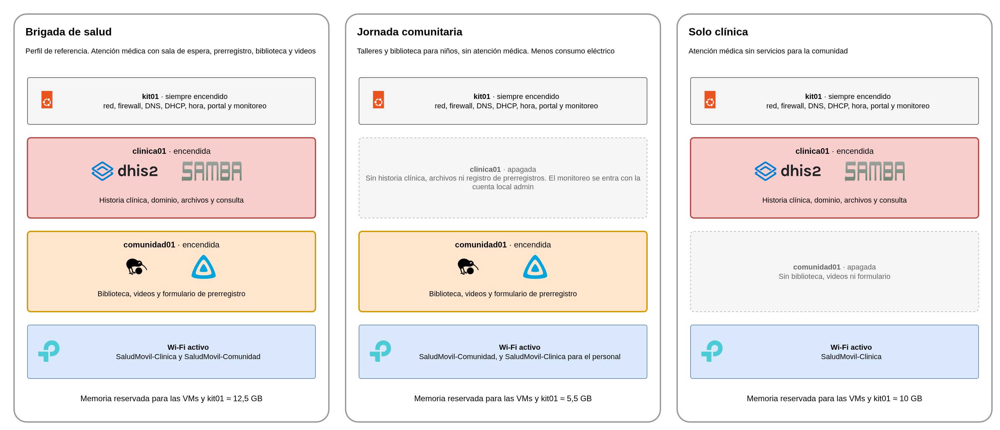

# Cambio de perfil por misión

El mismo kit sirve para misiones distintas. Según la misión se enciende o no cada máquina virtual y se activa o no el Wi-Fi de la Comunidad. kit01 siempre está encendido, y el direccionamiento, el DNS y el firewall no cambian entre perfiles.

<div class="diagrama"></div>

| Perfil | clinica01 | comunidad01 | Wi-Fi activo | Para qué |
|---|---|---|---|---|
| **Brigada de salud** (referencia) | Encendida | Encendida | `SaludMovil-Clinica` y `SaludMovil-Comunidad` | Atención médica con sala de espera, prerregistro, biblioteca y videos |
| **Jornada comunitaria** | Apagada | Encendida | Los dos (`SaludMovil-Clinica` queda para el personal) | Talleres y biblioteca para niños, sin atención médica y con menos consumo eléctrico |
| **Solo clínica** | Encendida | Apagada | `SaludMovil-Clinica` | Atención médica sin servicios para la comunidad |

Cambiar de perfil toma unos minutos y se hace con el kit encendido. El perfil queda guardado, así que se mantiene si kit01 se reinicia.

## Lo que se necesita

- Acceso a kit01 y a clinica01 por SSH, con el usuario de administración.
- Para el Wi-Fi, un navegador en la red Interna con dirección de administración y la página del punto de acceso, `http://10.20.10.3`. Por NetBird se llega con un túnel, `ssh -L 8080:10.20.10.3:80 <usuario>@100.90.225.113`, y la página queda en `http://localhost:8080`.

## Pasar a "Solo clínica"

1. En kit01, quitar el arranque automático de comunidad01 y apagarla.

   ```bash
   sudo virsh -c qemu:///system autostart --disable comunidad01
   sudo virsh -c qemu:///system shutdown comunidad01
   ```

2. En clinica01, detener la publicación de contenido, que cada 10 minutos copia el recurso `contenido` a comunidad01 y falla si está apagada.

   ```bash
   sudo systemctl disable --now publicacion.timer
   sudo systemctl reset-failed publicacion.service
   ```

3. En la página del punto de acceso, **Wireless**, **Wireless Settings**, desactivar el SSID2 (`SaludMovil-Comunidad`) y guardar con **Save**. Si la página pide reiniciar el punto de acceso, se reinicia desde el enlace que muestra. El Wi-Fi se corta unos segundos.

**Cómo comprobar el cambio**

```bash
virsh -c qemu:///system list --all                                   # comunidad01 en "shut off"
virsh -c qemu:///system dominfo comunidad01 | grep Autostart          # Autostart: disable
```

En el tablero de monitoreo, comunidad01 aparece apagada con sus servicios en rojo (biblioteca, videos, registro, la descarga de la raíz del kit, SSH y ping) y dos alertas, **ExporterCaido** y **ServicioCaido**, las dos de comunidad01. Es lo esperado en este perfil. Todos los servicios de clinica01 y de kit01 siguen en verde. Si además aparece **UnidadFallida** de clinica01, es la publicación de contenido, y se resuelve con el paso 2.

## Pasar a "Jornada comunitaria"

1. En kit01, quitar el arranque automático de clinica01 y apagarla.

   ```bash
   sudo virsh -c qemu:///system autostart --disable clinica01
   sudo virsh -c qemu:///system shutdown clinica01
   ```

2. El Wi-Fi se deja como en el perfil de referencia, con los dos SSID activos. El de la Clínica queda para que el personal administre el kit.

Sin clinica01 no hay historia clínica, archivos compartidos ni consulta de prerregistros, y el formulario de prerregistro no puede guardar, porque la base de datos está en clinica01. El monitoreo se entra con la cuenta local `admin` de Grafana, porque el dominio está en clinica01. El tablero muestra clinica01 apagada con sus servicios en rojo. El formulario abre y, al enviar, avisa que no pudo guardar los datos. Su recuadro en el tablero sigue en verde, porque solo comprueba que la página responde.

**Cómo comprobar el cambio.** Lo mismo que en "Solo clínica", con clinica01 en `shut off` y `Autostart: disable`.

## Volver al perfil de referencia

1. En kit01, volver a activar el arranque automático de la máquina apagada y encenderla.

   ```bash
   sudo virsh -c qemu:///system autostart comunidad01      # o clinica01
   sudo virsh -c qemu:///system start comunidad01          # o clinica01
   ```

2. Si se venía de "Solo clínica", en clinica01 volver a activar la publicación de contenido, y en el punto de acceso activar otra vez el SSID2.

   ```bash
   sudo systemctl enable --now publicacion.timer
   ```

**Cómo comprobar el cambio**

```bash
virsh -c qemu:///system list --all                                # las dos en "running"
virsh -c qemu:///system dominfo comunidad01 | grep Autostart      # Autostart: enable
virsh -c qemu:///system dominfo clinica01 | grep Autostart        # Autostart: enable
```

En menos de un minuto el tablero vuelve a **Problemas ahora** en 0 y todos los servicios en verde. Con la publicación activa, `systemctl list-timers publicacion.timer` en clinica01 muestra la próxima ejecución.

## A tener en cuenta

- **Copia semanal.** La copia del domingo extrae datos de las dos máquinas virtuales. Si una está apagada por el perfil, la copia guarda lo que pudo extraer y termina con error, y el tablero muestra **UnidadFallida** de kit01 hasta la siguiente copia completa. Es esperable en los perfiles con una máquina apagada.
- **Apagado ordenado.** `kit-apagado` y la UPS lógica funcionan igual en cualquier perfil. Si una máquina ya está apagada, la salta.
- **Ansible.** El arranque automático de las máquinas virtuales también está en el inventario de Ansible, con las dos activadas. Si se vuelve a aplicar `playbooks/vms.yml`, el arranque automático vuelve al perfil de referencia, aunque las máquinas no se encienden solas hasta el próximo arranque de kit01.

## Prueba hecha en el kit

El 4 de noviembre de 2026 se pasó el kit a "Solo clínica" y se volvió al perfil de referencia, sin tocar el Wi-Fi, que se cambia en el sitio.

| Paso | Resultado |
|---|---|
| Perfil de referencia, antes | Las dos máquinas encendidas y con arranque automático, nada en rojo, ninguna alerta, 6,4 GB de memoria usada en kit01 |
| Quitar el arranque automático de comunidad01 y apagarla | Apagada en 2 s, `Autostart: disable` |
| Tablero en "Solo clínica" | 12 sondas de comunidad01 en rojo (6 servicios en IPv4 e IPv6), su exportador caído, alertas **ExporterCaido** y **ServicioCaido** de comunidad01. Las 14 sondas de clinica01 en verde. 5,1 GB de memoria usada |
| Alerta no prevista | **UnidadFallida** de clinica01, por la publicación de contenido. Con el paso 2 se fue |
| Volver al perfil de referencia | Todo en verde a los 24 s de encender comunidad01, sin alertas, y la publicación de contenido terminó bien |
