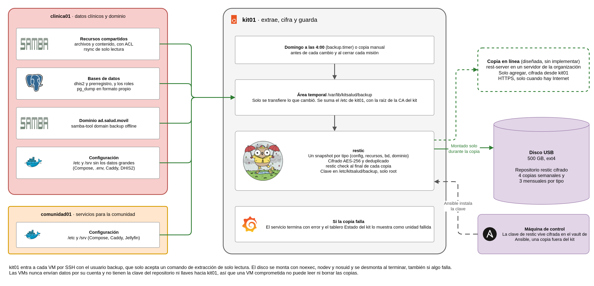

# Kit móvil de atención primaria en salud

## Plan de respaldo y restauración

**Proyecto final - Plataformas I - 2026-2** · Organización `kitsalud-movil-plats1`

Este plan describe qué se respalda en el kit, cómo, cada cuánto, dónde queda y cómo se recupera cada cosa. kit01, el mini PC que hace de router e hipervisor, extrae una vez por semana los datos de sus dos máquinas virtuales (clinica01, con los datos clínicos y el dominio, y comunidad01, con los servicios para la comunidad) y los guarda cifrados con restic en un disco USB. Lo instalan los roles de Ansible `backups` (en kit01) y `backup_origen` (en las VMs). El plan define además una copia en línea, diseñada y sin implementar (sección 8), y la energía que necesitan las copias y el apagado (sección 9).

## 1. Objetivos de recuperación

**RPO.** Se pierde como máximo una semana de datos, porque la copia corre el domingo a las 4:00. La ventana se acorta con una copia manual, que se hace antes de cada cambio de configuración y al cerrar cada misión.

```bash
sudo systemctl start backup.service    # en kit01, unos 15 s
```

**RTO.** Depende de qué se perdió. Los tiempos marcados como medidos salen de las pruebas en el kit real; los demás son estimados.

| Escenario | Tiempo de recuperación | Base |
|---|---|---|
| Un archivo de `archivos` o `contenido` | Unos 70 s | Medido en la prueba de restauración (68 s con el archivo y una tabla, desde la máquina de control por NetBird) |
| Una tabla de `prerregistro` | Unos 70 s | Medido en la prueba de restauración |
| La base `dhis2` completa | Menos de 5 min | Medido. Sacar el dump del disco tarda 2,1 s y `pg_restore` 7,7 s (333 tablas, 45 893 filas). A eso se suma copiar el dump a clinica01 y reiniciar DHIS2, que con datos arranca en unos 25 s |
| El dominio de Samba AD | De 15 a 30 min | Estimado. La restauración offline tarda 2,5 s (medido); el resto es ponerlo en servicio (sección 5.4) |
| Una configuración | Unos minutos | Estimado |
| Una VM | De 1 a 2 h, en la base y con Internet | Estimado. Se reconstruye con Ansible y después se restauran los datos |
| kit01 completo | Medio día, en la base y con Internet | Estimado. Instalar Ubuntu, Ansible completo y restaurar |

## 2. Qué se respalda

kit01 junta todo en un área temporal y hace un snapshot de restic por tipo, con su etiqueta.

| Etiqueta | Qué tiene | Origen | Método |
|---|---|---|---|
| `config` | `/etc` de kit01, con la raíz de la CA (`/etc/kitsalud/ca`) y los certificados de `/etc/kitsalud/tls`. `/etc` y `/srv` de clinica01 y comunidad01 sin datos grandes (Compose, `.env`, archivos de DHIS2, datos de Caddy con el intermedio de cada VM, configuración de Jellyfin) | kit01 y las dos VMs | Lectura directa en kit01 y `rsync` en las VMs |
| `recursos` | Recursos SMB `archivos` y `contenido` de clinica01, con dueños numéricos, ACL y atributos extendidos | clinica01 | `rsync` |
| `bd` | `pg_dump -Fc` de `dhis2` y `prerregistro`, y los roles (`pg_dumpall --globals-only`) | clinica01 | Comando forzado `postgres` |
| `dominio` | `samba-tool domain backup offline` de `ad.salud.movil`, con los secretos del dominio | clinica01 | Comando forzado `dominio` |

**Qué no se respalda y por qué.**

| Elemento | Motivo |
|---|---|
| Discos de las VMs | Se reconstruyen con Ansible y después se restauran los datos |
| Datos crudos de PostgreSQL (`/srv/dhis2/postgres`) | Van como `pg_dump`, que se puede restaurar en otra versión menor y no depende del estado del motor |
| Medios de comunidad01 (`/srv/medios`) | Son una copia de `contenido`, que sí se respalda, o los descarga Ansible |
| Imágenes Docker | Tienen versión fija en los Compose y se descargan otra vez |
| Logs centralizados (`/var/log/kitsalud`), datos de Prometheus y de Grafana, y los préstamos de Kea | Son de diagnóstico o se regeneran solos. Los dashboards de Grafana están versionados en `observability` |
| La clave del repositorio | Va en el vault de Ansible (sección 4) y nunca en el disco |

## 3. Método y frecuencia

<div class="diagrama"></div>

kit01 extrae los datos de las VMs, que nunca los envían por su cuenta. kit01 entra a cada VM por SSH con el usuario `backup`, cuya llave solo se acepta desde las direcciones de kit01 en la red de servidores y solo ejecuta `backup-extraer`. Ese comando solo acepta `ping`, `rsync` en modo demonio con módulos de solo lectura y, en clinica01, los dumps de PostgreSQL y el backup del dominio. Las VMs no tienen la clave del repositorio ni llaves hacia kit01, así que una VM comprometida no puede leer ni borrar las copias.

| Elemento | Valor |
|---|---|
| Programación | `backup.timer`, el domingo a las 4:00, después de la analítica de DHIS2 de las 2:00. Con `Persistent=true`, si kit01 estaba apagado corre al arrancar |
| Conexión | IPv6 y, si no responde, IPv4. El log dice cuál se usó |
| Duración | Unos 15 s por pasada. Las copias de `rsync` se conservan en el área temporal, así que solo se transfiere lo que cambió |
| Copia manual | `sudo systemctl start backup.service` antes de cada cambio y al cerrar cada misión |
| Verificación | `restic check` al final de cada copia |
| Falla | El servicio termina con error, aparece `UnidadFallida` en **Estado del kit** (Grafana) y lo que se pudo extraer se guarda igual |

## 4. Retención, destino y custodia

**Retención.** 4 semanales y 3 mensuales por etiqueta (`restic forget --group-by host,tags --keep-weekly 4 --keep-monthly 3 --prune`). Las copias manuales de una misma semana se reemplazan entre sí y queda la última.

**Destino.** Un disco USB 3.0 de 500 GB (Seagate, ext4 con etiqueta `kitbackup`), conectado a kit01. Se monta por UUID en `/mnt/backup` solo durante la copia, con `noatime,nodev,nosuid,noexec`, y no está en `fstab`. El repositorio de restic ocupa unos 850 MiB. Casi todo son los ZIM de `contenido`, que no se comprimen. Cada copia sin cambios en los recursos agrega unos 5 MiB, así que el disco alcanza para años con la retención de arriba.

**Cifrado y clave.** restic cifra el repositorio (AES-256 y Poly1305). La clave está en `/etc/kitsalud/backup/restic.clave` de kit01 (`400`, root) y sale de `vault_restic_password` en el vault de Ansible del kit. El vault está cifrado en el repositorio y su contraseña solo está en las máquinas de control (`~/.config/kitsalud/vault-pass`). Sin la clave las copias no se pueden leer, así que la contraseña del vault se guarda además fuera de los equipos del kit.

**Custodia.** El disco viaja con el kit. Hoy hay una sola copia y está en el mismo lugar que los datos, así que un robo, un incendio o un golpe se llevan los dos. Es un riesgo aceptado por el alcance del proyecto, y la copia en línea de la sección 8 es la forma de cerrarlo.

## 5. Procedimientos de restauración

Todo empieza en kit01, con el disco montado y las variables de restic cargadas.

```bash
sudo -i
mount -o noatime,nodev,nosuid,noexec UUID=65308479-a4c6-4315-b83f-8cc61382bdcc /mnt/backup
export RESTIC_REPOSITORY=/mnt/backup/restic RESTIC_PASSWORD_FILE=/etc/kitsalud/backup/restic.clave RESTIC_CACHE_DIR=/var/cache/restic
restic snapshots                        # fechas y etiquetas
# ... restauración ...
umount /mnt/backup                      # siempre al terminar
```

Lo restaurado se pasa a la VM con `scp` desde kit01 (`kitsalud@10.20.20.11` es clinica01). En las rutas de abajo, `S` es `/var/lib/kitsalud/backup`.

### 5.1 Un archivo o una carpeta de los recursos

```bash
restic ls latest --tag recursos | grep <nombre>
restic restore latest --tag recursos --include $S/clinica01/archivos/<ruta> --target /tmp/r
```

En clinica01 se copia a `/srv/samba/archivos/` con su dueño y permisos (`sudo cp -a` y, si hace falta, `chown`). El archivo nuevo hereda la ACL por defecto del recurso, así que queda igual que antes (comprobado en la prueba de restauración). Para una versión anterior se usa el ID de un snapshot de `restic snapshots --tag recursos` en lugar de `latest`.

### 5.2 Una tabla o una base

```bash
restic dump latest --tag bd $S/clinica01/postgres/<base>.dump > /tmp/<base>.dump
```

En clinica01, una tabla con `docker exec -i dhis2-db-1 pg_restore -U dhis -d <base> -t <tabla> < <base>.dump`. La base completa de `dhis2` se restaura con DHIS2 detenido, para que no escriba durante la carga.

```bash
cd /srv/dhis2 && docker compose stop core
docker exec -i dhis2-db-1 pg_restore -U dhis -d dhis2 --clean --if-exists < dhis2.dump
docker compose start core
```

Los roles (`globales.sql`) solo hacen falta si se perdió el PostgreSQL entero. Se cargan con `psql -U dhis -d postgres` antes de las bases. Las tablas analíticas se regeneran solas con el trabajo de las 2:00, o a mano desde DHIS2.

### 5.3 Una configuración

```bash
restic restore latest --tag config --include <ruta> --target /tmp/r
```

Las de kit01 están con su ruta original (`/etc/...`) y las de las VMs bajo `$S/<equipo>/etc` o `$S/<equipo>/srv`. Lo que gestiona Ansible se recupera mejor ejecutando otra vez su playbook; la copia sirve para comparar o para lo que se cambió a mano.

### 5.4 El dominio de Samba AD

Hay dos caminos.

**A. Aprovisionar otra vez con Ansible** (`playbooks/samba.yml`). El rol `samba_ad` crea `dc01` con el realm, los grupos, los usuarios y sus uid y gid fijos (RFC2307), y los recursos SMB usan permisos POSIX por uid y gid, así que los archivos restaurados conservan sus dueños. Se pierde lo que se cambió fuera de Ansible, como contraseñas cambiadas por los usuarios o cuentas creadas a mano. Es el camino cuando el dominio solo tiene lo que crea Ansible, que es el caso del kit hoy.

**B. Restaurar el backup del dominio**, cuando hay cambios hechos fuera de Ansible que se deben conservar.

```bash
restic dump latest --tag dominio $S/clinica01/dominio/dominio.tar.bz2 > /tmp/dominio.tar.bz2
# en clinica01, con samba-ad-dc detenido y /var/lib/samba apartado
samba-tool domain backup restore --backup-file=dominio.tar.bz2 --targetdir=/var/lib/samba-restaurado --newservername=dc02
```

`samba-tool` exige un nombre de DC nuevo. Con `--newservername=dc01` falla, porque ese DC ya existe dentro del backup (`Adding CN=DC01,OU=Domain Controllers,...`). Por eso el restaurado se llama `dc02`. Para que el kit siga usando `dc01.ad.salud.movil` (delegación de BIND9, certificado LDAPS, Grafana y la consulta de formularios), en el DNS de AD se agregan otra vez los registros `dc01` con las IP de clinica01, y después se ejecuta `playbooks/samba.yml` para recuperar el `smb.conf`, el certificado y los recursos.

```bash
samba-tool dns add 127.0.0.1 ad.salud.movil dc01 A 10.20.20.11 -U Administrator
samba-tool dns add 127.0.0.1 ad.salud.movil dc01 AAAA fd5a:fc7e:d716:20::11 -U Administrator
```

La restauración offline está probada en clinica01. Dejó los mismos 6 usuarios, los mismos grupos y los mismos miembros de `clinicos` que el DC vivo, con `DC02$` en lugar de `DC01$`, en 2,5 s y sin tocar el DC en uso. La puesta en servicio del camino B no se probó.

### 5.5 Una VM

1. Recrear la VM con `playbooks/vms.yml` y aplicar su playbook (`clinica01.yml` o `comunidad01.yml`, y `samba.yml`, `publicacion.yml` y `backups.yml` según la VM).
2. Restaurar los datos. En clinica01, los recursos (5.1), las bases (5.2) y, si hace falta, el dominio (5.4). comunidad01 no tiene datos propios aparte de su configuración, y los medios vuelven con la siguiente publicación desde `contenido`.
3. Ejecutar `playbooks/backups.yml`, que actualiza la llave de host de la VM en `known_hosts` de kit01, y hacer una copia manual.

Necesita Internet para los paquetes y las imágenes Docker, así que se hace en la base.

### 5.6 kit01 completo

1. Instalar Ubuntu Server 24.04, conservando los nombres de interfaz que da el kernel (`enp170s0` para la WAN y `enp171s0` hacia el switch), y NetBird.
2. Aplicar los playbooks de Ansible del kit, primero la base de kit01 y su red, después los servicios de red, las VMs y sus aplicaciones.
3. Montar el disco de backups en el kit nuevo. Con la misma clave del vault, `backup-kit` reconoce el repositorio y sigue usándolo.
4. Restaurar la raíz de la CA (`/etc/kitsalud/ca`) desde el snapshot `config`, para que los certificados emitidos sigan siendo válidos, y después las VMs (5.5).

Si kit01 no está, el repositorio se puede leer desde cualquier Linux con restic 0.16 o superior, el disco y la clave (`ansible-vault view` del vault de Ansible del kit).

### 5.7 Disco dañado o clave perdida

- **El disco falla o se pierde.** Los datos vivos no se tocan, solo se pierden las copias. Se formatea otro disco igual (GPT, ext4 `kitbackup`), se cambia `backup_disco_uuid` en el inventario y se ejecuta `playbooks/backups.yml`. La siguiente copia crea el repositorio.
- **Se pierde la clave.** Las copias no se pueden leer y no hay forma de recuperarlas. Se crea un repositorio nuevo con otra clave en otro disco. Si el repositorio existe pero no abre con la clave del vault, `backup-kit` no lo toca.

## 6. Verificación periódica

| Qué | Cuándo | Cómo |
|---|---|---|
| Integridad del repositorio | En cada copia | `restic check` en el log de `backup.service` |
| Que la copia corrió | Cada semana | **Estado del kit** sin `UnidadFallida` en kit01, y `systemctl list-timers backup.timer` |
| Restauración de un archivo y una tabla | Cada mes y después de cambiar los roles de backups | Script de la prueba de restauración (`P11-restauracion.sh`), que borra un archivo y una tabla de prueba y los recupera |
| Restauración de una base completa y del dominio | Antes de cada salida a campo | `dhis2` en una base temporal (`createdb` y `pg_restore -d <temporal>`, 5.2) y el dominio con `--targetdir` en un directorio temporal (5.4); se comparan con lo vivo y se borran |

## 7. Pruebas hechas

| Prueba | Resultado |
|---|---|
| Copia programada con el disco real | Cuatro snapshots, `restic check` sin errores. Contenido comparado con lo vivo (filas de DHIS2, recursos y ZIM) |
| Prueba de restauración, archivo de `archivos` y tabla de `prerregistro` | Aprobada, 16 de 16, en 68 s. Archivo con su dueño de AD y su ACL, abierto por SMB con `ana.rojas`; tabla con las mismas 1000 filas y el mismo md5 |
| Base `dhis2` completa en la base temporal `dhis2_restauracion` | Las 333 tablas con el mismo número de filas que la base viva (45 893 en total) y las mismas extensiones (PostGIS 3.5.2). `pg_restore` en 7,7 s. La base temporal se borró |
| Dominio restaurado en un directorio temporal de clinica01 | Mismos usuarios, grupos y miembros de `clinicos` que el DC vivo, en 2,5 s. El DC en uso no cambió (`dbcheck` sin errores, `kinit` y sondas LDAPS en verde). Con `--newservername=dc01` falla (sección 5.4) |

## 8. Copia en línea

**Estado.** Diseñada y sin implementar. No hay servidor, usuario ni credenciales, y este diseño no se ha probado.

La copia del disco USB viaja con el kit. La copia en línea deja una tercera copia fuera del sitio y completa la regla 3-2-1, con los datos vivos, el disco USB y un servidor externo. Si se pierden el kit y el disco a la vez, los datos se recuperan desde ese servidor.

### 8.1 Diseño

| Elemento | Diseño |
|---|---|
| Destino | `rest-server` en un servidor de la organización de salud, por HTTPS en el puerto 443, con TLS, un usuario para el kit y modo solo agregar |
| Qué se sube | Todos los snapshots del repositorio del disco USB (`config`, `recursos`, `bd` y `dominio`). Las imágenes Docker no se suben, porque están fuera del repositorio y se pueden descargar otra vez |
| Método | `restic copy` desde kit01, con un repositorio y una clave propios. Los datos salen cifrados, así que el servidor no puede leerlos |
| Cuándo | Un timer de kit01 revisa cada hora. Si `/run/kit-internet/modo` dice `con`, la UPS está en línea y hay snapshots sin subir, monta el disco, copia y desmonta |
| Sin Internet | No intenta nada. Los snapshots quedan pendientes y suben cuando vuelve la conexión |
| Si se corta a la mitad | `restic copy` solo envía lo que falta, así que la siguiente pasada continúa |
| Retención | 4 semanales y 3 mensuales, igual que en el disco. La aplica el administrador en el servidor, porque kit01 no puede borrar |
| Firewall | Sin cambios. kit01 ya puede salir a Internet por TCP 443, solo por IPv4, y las VMs no participan |
| Credenciales | La clave del repositorio y la contraseña del usuario van en el vault de Ansible y en archivos de kit01 que solo lee root |
| Falla | El servicio termina con error y aparece `UnidadFallida` en **Estado del kit** (Grafana) |

**Protección.** Con el modo solo agregar, kit01 puede subir copias nuevas y no puede borrar ni cambiar las que ya están. Una falla o un atacante en kit01 no alcanza lo que ya se subió. Las VMs siguen sin credenciales. Si el kit se pierde o lo roban, sus credenciales quedan en el equipo, así que se revoca su usuario en el servidor y después se cambia la clave del repositorio.

**Datos de pacientes.** El servidor guarda copias cifradas de datos sensibles, por eso la organización de salud aprueba el destino antes de activar la copia.

```bash
# En el servidor. La ruta y los certificados dependen de cada organización
rest-server --path /srv/restic --append-only --private-repos \
  --tls --tls-cert /etc/rest-server/cert.pem --tls-key /etc/rest-server/key.pem

# Una sola vez, en kit01. Comparte los parámetros del repositorio local para deduplicar
restic -r rest:https://kit01@respaldo.ejemplo.org/kit01/ init \
  --from-repo /mnt/backup/restic --copy-chunker-params

# En cada pasada, en kit01
restic -r rest:https://kit01@respaldo.ejemplo.org/kit01/ copy \
  --from-repo /mnt/backup/restic --from-password-file /etc/kitsalud/backup/restic.clave
```

### 8.2 Dimensionamiento

Los tamaños salen del repositorio actual y los tiempos son estimados, sin contar la sobrecarga del protocolo.

| Dato | Tamaño | A 2 Mb/s | A 10 Mb/s |
|---|---|---|---|
| Primera subida | 850 MiB | Cerca de 1 h | Unos 12 min |
| Copia semanal sin cambios en los recursos | 5 MiB | Unos 20 s | Unos 4 s |
| 10 GiB de videos nuevos en `contenido` | 10 GiB | Unas 12 h | Unas 2 h 20 min |

La primera subida y las cargas grandes de `contenido` se hacen en la base. En campo, con un enlace débil, solo pasa lo que cambió en la semana. En el servidor bastan 1 vCPU, 1 GB de RAM y 20 GB de disco para empezar, y el disco crece con `contenido`.

### 8.3 Recuperación

La ventana de pérdida es la última copia que alcanzó a subir. En una misión sin Internet, lo registrado en campo solo está en el kit y en el disco USB hasta volver a tener conexión.

```bash
# Desde cualquier Linux con restic 0.16 o superior
export RESTIC_REPOSITORY=rest:https://kit01@respaldo.ejemplo.org/kit01/
export RESTIC_PASSWORD_FILE=<clave> RESTIC_REST_PASSWORD=<contraseña>
restic snapshots
restic restore latest --tag bd --target /tmp/r
```

Lo descargado se restaura con los procedimientos de la sección 5. Bajar el repositorio completo toma unos 12 min a 10 Mb/s, estimado. Si se perdió el kit, primero se reconstruye kit01 (sección 5.6), que toma medio día en la base.

### 8.4 Para implementarla

1. Preparar el servidor con `rest-server`, un certificado válido y el usuario `kit01`.
2. Guardar las credenciales en el vault y agregar el timer al rol `backups`.
3. Hacer la primera subida en la base.
4. Probar que un archivo y una tabla se recuperan desde el servidor, y que `restic forget` desde kit01 es rechazado.

## 9. Energía

Las copias y el apagado ordenado dependen de tener energía. El kit no tiene UPS física, así que NUT simula la batería y las cifras de esta sección son estimadas. Ningún consumo se ha medido con un vatímetro.

| Carga | Consumo | Cómo se obtiene |
|---|---|---|
| Típica | ≈ 47 W | Mini PC 25 W, switch 18 W y AP 4 W |
| Diseño | ≈ 95 W | 136 W de las fuentes de los equipos, menos 30 % |
| Pico estimado | ≈ 101 W | Mini PC 60 W, switch 36 W y AP 5,4 W |

| Situación | Equipo | Alcance |
|---|---|---|
| Corte de energía | UPS de 1000 VA y 600 W, unos 70 Wh útiles | Cerca de 1 h 30 a carga típica y 45 min a carga de diseño |
| Jornada de 8 h sin red eléctrica | Estación LiFePO4 de 1024 Wh, unos 870 Wh útiles | 376 Wh a carga típica y 760 Wh a carga de diseño |

**Reserva para apagar.** La señal de batería baja se configura en el 20 %, unos 14 Wh. El peor caso del apagado son 7 minutos, con 180 s por VM y un minuto para kit01, y a carga de diseño usa unos 11 Wh. En las pruebas, cada VM cerró en menos de 5 s.

**Cierre de una misión.** Primero la copia manual, que dura unos 15 s y usa menos de 1 Wh, y después `sudo kit-apagado`.

**Corte durante una copia.** restic escribe el snapshot al final, así que una copia interrumpida no queda como válida. Con `Persistent=true`, la copia corre otra vez al arrancar kit01. Este caso no se ha probado con un corte real.

**Copia en línea.** Solo corre con la UPS en línea, para no gastar batería en una subida.

## 10. Límites conocidos

- Hoy hay una sola copia, en el mismo lugar que el kit. La evolución es la copia en línea de la sección 8 y un segundo disco que se rota y se queda en la base.
- Lo que cambia entre dos copias se pierde si falla el SSD de kit01 antes de la siguiente. La copia manual al cerrar cada misión reduce esa ventana.
- La reconstrucción de una VM o de kit01 necesita Internet, así que en campo solo se restauran datos sobre equipos que funcionan.
