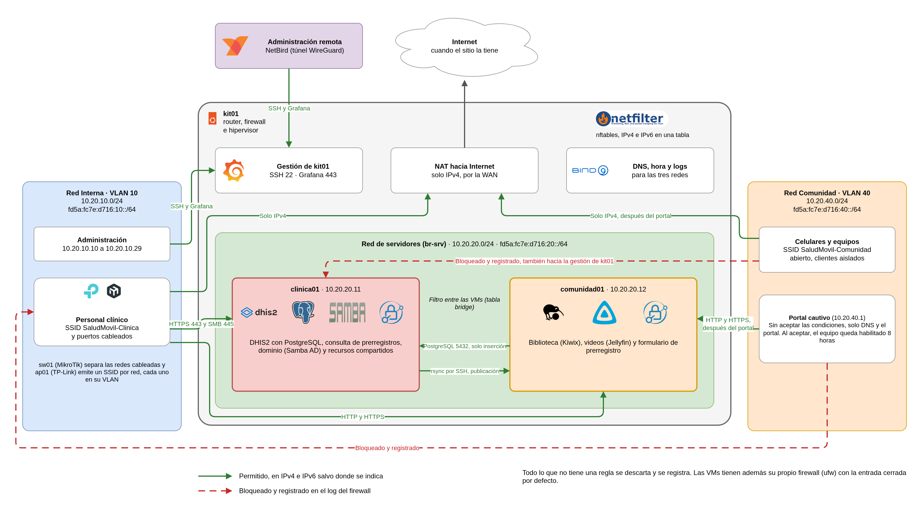

# Kit móvil de atención primaria en salud

## Matriz de seguridad

**Proyecto final - Plataformas I - 2026-2** · Organización `kitsalud-movil-plats1`

Este documento reúne las reglas de firewall del kit, los flujos de red permitidos y bloqueados, los puertos de cada equipo, la forma de administrar el kit en remoto, la política de credenciales y la protección de las copias de respaldo. Todo lo que aparece aquí es lo que está aplicado en los equipos, revisado el 2 de noviembre de 2026.

## 1. El kit y sus redes

El kit tiene un mini PC, `kit01`, que hace de router, firewall e hipervisor. Dentro corren dos máquinas virtuales. `clinica01` guarda los datos sensibles (DHIS2 con PostgreSQL, el dominio de Samba AD, los recursos compartidos y la consulta de prerregistros) y `comunidad01` sirve lo que ve la comunidad (biblioteca, videos y formulario de prerregistro). Un switch MikroTik CCR2004 (`sw01`) separa las redes cableadas y un punto de acceso TP-Link (`ap01`) emite un SSID por red.

| Red | Interfaz en kit01 | IPv4 | IPv6 | Quién está |
|---|---|---|---|---|
| Interna (VLAN 10) | `lan0.10` | `10.20.10.0/24` | `fd5a:fc7e:d716:10::/64` | Personal clínico y administración, sw01 (`.2`) y ap01 (`.3`) |
| Comunidad (VLAN 40) | `br-com` | `10.20.40.0/24` | `fd5a:fc7e:d716:40::/64` | Celulares y equipos de la comunidad |
| Servidores | `br-srv` (solo dentro de kit01) | `10.20.20.0/24` | `fd5a:fc7e:d716:20::/64` | clinica01 (`.11`), comunidad01 (`.12`) y los servicios de kit01 (`.10`) |
| WAN | `enp170s0` | La que entrega el sitio | Ninguna | Salida a Internet, cuando la hay |
| NetBird | `wt0` | `100.90.225.113` | Ninguna | Administración remota durante el desarrollo |

Las direcciones de administración son `10.20.10.10` a `10.20.10.29`, reservadas por MAC en el DHCP de la red Interna. Los servicios de red de kit01 (DNS, NTP, logs) escuchan en `10.20.20.10` y `fd5a:fc7e:d716:20::10`.

## 2. Principios

- **Denegar y registrar por defecto.** Todo lo que no tiene una regla explícita se descarta y queda en el log con el prefijo `fw-drop`, limitado a 10 registros por segundo.
- **IPv4 e IPv6 juntos.** Una sola tabla `inet` filtra las dos familias con las mismas zonas. Cada regla que vale para las dos se escribe en par, una para IPv4 y otra para IPv6.
- **IPv6 solo dentro del kit.** Las direcciones IPv6 son locales (ULA) y kit01 no reenvía IPv6 hacia la WAN. La salida a Internet es solo IPv4, con NAT en una tabla aparte.
- **Filtro entre las dos VMs.** Como las dos VMs comparten el bridge `br-srv` dentro de kit01, una tabla `bridge` filtra lo que pasa de una a otra. Solo se permiten dos conexiones.
- **Segunda capa en las VMs.** Cada VM tiene `ufw` con la entrada denegada por defecto, así que una regla de más en kit01 no basta para llegar a un servicio.
- **Los bloqueos importantes se cuentan aparte.** Lo que la comunidad intenta hacia la red clínica, el SSH desde equipos que no son de administración y la salida no permitida de kit01 a Internet tienen su propia cadena, con contador y prefijo en el log.

## 3. Flujos permitidos y bloqueados

El diagrama resume quién llega a qué. Todo pasa por el firewall de kit01, y la tabla que sigue tiene cada flujo con sus puertos.

| # | Origen | Destino | Puertos | Familias | Qué permite o por qué se bloquea | Dónde se filtra |
|---|---|---|---|---|---|---|
| 1 | Administración (Interna) y NetBird | kit01 | 22, 443, eco ICMP | v4 (las direcciones de administración y NetBird son IPv4) | SSH y Grafana | kit01 |
| 2 | kit01 | clinica01 y comunidad01 | 22 | v4 y v6 | Salto SSH de administración y extracción de las copias | ufw de cada VM |
| 3 | Interna, Comunidad y Servidores | kit01 (`.10`) | 53 TCP y UDP, 123 UDP | v4 y v6 | DNS y hora | kit01 |
| 4 | Interna y Comunidad | kit01 | 67 UDP; 547 UDP desde `fe80::/10` | v4 y v6 | DHCPv4 y DHCPv6 sin estado | kit01 |
| 5 | Interna | clinica01 | 443, 445 | v4 y v6 | DHIS2, consulta de prerregistros y recursos compartidos | kit01 y ufw |
| 6 | Interna | comunidad01 | 80, 443 | v4 y v6 | Biblioteca, videos y formulario de prerregistro | kit01 y ufw |
| 7 | Comunidad sin aceptar el portal | kit01 (`10.20.40.1`) | 80 | v4 y v6 | Página del portal cautivo. El HTTP hacia cualquier otro destino se redirige ahí y el HTTPS se rechaza al instante | kit01 |
| 8 | Comunidad que aceptó el portal | comunidad01 | 80, 443 | v4 y v6 | Biblioteca, videos y formulario. Es lo único que la comunidad alcanza en la red de servidores | kit01 y ufw |
| 9 | Comunidad que aceptó el portal | Internet | Todos | Solo v4, con NAT | Conectividad de la comunidad cuando hay Internet | kit01 |
| 10 | comunidad01 | clinica01 | 5432 | v4 y v6 | El formulario guarda el prerregistro en PostgreSQL con un usuario que solo puede insertar | Tabla `bridge` de kit01 y PostgreSQL |
| 11 | clinica01 | comunidad01 | 22 | v4 y v6 | Publicación de contenido con `rsync` y un usuario restringido | Tabla `bridge` de kit01 y ufw |
| 12 | kit01 | clinica01 | 636 | v4 y v6 | Inicio de sesión de Grafana con las cuentas del dominio (LDAPS) | ufw |
| 13 | kit01 | clinica01 y comunidad01 | 9100; 443 y 445 en clinica01; 80 y 443 en comunidad01 | v4 y v6 | Métricas y sondas del monitoreo | ufw |
| 14 | clinica01 y comunidad01 | kit01 (`.10`) | 514 TCP | v4 y v6 | Envío de logs al log central | kit01 |
| 15 | sw01 | kit01 (`.10`) | 514 UDP, 123 UDP | v4 y v6 | Syslog y hora del switch | kit01 |
| 16 | clinica01 y comunidad01 | Internet | 80, 443 | Solo v4, con NAT | Paquetes e imágenes, en una ventana de mantenimiento con Internet | kit01 |
| 17 | kit01 | Internet | 53, 80 y 443 TCP; todo UDP; ICMP | v4 | DNS hacia afuera, NTP, actualizaciones y el túnel de NetBird, que usa puertos UDP variables. Lo demás se bloquea y se registra | kit01 |
| 18 | kit01 | clinica01 | 53 TCP y UDP | v4 y v6 | El DNS del kit consulta la zona del dominio al DNS de Samba | ufw |
| 19 | Interna | Internet | Todos | Solo v4, con NAT | Conectividad del personal clínico cuando hay Internet | kit01 |
| 20 | Interna | kit01, clinica01 y comunidad01 | Eco ICMP | v4 y v6 | Diagnóstico y prueba extremo a extremo | kit01 |
| 21 | Comunidad y Servidores | Su propia puerta de enlace | Eco ICMP | v4 y v6 | Cada equipo comprueba su conectividad | kit01 |
| 22 | Todas | Todas | ICMPv6 de vecinos, enrutadores y errores | v6 | IPv6 no funciona sin ellos | kit01 |
| 23 | Comunidad | Interna, clinica01 y la gestión de kit01 (22, 443) | Todos | v4 y v6 | **Bloqueado y registrado.** La comunidad nunca alcanza la red clínica, haya aceptado el portal o no | kit01 |
| 24 | Interna sin dirección de administración | SSH de kit01 y de las VMs | 22 | v4 y v6 | **Bloqueado y registrado.** SSH solo desde las direcciones de administración, y nunca por IPv6 | kit01 |
| 25 | Interna | Puertos del dominio en clinica01 (88, 135, 389, 464, 49152 en adelante) | | | **No habilitado.** Solo haría falta si se unieran equipos Windows al dominio | ufw (cerrado) |

## 4. Reglas de kit01

Las reglas están en `/etc/nftables.conf` y se aplican con Ansible. Cada fila corresponde a una regla del ruleset activo, o a dos cuando la columna "Reglas" lo indica (normalmente el par IPv4 e IPv6). Las cadenas `input` y `forward` terminan con la política `drop`.

### 4.1 Tráfico hacia kit01 (`input`, 31 reglas)

| Regla | Reglas | Acción | Flujo | Por qué |
|---|---|---|---|---|
| Interfaz `lo` | 1 | Acepta | | Tráfico del propio equipo |
| Conexiones establecidas o relacionadas | 1 | Acepta | Todos | Las respuestas de lo que ya se permitió |
| Conexiones inválidas | 1 | Descarta | | Paquetes que no pertenecen a ninguna conexión válida |
| ICMPv6 de errores, vecinos, enrutadores y multicast desde `fe80::/10` y la ULA del kit | 1 | Acepta | 22 | Funcionamiento de IPv6 |
| ICMPv6 de vecinos y MLDv2 desde `::` | 1 | Acepta | 22 | Detección de direcciones duplicadas al conectarse |
| Eco ICMP desde la Interna y NetBird | 1 | Acepta | 1, 20 | Diagnóstico |
| Eco ICMPv6 desde la Interna | 1 | Acepta | 20 | Diagnóstico |
| Eco ICMP desde la Comunidad hacia `10.20.40.1` | 1 | Acepta | 21 | El cliente prueba su puerta de enlace |
| Eco ICMPv6 desde la Comunidad hacia `fd5a:fc7e:d716:40::1` y `fe80::1` | 1 | Acepta | 21 | Lo mismo en IPv6 |
| Eco ICMP desde Servidores hacia `10.20.20.1` | 1 | Acepta | 21 | Cada VM prueba su puerta de enlace |
| Eco ICMPv6 desde Servidores hacia `fd5a:fc7e:d716:20::1` y `fe80::1` | 1 | Acepta | 21 | Lo mismo en IPv6 |
| UDP 67 desde la Interna y la Comunidad | 1 | Acepta | 4 | DHCPv4 |
| UDP 547 desde `fe80::/10` en la Interna y la Comunidad | 1 | Acepta | 4 | DHCPv6 sin estado (DNS, dominio y hora) |
| TCP 80 desde la Comunidad hacia su puerta de enlace, en IPv4 e IPv6 | 2 | Acepta | 7 | Página del portal cautivo |
| TCP y UDP 53 hacia `.10` desde las tres redes internas, en IPv4 e IPv6 | 2 | Acepta | 3 | DNS del kit |
| UDP 123 hacia `.10` desde las tres redes internas, en IPv4 e IPv6 | 2 | Acepta | 3 | Hora del kit |
| TCP 514 hacia `.10` desde clinica01 y comunidad01, en IPv4 e IPv6 | 2 | Acepta | 14 | Logs de las VMs |
| UDP 514 hacia `.10` desde sw01, en IPv4 e IPv6 | 2 | Acepta | 15 | Syslog del switch |
| TCP 22 y 443 desde `10.20.10.10-29` | 1 | Acepta | 1 | SSH y Grafana desde las direcciones de administración |
| TCP 22 y 443 desde NetBird (`wt0`) | 1 | Acepta | 1 | Administración remota |
| UDP 51820 desde la WAN | 1 | Acepta | 17 | Túnel WireGuard de NetBird |
| TCP 22 y 443 desde la Comunidad | 1 | Bloquea y registra (`fw-drop F-20`) | 23 | La comunidad no llega a la gestión del kit |
| TCP 22 desde la Interna sin dirección de administración | 1 | Bloquea y registra (`fw-drop F-21`) | 24 | SSH solo desde administración |
| TCP 22 por IPv6 desde la Interna | 1 | Bloquea y registra (`fw-drop F-21`) | 24 | Las direcciones de administración son IPv4 |
| Todo lo demás | 2 | Registra (`fw-drop`) y cuenta | | Lo que no se permitió; después aplica la política `drop` |

### 4.2 Tráfico que atraviesa kit01 (`forward`, 21 reglas)

| Regla | Reglas | Acción | Flujo | Por qué |
|---|---|---|---|---|
| Conexiones establecidas o relacionadas | 1 | Acepta | Todos | Respuestas |
| Conexiones inválidas | 1 | Descarta | | |
| Errores ICMPv6 (destino inalcanzable, paquete demasiado grande, tiempo excedido, problema de parámetro) | 1 | Acepta | 22 | IPv6 los necesita en tránsito |
| Comunidad hacia la Interna | 1 | Bloquea y registra (`fw-drop F-20`) | 23 | Separación de la comunidad |
| Comunidad hacia clinica01, en IPv4 e IPv6 | 2 | Bloquea y registra (`fw-drop F-20`) | 23 | Va antes que cualquier aceptación, así el intento queda registrado haya aceptado el portal o no |
| TCP 22 desde la Interna hacia la red de servidores | 1 | Bloquea y registra (`fw-drop F-21`) | 24 | A las VMs solo se entra saltando por kit01 |
| Interna hacia la WAN, solo IPv4 | 1 | Acepta | 19 | Internet para el personal |
| clinica01 y comunidad01 hacia la WAN por TCP 80 y 443, solo IPv4 | 1 | Acepta | 16 | Paquetes e imágenes |
| Interna hacia clinica01 por TCP 443 y 445, en IPv4 e IPv6 | 2 | Acepta | 5 | DHIS2, consulta y recursos compartidos |
| Eco desde la Interna hacia las dos VMs, en IPv4 e IPv6 | 2 | Acepta | 20 | Diagnóstico |
| Interna hacia comunidad01 por TCP 80 y 443, en IPv4 e IPv6 | 2 | Acepta | 6 | Biblioteca, videos y formulario |
| Comunidad con la MAC en el set del portal hacia comunidad01 por TCP 80 y 443, en IPv4 e IPv6 | 2 | Acepta | 8 | Servicios para la comunidad |
| Comunidad con la MAC en el set del portal hacia la WAN, solo IPv4 | 1 | Acepta | 9 | Internet para la comunidad |
| Comunidad sin la MAC en el set hacia TCP 443 | 1 | Rechaza con RST | 7 | El navegador recibe la respuesta al instante y prueba por HTTP, que lleva al portal |
| Todo lo demás | 2 | Registra (`fw-drop`) y cuenta | | Después aplica la política `drop` |

El set del portal (`portal_ok`) guarda la MAC de cada equipo que aceptó las condiciones, con un vencimiento de 8 horas. Lo llena el servicio del portal y aplica igual a IPv4 e IPv6.

### 4.3 Redirección al portal (`portal_redireccion`, 2 reglas)

| Regla | Reglas | Acción | Flujo | Por qué |
|---|---|---|---|---|
| TCP 80 desde la Comunidad sin la MAC en el set, hacia una dirección que no es de kit01, en IPv4 e IPv6 | 2 | Redirige a `10.20.40.1` o `fd5a:fc7e:d716:40::1` | 7 | Cualquier página HTTP lleva al portal |

### 4.4 Salida de kit01 (`output` y `salida_wan`, 6 reglas)

Hacia dentro del kit y por NetBird la salida no se filtra, porque kit01 es quien administra y monitorea. Hacia la WAN pasa por `salida_wan`.

| Regla | Reglas | Acción | Flujo | Por qué |
|---|---|---|---|---|
| Lo que sale por la WAN va a `salida_wan` | 1 | Salta | 17 | |
| Conexiones establecidas o relacionadas | 1 | Acepta | 17 | Respuestas |
| Todo UDP | 1 | Acepta | 17 | DNS, NTP y NetBird, que negocia el túnel por UDP con puertos variables |
| TCP 53, 80 y 443 | 1 | Acepta | 17 | DNS por TCP, repositorios de paquetes y HTTPS |
| ICMP e ICMPv6 | 1 | Acepta | 17 | Diagnóstico y descubrimiento de MTU |
| Todo lo demás | 1 | Bloquea y registra (`fw-drop F-18`) | 17 | Un equipo comprometido no puede abrir conexiones arbitrarias hacia afuera |

### 4.5 Cadenas de bloqueo (6 reglas)

Cada bloqueo importante tiene su cadena, con dos reglas. La primera registra con un prefijo propio y la segunda descarta. `fw-drop F-18` marca la salida no permitida de kit01 hacia Internet, `fw-drop F-20` lo que la comunidad intenta hacia la red clínica o la gestión del kit y `fw-drop F-21` el SSH desde equipos sin dirección de administración. Así, en el log central se puede contar cada tipo de intento por separado.

### 4.6 Entre las dos VMs (tabla `bridge filtro_vms`, 12 reglas)

Solo ve lo que `br-srv` pasa de una VM a la otra. Lo que va hacia kit01 o sale por él lo filtran las reglas anteriores.

| Regla | Reglas | Acción | Flujo | Por qué |
|---|---|---|---|---|
| Cualquier bridge que no es `br-srv` | 1 | Acepta | | El bridge de la Comunidad no se toca aquí |
| Conexiones establecidas o relacionadas | 1 | Acepta | 10, 11 | La respuesta de una conexión permitida no abre el camino contrario |
| Conexiones inválidas | 1 | Descarta | | |
| ARP | 1 | Acepta | | Resolución de direcciones IPv4 |
| ICMPv6 de vecinos | 1 | Acepta | 22 | Resolución de direcciones IPv6 |
| Broadcast y multicast | 1 | Descarta | | Sin anuncios ni descubrimiento entre las VMs |
| comunidad01 hacia clinica01 por TCP 5432, en IPv4 e IPv6 | 2 | Acepta | 10 | Formulario de prerregistro |
| clinica01 hacia comunidad01 por TCP 22, en IPv4 e IPv6 | 2 | Acepta | 11 | Publicación de contenido |
| Todo lo demás | 2 | Registra (`fw-drop br-srv`) y descarta | | Una VM comprometida no alcanza otros servicios de la otra |

### 4.7 NAT (tabla `ip nat_kit`, 1 regla)

| Regla | Reglas | Acción | Por qué |
|---|---|---|---|
| Lo que sale por la WAN desde `10.20.0.0/16` | 1 | Enmascara con la dirección de la WAN | Salida a Internet de las redes del kit. El filtrado decide quién llega hasta aquí |

NetBird y libvirt usan sus propias tablas (`ip filter`, `ip nat` y otras). El archivo de reglas del kit nunca borra el ruleset completo; borra y vuelve a crear solo sus tablas, así que aplicarlo no afecta a NetBird.

## 5. Segunda capa en las VMs

Las dos VMs tienen `ufw` con la entrada denegada y la salida permitida (la salida la limita kit01). Las reglas existen en IPv4 e IPv6.

**clinica01**

| Puerto | Desde | Por qué |
|---|---|---|
| 22 | kit01 (`10.20.20.1`, `.10`, sus IPv6 y `fe80::1`) | Administración y copias |
| 53 TCP y UDP | kit01 | El DNS del kit consulta la zona del dominio |
| 443 | Red Interna | DHIS2 y consulta de prerregistros |
| 445 | Red Interna | Recursos compartidos |
| 636 | kit01 | Inicio de sesión de Grafana con el dominio |
| 9100, 443 y 445 | kit01 | Monitoreo |

PostgreSQL (5432) corre en Docker, que publica el puerto con sus propias reglas y no pasa por `ufw`. Lo protegen la tabla `bridge` de kit01, que solo deja pasar a comunidad01, y la configuración de acceso de PostgreSQL, que acepta al usuario de los formularios solo desde comunidad01, al de la consulta solo desde clinica01 y al de DHIS2 solo desde la red interna de Docker. Samba escucha además en los puertos del dominio (88, 135, 389, 464, 3268, 3269 y 49152 a 49154), que `ufw` deja cerrados.

**comunidad01**

| Puerto | Desde | Por qué |
|---|---|---|
| 22 | kit01 | Administración y copias |
| 22 | clinica01 | Publicación de contenido |
| 80 y 443 | Redes Interna y Comunidad | Biblioteca, videos y formulario. kit01 deja pasar a la comunidad solo después del portal |
| 9100, 80 y 443 | kit01 | Monitoreo |

## 6. Switch y punto de acceso

**sw01 (MikroTik CCR2004)**

- Funciona como switch. No reenvía IPv4 ni IPv6 y tiene una sola dirección, la de gestión (`10.20.10.2` y `fd5a:fc7e:d716:10::2`), así que no puede enrutar entre redes y saltarse el firewall de kit01.
- SSH y Winbox solo aceptan conexiones desde kit01 (`10.20.10.1`) y las direcciones de administración. Telnet, FTP, la web y la API están desactivados.
- DHCP snooping activo, con `ether1` (hacia kit01) como único puerto de confianza. Un servidor DHCP conectado a otro puerto no puede entregar direcciones.
- Los anuncios de enrutador IPv6 (RA) que entran por los puertos de acceso se descartan, así solo kit01 anuncia rutas. El filtro corre en la CPU del switch porque su chip no acepta esa regla.
- Un solo usuario, `admin`. Cada cambio se hace en Safe Mode, que deshace todo si la sesión se corta.

**ap01 (TP-Link TL-WA801ND)**

- Un SSID por red, cada uno en su VLAN, con aislamiento entre clientes inalámbricos.
- Su servidor DHCP está apagado; las direcciones las entrega kit01.
- Se administra por HTTP en `10.20.10.3`, solo por IPv4, con la contraseña de fábrica, que es un riesgo aceptado del proyecto.

## 7. Puertos en escucha

| Equipo | Puerto | Servicio | Dirección | Quién llega |
|---|---|---|---|---|
| kit01 | 22 TCP | SSH | Todas | Administración y NetBird |
| kit01 | 443 TCP | Grafana (nginx) | Todas | Administración y NetBird |
| kit01 | 80 TCP | Portal cautivo (nginx) | `10.20.40.1` y `fd5a:fc7e:d716:40::1` | Comunidad |
| kit01 | 53 TCP y UDP, 123 UDP, 514 UDP y TCP | BIND9, Chrony, rsyslog | `10.20.20.10` y `fd5a:fc7e:d716:20::10` | Redes internas, según el flujo |
| kit01 | 67 UDP, 547 UDP | Kea DHCPv4 y DHCPv6 | Interna y Comunidad | Clientes |
| kit01 | 51820 UDP | WireGuard de NetBird | WAN | Túnel de administración |
| kit01 | 3000, 3493, 8081, 9090, 9100, 9115, 953 | Grafana, NUT, servicio del portal, Prometheus, exportadores, control de BIND9 | Solo `127.0.0.1` o `::1` | Nadie desde la red |
| clinica01 | 22 | SSH | Todas | kit01 |
| clinica01 | 443 | Caddy (DHIS2 y consulta) | Todas | Interna y kit01 |
| clinica01 | 445 | Samba | `.11` y su IPv6 | Interna y kit01 |
| clinica01 | 636, 53 | LDAPS y DNS de Samba | `.11` y su IPv6 | kit01 |
| clinica01 | 5432 | PostgreSQL (Docker) | `.11` y su IPv6 | comunidad01 |
| clinica01 | 9100 | Exportador de métricas | Todas | kit01 |
| clinica01 | 8080, 8200 | DHIS2 y consulta, detrás de Caddy | Solo `127.0.0.1` | Nadie desde la red |
| comunidad01 | 22 | SSH | Todas | kit01 y clinica01 |
| comunidad01 | 80, 443 | Caddy (biblioteca, videos y formulario) | Todas | Interna, Comunidad después del portal, kit01 |
| comunidad01 | 9100 | Exportador de métricas | Todas | kit01 |
| comunidad01 | 8090, 8096, 8100 | Kiwix, Jellyfin y formulario, detrás de Caddy | Solo `127.0.0.1` | Nadie desde la red |

## 8. Administración remota

**En el sitio.** Se administra desde un equipo con dirección de administración en la red Interna. kit01 acepta SSH y Grafana desde esas direcciones. A las VMs se entra saltando por kit01 (`ssh -J usuario@kit01 usuario@clinica01`), porque solo aceptan SSH desde kit01. sw01 acepta SSH y Winbox desde kit01 y desde las direcciones de administración, y ap01 se administra por su página web desde la red Interna.

**Durante el desarrollo.** NetBird corre solo en kit01. Abre el túnel hacia afuera, así que no hace falta abrir puertos en la red del sitio; la WAN solo acepta el UDP 51820 del túnel. Desde NetBird se llega a SSH y Grafana de kit01, y desde ahí a lo demás. NetBird se puede desactivar en una misión real sin afectar el kit.

**Cambios que pueden cortar el acceso.** Antes de aplicar un cambio de red o de firewall en kit01 se valida el archivo (`nft -c -f`, `netplan generate`, `sshd -t`) y se programa la vuelta al archivo anterior en 2 minutos (`systemd-run --on-active=120`). La vuelta se cancela solo si el acceso sigue funcionando. La red se reconfigura con `netplan generate` y `networkctl reload`, que no bajan los enlaces. Las reglas aceptan siempre el SSH por NetBird y el túnel por la WAN. En sw01 cada cambio se hace en Safe Mode.

**SSH.** En todos los equipos `root` no puede entrar por SSH (`PermitRootLogin no`). Se entra con el usuario de administración y contraseña, y se usa `sudo`.

## 9. Credenciales

**Política**

- Ninguna contraseña, llave o token se guarda en los repositorios. Los secretos viven en un vault de Ansible cifrado con AES-256, y la contraseña del vault solo está en las máquinas de control, fuera de los repositorios.
- Lo que una aplicación necesita en un archivo `.env` lo genera Ansible desde el vault en la VM, con permisos `600`. En los repositorios solo está el `.env.example`, sin valores.
- Cada servicio usa su propia cuenta con lo mínimo que necesita. Las personas usan cuentas individuales en las aplicaciones (DHIS2, dominio).
- Las contraseñas actuales son de laboratorio y las conoce el grupo, porque el kit es un proyecto académico. **Antes de una misión real se cambian todas.** Las del vault se cambian con `ansible-vault edit` y vuelven a los equipos al ejecutar los playbooks. Otras requieren un paso a mano. La del punto de acceso se cambia en su página web, la de la cuenta de NetBird en su servicio y la clave de las copias con `restic key`, porque el repositorio de copias ya está cifrado con la anterior. Las personas del dominio cambian la suya al iniciar sesión.

**Inventario** (sin valores)

| Credencial | Para qué | Dónde vive | Restricción |
|---|---|---|---|
| Usuario de administración compartido | SSH y `sudo` en kit01, clinica01 y comunidad01 | Vault (hash de la contraseña) | Sin acceso directo de root; SSH solo desde administración, NetBird o kit01 |
| `admin` de sw01 | Gestión del switch | Vault | Solo desde kit01 y administración |
| Administrador de ap01 | Página de gestión del AP | Vault | Contraseña de fábrica; solo HTTP e IPv4 |
| `Administrator` del dominio | Administración de Samba AD | Vault | Solo se usa para tareas del dominio |
| Personas del dominio | Recursos compartidos, Grafana y consulta de prerregistros | Samba AD | Contraseña de al menos 8 caracteres, bloqueo por 15 minutos después de 5 intentos fallidos. Grupo clínico y grupo de administración |
| Cuentas de DHIS2 | Registro y consulta de pacientes | DHIS2 (la de `admin` en el vault) | Cuentas individuales; la de fábrica cambiada |
| `admin` local de Grafana | Respaldo si el dominio no responde | Vault | Grafana solo desde administración |
| `admin` de Jellyfin | Administración de los videos | Vault | Oculta y sin acceso desde la Comunidad |
| `comunidad` de Jellyfin | Ver los videos | Sin contraseña | Solo reproduce, sin transcodificar |
| `dhis` de PostgreSQL | DHIS2 | Vault | Solo desde la red interna de Docker |
| `formularios` de PostgreSQL | Guardar prerregistros | Vault | Solo `INSERT`, solo desde comunidad01 |
| `consultas` de PostgreSQL | Consulta de prerregistros | Vault | Solo `SELECT` y actualizar dos columnas, solo desde clinica01 |
| Clave de las copias (restic) | Cifrado del repositorio de copias | Vault y `/etc/kitsalud/backup/restic.clave` en kit01 (`400`, root) | Las VMs no la tienen |
| Usuario `upsmon` de NUT | Monitor de la UPS lógica | Vault | Solo en `localhost` de kit01 |
| Llave SSH de las copias | kit01 extrae datos de las VMs | Solo en kit01 (`600`) | En las VMs solo entra desde kit01 y solo ejecuta el comando de extracción |
| Llave SSH de publicación | clinica01 copia contenido a comunidad01 | Solo en clinica01 | En comunidad01 solo entra desde clinica01 y solo ejecuta `rsync` en módulos de escritura |
| Llave de la CA raíz del kit | Firma los certificados intermedios | Solo en kit01 (`/etc/kitsalud/ca`, `600`) | Nunca sale de kit01 ni va a un repositorio |
| Llaves de los intermedios | Firman los certificados HTTPS y LDAPS de cada VM | Cada VM, generadas ahí | Limitadas a los nombres de su VM |
| Cuenta de NetBird | Administración remota | Servicio de NetBird | Fuera del kit |

**Usuario de administración compartido.** Por el tamaño del grupo, kit01, las VMs y sw01 se administran con un solo usuario. La consecuencia es que el log no distingue a las personas. Se compensa con el acceso limitado por dirección, sin root directo, y con `sudo` registrado en el log central de cada equipo.

## 10. Protección de las copias

- **Copias por extracción.** kit01 entra a cada VM con una llave que solo se acepta desde las direcciones de kit01 y solo ejecuta un comando de extracción. Ese comando acepta `rsync` en modo de solo lectura (rechaza `--remove-source-files`), los volcados de las bases de la lista y el respaldo del dominio. Una VM comprometida no tiene credenciales para leer, cambiar o borrar las copias.
- **Repositorio cifrado.** restic cifra todo con la clave que solo tiene kit01, guardada como root con permisos `400`.
- **Disco montado solo durante la copia.** El disco USB se monta por su UUID, una vez por semana, con `nodev`, `nosuid` y `noexec`, y se desmonta al terminar, también si algo falla. No está en `fstab`.
- **Integridad y aviso.** Cada copia termina con `restic check`. Si la copia falla, el monitoreo lo muestra como unidad fallida en kit01.
- **Retención.** Se guardan 4 copias semanales y 3 mensuales, así que un daño que se nota tarde todavía tiene una copia anterior.
- **La clave fuera del kit.** Si se pierde la clave, las copias no se pueden leer. Por eso, además de kit01, queda en el vault de las máquinas de control.

## 11. Riesgos aceptados y hallazgos

| Riesgo o hallazgo | Por qué se acepta | Qué lo reduce |
|---|---|---|
| Usuario de administración compartido | Tamaño del grupo y alcance académico | Acceso por dirección, sin root, `sudo` registrado |
| Contraseñas de laboratorio conocidas por el grupo | Proyecto académico | Se cambian antes de una misión real (sección 9) |
| ap01 con la contraseña de fábrica, gestión solo por HTTP, y según su manual cualquier cliente inalámbrico puede llegar a su página | El firmware no permite más y es un equipo de laboratorio | Servidor DHCP, WPS y SNMP del AP apagados; aislamiento de clientes |
| Una sola copia de respaldo, que viaja con el kit | Hay un solo disco | Copia cifrada y desmontada. La mejora es un segundo disco que se rota y queda en la base |
| PostgreSQL sin TLS entre las VMs | El tráfico no sale de kit01; va por el bridge interno | Tabla `bridge` y usuario de solo `INSERT` |
| kit01 puede sacar cualquier UDP hacia Internet | NetBird negocia el túnel por UDP con puertos variables | Solo kit01; las VMs solo salen por TCP 80 y 443 |
| El filtro de RA de sw01 corre en la CPU | El chip del switch no acepta esa regla | Solo afecta el rendimiento del switch |
| `sshd` con `X11Forwarding yes` y `MaxAuthTries 6` (valores de fábrica de Ubuntu) | Hallazgo de esta revisión | SSH solo desde administración. Se puede desactivar el reenvío X11 y bajar los intentos sin afectar el uso; `AllowTcpForwarding` debe quedar activo en kit01 porque el salto `ssh -J` lo usa |

## 12. Cómo se verificó

Todo se revisó en el kit real el 2 de noviembre de 2026.

| Qué se comprobó | Cómo | Resultado |
|---|---|---|
| Las reglas activas son las versionadas | El rol de Ansible del firewall genera las reglas en un archivo aparte, las carga en un espacio de red desechable y compara el resultado con el ruleset activo, sin aplicar nada (`--check`) | Sin diferencias en kit01 |
| Esta matriz cubre todas las reglas | Conteo de reglas por cadena en el ruleset activo (`nft -a list table`) comparado con la columna "Reglas" de cada tabla | 79 reglas (31 de entrada, 21 de reenvío, 2 de redirección, 6 de salida, 6 de bloqueo, 12 entre las VMs y 1 de NAT), todas en la matriz |
| Los flujos funcionan como dice la matriz | Un playbook prueba 69 conexiones en IPv4 e IPv6 desde kit01, las dos VMs, sw01 (red Interna sin dirección de administración) y una VM de prueba en la red Comunidad, antes y después de aceptar el portal | Las 69 dieron el resultado esperado. Los intentos bloqueados quedaron en el log (4 de la salida de kit01, 48 de la Comunidad, 16 de SSH sin dirección de administración y 28 entre las VMs) |
| Reglas de las VMs | `ufw status numbered` en clinica01 y comunidad01 | Las de la sección 5 |
| Puertos en escucha y SSH | `ss -ltnup` y `sshd -T` en kit01 y las VMs | Los de la sección 7; `PermitRootLogin no` en los tres |
| Protección de sw01 | `/ip service print`, `/user print`, `/ip settings print` y los filtros del bridge, en modo de solo lectura | Los de la sección 6 |
| Ningún secreto en los repositorios | Un script busca cada valor del vault en el historial completo de los seis repositorios, sin imprimirlos, y además llaves privadas y archivos `.env` versionados. Un control positivo comprueba que el script detecta los 15 secretos | 0 coincidencias. Las 11 versiones del vault en el historial están cifradas |
